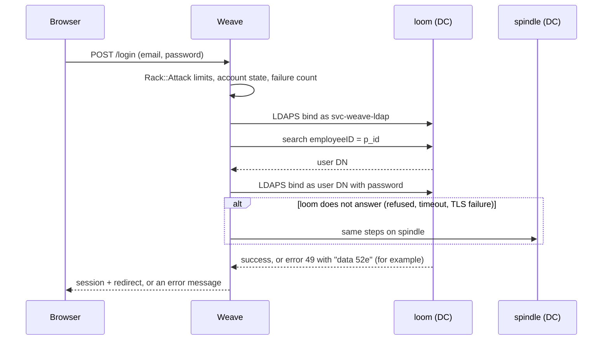
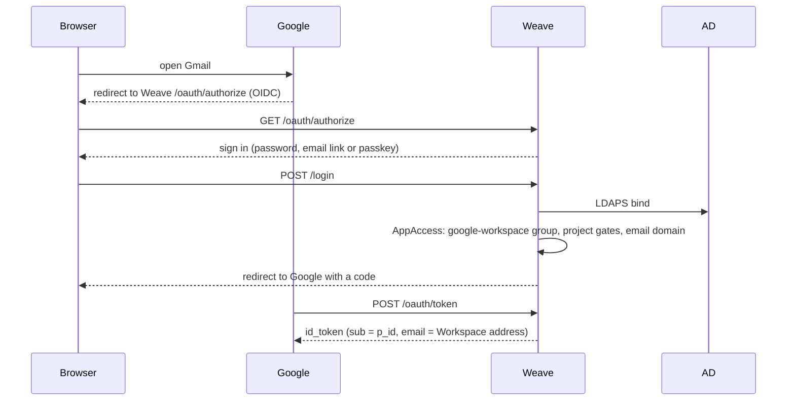

# Active Directory passwords and Google sign-in

Weave can use the Patchwork Active Directory (AD) as the only password store. Google Workspace can then use Weave as its sign-in provider (OIDC). This page tells how the parts work, how to configure them, how to test them on staging, and what to set in the Google Admin console.

The feature is off by default. Turn it on in staging first.

## Summary

- AD (`patchwork.internal`) keeps the only copy of the password for each Weave user who has an AD account. Weave never saves that password.
- The link is the AD attribute `employeeID`. It holds the Weave public id (`PWL…`, the `p_id`, which is also the OIDC `sub`).
- Weave checks a password with an LDAPS simple bind as the user. It finds the user with the service account `svc-weave-ldap`.
- Weave writes a new password to AD (`unicodePwd`) as the service account.
- Users with no AD account keep Weave's own sign-in. Password sign-in stays for admins only. Other users sign in with email links and passkeys.
- Google Workspace is an OAuth app in Weave. Only members of the `google-workspace` group can use it.
- A sponsored project (for example HackBoston) is a Weave group. The group can waive the Patchwork Code of Conduct and the Patchwork Slack for its members.

## Linking a Weave user to AD

Weave searches for `(&(objectCategory=person)(objectClass=user)(employeeID=<p_id>))` under `OU=Patchwork,DC=patchwork,DC=internal`.

- No result: the user has no AD account. Weave's own password flow applies.
- One result: Weave records `users.directory_linked_at` and replaces the local password digest with a random value. From then on, only the AD password works.
- More than one result: Weave refuses the sign-in (fail closed) and logs the error. Fix the duplicate `employeeID` in AD.

Weave links a user at these times:

- At a password sign-in.
- In the background after any other sign-in (`LinkDirectoryAccountJob`).
- When the user opens `/password`.
- When an operator runs `bin/rails active_directory:link`.

The sign-in page shows the password field only for admins and for linked users. It reads Weave's database only, so the page can not be used to ask AD about an email address. A user who is not linked yet can use `/login/pw`.

If a linked user's AD account goes away, password sign-in stops with "Contact an administrator". To unlink the user, an operator sets `directory_linked_at` to `NULL` in the console. The user then signs in with an email link.

## Sign-in



| AD answer | Meaning | What the user sees |
| --- | --- | --- |
| success | right password | signed in |
| `52e`, `525` | wrong password, no such user | "Invalid email or password" |
| `775` | account locked | "Too many failed sign-in attempts" |
| `533`, `701`, `530`, `531` | disabled, expired, not permitted now | "Contact an administrator" |
| `773`, `532` | must change password, password expired | the expired-password page |
| no DC answers | network, TLS or service account problem | "Password sign-in is not available now" |

Rules:

- Weave never sends a bind with an empty password. AD treats it as an anonymous bind, which succeeds.
- Weave does not bind for an account that Weave itself locked, suspended or deactivated.
- Weave moves to the next DC only for a transport problem. It never repeats a failed password on the second DC, so one attempt counts once toward the AD lockout.
- When AD is on and does not answer, Weave fails closed. It never falls back to the Weave password.

### Limits

Weave must not become a tool for password spraying against AD. These limits apply:

- Rack::Attack: 5 password sign-ins in 15 minutes for each email, and 20 for each IP.
- Rack::Attack: 10 password changes in 15 minutes for each IP.
- The existing limits on `/login` (5 in 20 seconds for each email, 10 in 1 minute for each IP, 3 email links in 5 minutes) still apply.
- `DirectoryPasswords`: after 5 failed binds for one user in 15 minutes, Weave sends no more binds for that user until the window ends. This limit counts across all IPs and app processes (the Rack::Attack Redis store).

Set the AD lockout threshold higher than 5 (for example 10 in 15 minutes). Then Weave alone can not lock an AD account.

### Expired password

A bind that returns `773` or `532` proves that the old password is right. Weave keeps the user id and the time in the session for 10 minutes, never the password. It sends the user to `/password/expired`. The user types the old password and a new one. Weave sends an AD "change" as the service account. The user then signs in with the new password, and a pending Google sign-in continues.

## Password change and reset

The page is `/password`. Google links to it as the "Change password URL". A person who arrives without a Weave session signs in first and comes back to `/password`.

| Who | Form | AD operation |
| --- | --- | --- |
| Linked user who knows the password | current + new | change: `delete` old `unicodePwd` + `add` new, in one modify. AD applies its history rules. |
| Linked user who forgot the password | new only, for 15 minutes after an email-link or passkey sign-in | reset: `replace` as the service account |
| Superadmin in the admin panel | new password on the user form | reset: `replace` as the service account |
| Admin with no AD account | current + new | Weave password, as before |
| Other users | none | they have no password |

The value is the password in double quotes, encoded as UTF-16LE. Weave writes it over LDAPS only.

When AD refuses the new password with `0000052D` (constraint violation), the user sees: "The new password does not meet the Patchwork password policy." A wrong current password (`00000056`) counts as a failed attempt.

An admin can not change a password while impersonating a user.

## Google Workspace



### Who has Google sign-in

Membership of the `google-workspace` group decides it. The app is restricted, and that group is its only access grant (see `AppAccess`). This is the same rule Weave uses for every restricted app. An admin adds or removes people at `/admin/groups/google-workspace`. A person outside the group gets the "You don't have access" page. Google gets no code.

Not all Weave users get Google sign-in. Add only the people whose Google account is in an SSO OU or group.

### The email claim

Google matches the `email` claim to the person's primary Google address. The app has `email_domains` (by default `patchworklabs.org`, `hackboston.dev`, `hackathon.help`). For this app the claim is the user's confirmed address on one of those domains, the primary address first. A user who has none gets the "You don't have access" page. Other apps still get the primary address.

### Create the app

Run this on the Weave host. Use the redirect URI from the Google SSO profile (see the Google Admin console steps below):

```sh
bin/rails google_workspace:setup REDIRECT_URI=https://accounts.google.com/... EMAIL_DOMAINS=patchworklabs.org,hackboston.dev,hackathon.help
```

The task is safe to run again. It keeps the client id and secret. It creates the `google-workspace` group if it does not exist. Read the client secret on the app's admin page. Do not put it in the repository.

The app requires the Code of Conduct and guardian consent like any other app. A superadmin can change that on the app's admin page.

## Sponsored projects

A sponsored project, such as HackBoston or hackathon.help, is a manual Weave group. A superadmin sets these options on the group form:

- "Members do not need to accept the Patchwork Code of Conduct to use apps" (`waives_code_of_conduct`).
- "Members do not need to join the Patchwork Slack" (`waives_slack`). Members accept the Code of Conduct in Slack, so this option needs the Code of Conduct waiver too.

The options apply to every member of the group. Put only the project's own people in the group. A Patchwork member in no project group still gets every gate. The age and guardian consent rules apply to everyone.

To put the people of an AD OU in the group:

```sh
bin/rails active_directory:add_ou_to_group OU="OU=HackBoston,OU=Sponsored-Projects,OU=Users,OU=Patchwork,DC=patchwork,DC=internal" GROUP=hackboston
bin/rails active_directory:add_ou_to_group OU="..." GROUP=hackboston CONFIRM=1
```

The first command is a dry run. Run it again when the OU gets new people.

Follow-up: Weave could keep project groups in sync from the AD OU automatically, the same way `SystemGroups` follows user attributes.

## Configuration

ENV comes first. The `active_directory` credentials are the fallback.

| ENV | Credential | Default | Notes |
| --- | --- | --- | --- |
| `AD_ENABLED` | `enabled` | `false` | The feature flag. Set `true` on staging first. |
| `AD_HOSTS` | `hosts` | `loom.patchwork.internal,spindle.patchwork.internal` | Tried in order. Use names that are in the DC certificates. |
| `AD_PORT` | `port` | `636` | LDAPS. |
| `AD_BASE_DN` | `base_dn` | `OU=Patchwork,DC=patchwork,DC=internal` | |
| `AD_BIND_DN` | `bind_dn` | none | DN or UPN of `svc-weave-ldap`. |
| `AD_BIND_PASSWORD_FILE` | none | none | Path to a file with the service account password. Preferred. |
| `AD_BIND_PASSWORD` | `bind_password` | none | Used when there is no file. |
| `AD_CA_FILE` | `ca_file` | none | PEM bundle of the Patchwork AD CS chain. Required. |
| `AD_CONNECT_TIMEOUT` | `connect_timeout` | `5` | Seconds. |
| `AD_TIMEOUT` | `timeout` | `10` | Seconds for each operation on one DC. |

Weave always verifies the DC certificate against `AD_CA_FILE` and checks the host name. There is no setting to turn verification off. When `AD_ENABLED` is `true` but a value is missing, Weave fails closed: password sign-in shows "not available" for everyone, and email links and passkeys still work.

`bin/rails active_directory:doctor` shows the settings (never the password) and what is missing.

## Infra, AD and Google before staging

### Infra (`jaspermayone/infra`, `modules/weave`)

1. Add the staging values to `secrets/weave-staging-env.age`: `AD_ENABLED=true`, `AD_BIND_DN`, `AD_CA_FILE=/run/weave/ad-ca.pem`, `AD_BIND_PASSWORD_FILE=/run/weave/ad-bind-password`.
2. Add an agenix secret for the service account password. Mount it read-only into the staging container at the path above.
3. Mount the Patchwork AD CS root and intermediate certificates (PEM) into the container at `AD_CA_FILE`.
4. Make sure the container can resolve `loom.patchwork.internal` and `spindle.patchwork.internal` (DNS through the thimble VPN, or `extraHosts` with 10.100.90.10 and 10.100.90.11) and can reach TCP 636 on both.
5. Restart the staging service. The container reads its env file only at start.

### AD

1. Create `svc-weave-ldap` in a service-account OU. Give it a long random password that does not expire.
2. Give it read access to user objects under `OU=Patchwork`.
3. Delegate "Reset password" on the user OUs that Weave manages, and only those. Do not give it other rights.
4. Keep the default "Change password" right for Everyone on user objects. Weave sends a self-service change (delete + add, with the old password) as the service account, also for a user who must change the password and can not bind. Staging step 5 checks this.
5. Make sure each DC has an LDAPS certificate from the Patchwork AD CS with the DC's FQDN in the subject alternative name.
6. Set `employeeID` to the Weave `p_id` on each AD user. Use the `SPWL…` ids for staging users.
7. Set the lockout threshold above 5 (see Limits).

### Google Admin console

1. On the Weave host, run `bin/rails google_workspace:setup REDIRECT_URI=https://accounts.google.com/pending`. Google shows the real redirect URI only after the profile exists, so start with this placeholder. The task prints the client id.
2. Security > Authentication > SSO with third-party IdP > Add OIDC profile.
3. Name: "Weave". Issuer URL: `https://weave.patchworklabs.org` (staging: `https://weave-staging.patchworklabs.org`). Client ID and client secret: from the Weave admin page of the "Google Workspace" app. Change password URL: `https://weave.patchworklabs.org/password` (staging: the staging host).
4. Save. Copy the redirect URI from the profile. Run `bin/rails google_workspace:setup REDIRECT_URI=<that URI>` again. The task changes the redirect URI and keeps the client id and secret.
5. Manage SSO profile assignments: assign the Weave profile to the OUs or groups that use SSO. Start with one test OU.
6. Make a Workspace group for exemptions (for example "SSO off"), and assign "None" (Google sign-in) to it. Put people who must keep Google passwords in it, for example `mayonej`.
7. Super admins always sign in with their Google password at `admin.google.com`. SSO does not apply to them there. Keep at least one super admin with a Google password and 2-step verification.
8. Turn off user account recovery for the SSO OUs (Security > Account recovery), so Google can not reset a password that AD keeps.
9. In Weave, add each SSO user to the `google-workspace` group, and make sure each has a confirmed address on a Workspace domain.

## Staging test plan (real AD)

Run each step on `weave-staging.patchworklabs.org` with test accounts only.

1. `bin/rails active_directory:doctor` shows `usable: true`.
2. A test AD user with `employeeID` = its `SPWL…` id signs in at `/login/pw` with the AD password. The user row gets `directory_linked_at`.
3. A wrong password shows "Invalid email or password". The AD `badPwdCount` goes up by one only.
4. Disable the AD user. Sign-in shows "Contact an administrator". Enable it again.
5. Set "User must change password at next logon". Sign-in goes to `/password/expired`. Change the password there. Sign in with the new password.
6. On `/password`, enter a password that breaks the AD policy. The page shows the policy message.
7. Change the password with the current password. Then try to change it back. AD history refuses it.
8. Sign in with an email link, then reset the password on `/password` without the current one.
9. As a superadmin, reset the test user's password in the admin panel. Sign in with it.
10. Stop LDAPS on loom (or block it). Sign-in still works through spindle. Block both: sign-in shows "not available", and email links still work.
11. Point `AD_CA_FILE` at a wrong CA. Sign-in shows "not available" and the log shows a certificate error.
12. Six wrong passwords in a row: the sixth gets "Too many failed sign-in attempts", and AD shows at most five failures from Weave.
13. A test user with no AD account: email links work, and admin password sign-in works with the Weave password.
14. Google: a test user in the SSO OU and in the `google-workspace` group opens Gmail, signs in at Weave, and reaches the inbox. Google shows the right account.
15. A user who is not in `google-workspace` gets "You don't have access" at Weave.
16. A HackBoston test user (no Slack, no Code of Conduct, in the HackBoston group with both waivers, and in `google-workspace`) signs in to Google with the `hackboston.dev` address.
17. Google's "Change password" link opens `/password` on Weave.

## Code

| Part | File |
| --- | --- |
| LDAP adapter | `app/services/active_directory/client.rb` |
| Settings | `app/services/active_directory/config.rb` |
| Password policy layer | `app/services/directory_passwords.rb` |
| Sign-in | `AuthController#login` |
| Change and reset | `app/controllers/passwords_controller.rb`, `app/controllers/expired_passwords_controller.rb` |
| Admin reset | `Admin::UsersController#update` |
| Google app | `app/services/google_workspace_app.rb`, `lib/tasks/google_workspace.rake` |
| Email claim and access | `AppAccess.email_for`, `config/initializers/doorkeeper_openid_connect.rb` |
| Project waivers | `Group#waives_code_of_conduct`, `Group#waives_slack`, `User#code_of_conduct_required?` |
| Rate limits | `config/initializers/rack_attack.rb` |
| Tasks | `lib/tasks/active_directory.rake` |
