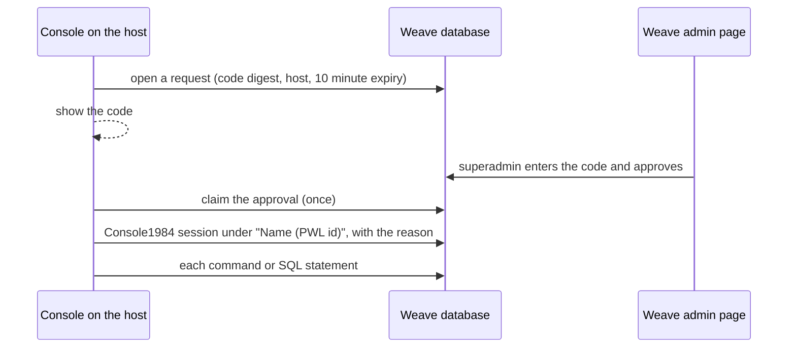

# Console access

Every production console names the person who uses it. A console waits until a superadmin approves it in Weave. Console1984 then records the session under that person. This applies to production and staging. The Patchwork standard for all apps is `console-access.md` in `patchworklabsorg/internal-docs`.

## Open a console

1. Start the console on the host:

   ```bash
   docker exec -it weave-web bin/rails console
   docker exec -it weave-web bin/rails dbconsole
   ```

2. The console shows a code, for example `QBXN-S8VG`, and waits.
3. Sign in to Weave as yourself. Open `/admin/console_access` and enter the code.
4. Make sure that the page shows your console and host. Then click "Approve".
5. The console asks why you need it. Write a real reason, for example "Fix the stuck signup for PWL5A1B2C3D4".

Approve only a console that you started yourself. The approval names you, not the person who asked you.



## Rules

- Only a superadmin can approve. An admin who impersonates a member cannot approve.
- A code expires after 10 minutes. One approval opens one console. A console must claim an approval within 10 minutes.
- Weave records the approver's IP address.
- When a console opens, Weave sends an email to the approver at once. If Weave cannot send it, the console stays closed. If you get this email for a console that you did not start, tell the other superadmins.
- The console checks again that the approver is a superadmin when it opens.
- The audit records (Console1984, Audits1984 and `console_access_requests`) write through their own database connection pool (`ConsoleAuditRecord`). A console user who runs `BEGIN` and then `ROLLBACK` on the app's connection cannot roll them back.
- Weave stores only a SHA-256 digest of the code.
- The Console1984 username is the approver's name and PWL id, for example `Ada Lovelace (PWL23E61E9BA2)`. The PWL id is also the `employeeID` of the person's AD account (see `docs/ACTIVE_DIRECTORY.md`).
- Review the sessions at `/admin/console` (Audits1984).

## The SQL console

In production and staging, `bin/rails dbconsole` does not start psql. It starts an audited SQL console:

- End a statement with a semicolon.
- `\dt` lists the tables. `\d TABLE` lists the columns of a table. `\q` or Ctrl-D quits.
- Console1984 records each statement before it runs. A backslash command is recorded with the SQL that it runs.
- The console refuses any statement that names the audit tables: the Console1984 tables, `console_access_requests` and `audits1984_audits`.
- Use `--db queue` to open the Solid Queue database.

In development, `bin/rails dbconsole` still starts psql.

## Limits

- The approval proves who approved, not who types. The rule "approve only your own console" makes this gap smaller, but does not close it.
- A person with a shell on the host can still run `psql` in the database container or in the Weave image (the image has `postgresql-client` today), or `bin/rails runner`. Do not use them to read or change member data. `bin/rails runner` can also write a false approval into the database. The approval email reduces this risk, but it is not proof: the false approval chooses whom the email goes to.
- The consoles connect as the app's database role. In production that role is a superuser. So the table checks in the Rails console (Console1984) and in the SQL console only read the statement text, and a person can get past them, for example with a quoted identifier such as `U&"console1984\005fcommands"` or with SQL built at run time. Each statement is recorded before it runs, but a later statement can delete the record. For the SQL console, a separate database role with only INSERT on the audit tables closes this gap. That needs a change in the infra repo. A Rails console runs any Ruby in the app, so it can always read the app's own database credentials.
- Console1984 encrypts the recorded commands with Active Record encryption. The production and staging credentials must have the `active_record_encryption` keys.

## Code

- `app/models/console_access_request.rb`: the request, the code and the approval.
- `app/controllers/admin/console_access_controller.rb`: the approval page.
- `lib/console_access/`: the wait for approval, the Console1984 username resolver, the SQL console and the `dbconsole` hook.
- `config/initializers/console_access.rb`: sets the Console1984 username resolver.
- `app/models/console_audit_record.rb`: the base class of the audit records, with its own connection pool.
- `app/mailers/console_access_mailer.rb`: the email to the approver.
