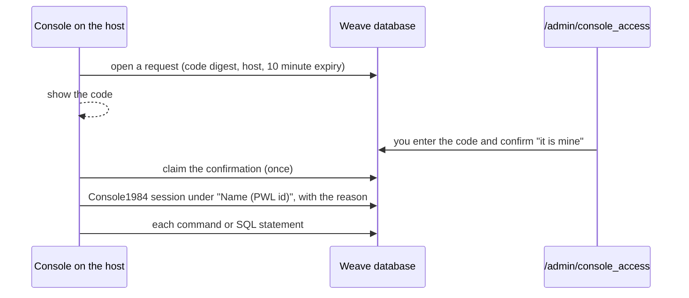

# Console access

Every production console records who uses it. A console waits until the person who started it signs it in to Weave as themselves. Console1984 then records the session under that person. Nobody else approves it. This applies to production and staging. The Patchwork standard for all apps is `console-access.md` in `patchworklabsorg/internal-docs`.

## Open a console

1. Start the console on the host:

   ```bash
   docker exec -it weave-web bin/rails console
   docker exec -it weave-web bin/rails dbconsole
   ```

2. The console shows a code, for example `QBXN-S8VG`, and waits.
3. Sign in to Weave as yourself. Open `/admin/console_access` and enter the code.
4. Make sure that the page shows your console and host. Then click "Yes, it is mine".
5. The console asks why you need it. Write a real reason, for example "Fix the stuck signup for PWL5A1B2C3D4".

If the page shows a console that you did not start, click "No, it is not mine". That console stops.



## Rules

- Any admin can sign in a console, for themselves only. An admin who impersonates a member cannot.
- A code expires after 10 minutes. One confirmation opens one console. A console must claim a confirmation within 10 minutes.
- Weave records the IP address of the confirmation.
- When the console opens, it checks again that the person is an admin.
- Weave stores only a SHA-256 digest of the code.
- The Console1984 username is the person's name and PWL id, for example `Ada Lovelace (PWL23E61E9BA2)`. In production, the PWL id is also the `employeeID` of the person's AD account (see `docs/ACTIVE_DIRECTORY.md`).
- Review the sessions at `/admin/console` (Audits1984).

## The SQL console

In production and staging, `bin/rails dbconsole` does not start psql. It starts an audited SQL console:

- End a statement with a semicolon.
- `\dt` lists the tables. `\d TABLE` lists the columns of a table. `\q` or Ctrl-D quits.
- Console1984 records each statement before it runs. A backslash command is recorded with the SQL that it runs.
- The console warns about and skips any statement that names the audit tables. The database roles below are the real protection.
- Use `--db queue` to open the Solid Queue database.

In development, `bin/rails dbconsole` still starts psql.

## How the records are protected

- **Database roles.** The app signs in as `weave_app`, which is not a superuser. The audit tables (Console1984, Audits1984 and `console_access_requests`) belong to `weave_audit`. `weave_app` can read them and add rows, and can change only the few columns that the app must change. It cannot delete, truncate, drop or rewrite them. This applies to both consoles, because both use the app's credentials. The superuser `weave` has no password and works only inside the db container. The infra repo sets this up (`modules/weave/db-roles.sql`) each time `weave-web` starts.
- **Own connection.** The audit records write through their own connection pool (`ConsoleAuditRecord`). A console user who runs `BEGIN` and then `ROLLBACK` cannot roll them back.
- **Encryption.** Console1984 encrypts the recorded commands with Active Record encryption. The production credentials have the `active_record_encryption` keys.

A migration that changes an audit table must run by hand as `weave` in the db container, because `weave_app` does not own those tables.

## Limits

- The sign-in proves who signed in, not who types. Enter only the code of a console that you started.
- A person with a shell on the host can still run `psql` as `weave` in the db container, or `bin/rails runner`. Do not use them to read or change member data.

## Code

- `app/models/console_access_request.rb`: the request, the code and the confirmation.
- `app/controllers/admin/console_access_controller.rb`: the sign-in page.
- `app/models/console_audit_record.rb`: the base class of the audit records, with its own connection pool.
- `lib/console_access/`: the wait for the sign-in, the Console1984 username resolver, the SQL console and the `dbconsole` hook.
- `config/initializers/console_access.rb`: sets the Console1984 username resolver.
