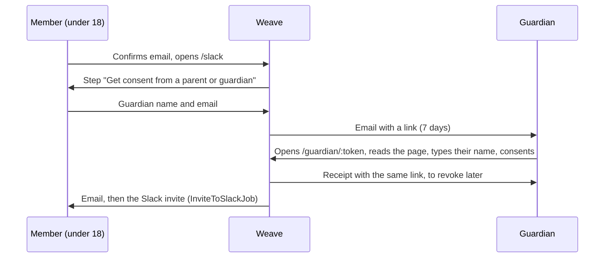

# Guardian consent

A member under 18 needs consent from a parent or legal guardian before they join the Slack or use Patchwork Labs apps. Weave calculates the age from `users.birthday`. A member with no birthday is not asked.

## The flow

- `GuardianConsent` keeps one row per request. A new request supersedes the pending one. Weave keeps only a SHA-256 digest of the link token.
- The guardian's name and email, and the typed signature, are encrypted with Lockbox.
- The guardian email cannot belong to a Weave account. A member who is signed in cannot consent from their own session.
- Each grant records the time, IP, user agent and `GuardianConsent::TEXT_VERSION`.
- The requirement ends by itself on the member's 18th birthday.
- The text is in `config/locales/guardian_consent.en.yml`. When the guardian page text changes, change `GuardianConsent::TEXT_VERSION` too.

## Revoking

The guardian can take the consent back from the link in the receipt. A superadmin can revoke it from the user's admin page. Weave then:

1. Removes app access (`RevokeLostAppAccessJob`).
2. Emails the member.
3. Emails the admins when the guardian revoked it (`AdminMailer#guardian_consent_revoked`). The Slack account does not change, so an admin decides what to do there.

## App access

Every OAuth app requires guardian consent for members under 18 (see `AppAccess`). The check comes before the code of conduct check. The authorize endpoint sends the member to `/slack` to ask for consent. Their existing tokens stop working while consent is missing.

A superadmin can opt out one app on the app's admin page (`oauth_applications.requires_guardian_consent`).

## Admin tools

On the user's admin page, in "App Access":

- Any admin who can manage the user can send the request again.
- A superadmin can record consent given offline, for example on a paper form. A note that says where the form is is required.
- A superadmin can revoke the consent.
