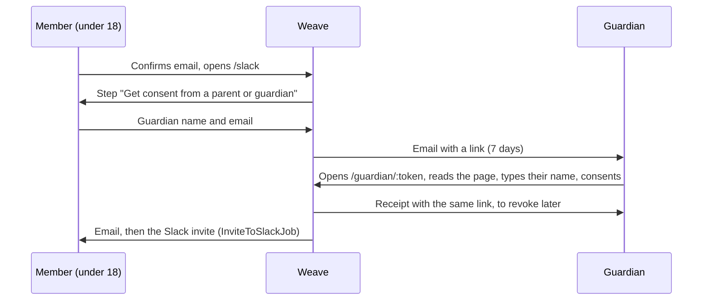

# Guardian consent

A member under 18 needs consent from a parent or legal guardian before they join the Slack or use Patchwork Labs apps. Weave calculates the age from `users.birthday`.

## Birthday and minimum age

Patchwork Labs is for people 13 and older (`User::MINIMUM_AGE`).

- Sign-up requires a birthday and refuses people under 13.
- Accounts made another way (the Slack import, an admin) can have no birthday. `/slack` asks for it before any other step, with the Slack profile birthday filled in when there is one. `/` sends signed-in members there.
- Signing in to an app that requires guardian consent asks for the birthday first, then goes back to the app. Tokens issued before do not stop working, so members are asked at their next app sign-in.
- A member sets the birthday once. Admins can correct it on the admin edit page.
- A member who adds a birthday under 13 loses app access (`AppAccess`, no opt-out), gets no Slack invite, and the admins get `AdminMailer#under_minimum_age`. Weave does not delete the account.

## The flow

- `GuardianConsent` keeps one row per request. A new request supersedes the pending one. Weave keeps only a SHA-256 digest of the link token.
- The guardian's name and email, and the typed signature, are encrypted with Lockbox.
- The guardian email cannot belong to a Weave account. A member who is signed in cannot consent from their own session.
- Each grant records the time, IP, user agent and `GuardianConsent::TEXT_VERSION`.
- The requirement ends by itself on the member's 18th birthday.
- The text is in `config/locales/guardian_consent.en.yml`. When the guardian page text changes, change `GuardianConsent::TEXT_VERSION` too.

## Checking that the guardian is real

An email link proves only that someone reads that inbox. A member could give a friend's address. Weave cannot stop that, so it makes it likely to be found:

- The member form and the guardian page say that Patchwork Labs checks some consents by contacting the guardian, and that false details break the Code of Conduct.
- When the guardian consents, `GuardianConsentSignals` sets flags:
  - `same_device`: the guardian page ran in a browser the member signed in with (FingerprintJS).
  - `quick_grant`: consent came within 5 minutes of the request.
  - `member_name`: the guardian's name is the member's own name.
  - `spot_check`: a random 10% of consents with no other flag.
- A shared home IP is normal for a real parent, so the IP is not a flag.
- A flagged consent stands, but waits in the review queue at `/admin/guardian_consents`. For any flag except `spot_check`, Weave emails the admins (`AdminMailer#guardian_consent_flagged`).
- An admin contacts the guardian, then marks the consent as checked with a note, or a superadmin revokes it on the member's page.
- Before Krater gives a budget to a minor, it needs a stronger check: a signed guardian form and a call. Krater reads the `minor` field from the directory API for this.

## Revoking

The guardian can take the consent back from the link in the receipt. A superadmin can revoke it from the user's admin page. Weave then:

1. Removes app access (`RevokeLostAppAccessJob`).
2. Emails the member.
3. Emails the admins when the guardian revoked it (`AdminMailer#guardian_consent_revoked`). The Slack account does not change, so an admin decides what to do there.

## App access

Every OAuth app requires guardian consent for members under 18 (see `AppAccess`). The check comes before the code of conduct check. The authorize endpoint sends the member to `/slack` to ask for consent. Their existing tokens stop working while consent is missing.

A superadmin can opt out one app on the app's admin page (`oauth_applications.requires_guardian_consent`).

## Admin tools

On the user's admin page, in "App Access":

- Any admin who can manage the user can send the request again.
- A superadmin can record consent given offline, for example on a paper form. A note that says where the form is is required.
- A superadmin can revoke the consent.
