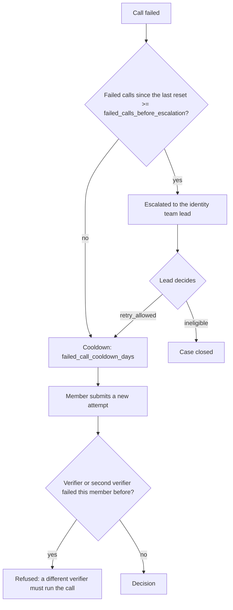
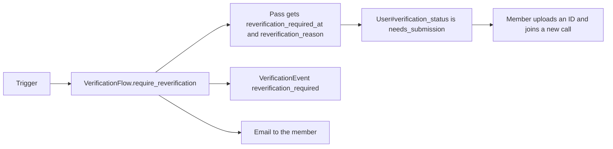
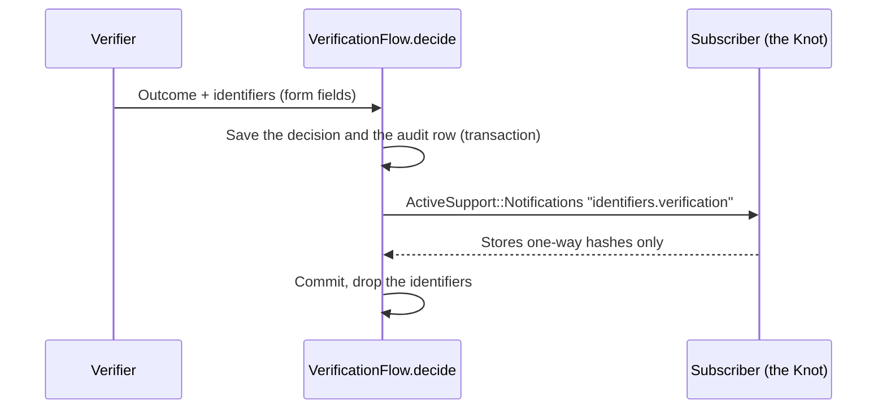
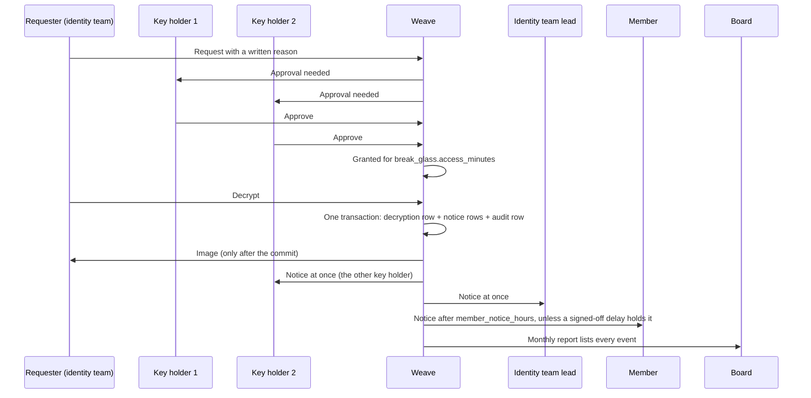

# KYC

Weave runs identity verification and trust for Patchwork Labs programs. The design is the internal proposal "Identity, verification, and trust" (draft v0.8). This file has one section for each part of the build.

Identity verification gates program resources only: compute, servers and grant money. The community and the Slack invite are not gated by KYC.

Every page that collects or handles identity data links to the public page "What we do with your data". Read the URL through `Weave.data_page_url` (`lib/weave.rb`). Do not write the URL in a view.

## Verification

Layer 1 of the proposal (section 03). It answers three questions: is this a real person, how old and where, and is it the same person who signed. The flow is the same for everyone, staff included. Nobody verifies their own account.

### The identity team

The identity team is a flag on the user, not a role rank:

| Column | Meaning |
| --- | --- |
| `users.identity_team` | Runs verification: pre-review, calls, break-glass requests. |
| `users.identity_key_holder` | Approves break-glass access to stored ID images. At most `break_glass.max_key_holders` (3) people. Any 2 of them approve a request. |
| `users.identity_lead` | Gets every break-glass notice and resolves escalations. |

- `SystemGroups` mirrors `identity_team` into the `identity-team` system group, so access rules and apps can ask "is the user in group X?" like the other built-in groups.
- The identity team pages live in the admin panel (`/admin/verifications`). A team member also needs the admin role to reach them.
- Only an owner changes these flags (`Admin::UserIdentityTeamController`), and never on their own account. PaperTrail records each change.

### The flow

```mermaid
stateDiagram-v2
  [*] --> submitted: member uploads an ID
  submitted --> pre_review: team member takes it
  pre_review --> needs_resubmission: document problem, with a note
  pre_review --> awaiting_call: Document OK (pre-reviewer)
  awaiting_call --> call_scheduled: verifier records the agreed call time
  call_scheduled --> call_scheduled: call moved
  call_scheduled --> verified: pass
  call_scheduled --> failed: fail
  needs_resubmission --> [*]: member submits a new attempt at once
  failed --> [*]: new attempt after the cooldown, different verifier
  failed --> escalated: Nth fail in a row
  escalated --> [*]: lead allows a retry, or closes the case (ineligible)
```

- `Verification` is one row per attempt. `previous_attempt_id` links each attempt to the one before it, so the history reads as one chain.
- `VerificationFlow` holds the steps. Each step adds a `VerificationEvent`.
- Scheduling is manual. The pre-reviewer ends pre-review with "Document OK" (`VerificationFlow.approve_document`, event `document_approved`). After that, nobody can see the image in pre-review. The attempt waits in `awaiting_call`, and the member gets an email that says the team will contact them. A verifier agrees a time with the member by email or Slack. Then the verifier records the time as a separate step (`VerificationFlow.schedule_call`). This step does not touch the image. "Send back" (`reject_document`) still works during pre-review.
- Hand-over: any other identity team member can click "Take over pre-review" on an attempt in pre-review (`VerificationFlow.take_over_pre_review`). They become the pre-reviewer. The `pre_review_taken_over` event logs the old and the new pre-reviewer. Only the current pre-reviewer can see the image and mark "Document OK".
- `verification_method` is `document_call` (an ID image, then a live call) or `digital_id_call` (a digital ID, then a live call). See "Digital ID" below.
- The member page is `/verification`. The profile page links to it.
- The member gets an email at each step (`VerificationMailer#status_changed`). The text is in `config/locales/verification.en.yml`.

### The audit record

`VerificationEvent` rows are append-only. A row is read-only after it is created, and the app can't delete one. The foreign key to `verifications` has no cascade, so a verification can't be deleted while its audit rows exist.

The `decided` event holds:

- who attended: the member, the verifier, an optional second verifier, and whether a guardian attended (and which guardian consent);
- the document type (type only), the method, the outcome, and the written reason;
- the age and region consistency attestation.

The decision columns on `Verification` can't change after the decision.

The call is never recorded. There is no video or recording column. The record is the written attestation of the verifier.

### Retry rules

- Nobody who failed a member, as the verifier or the second verifier, can verify that member again (`VerificationFlow.excluded_verifier_ids`).
- A key holder may run or join a call. All three key holders are also verifiers, so the only limit is in break-glass: the lead verifier on a member's calls can't approve that member's request.
- A lead's `retry_allowed` resets the count of failed calls.

### Status

`User#verification_status` is derived from the attempts each time. It is never stored.

| Status | When |
| --- | --- |
| `needs_submission` | No attempt, or the last attempt needs a new document or failed, or a trigger ended the last pass (see "Re-verification"). |
| `pending` | An attempt is in progress, or a failed attempt waits for the lead. |
| `verified` | The last attempt passed, and no trigger ended the pass. |
| `ineligible` | The lead closed the case. |

Apps read it as:

- the `verification_status` field in the directory API (`DirectoryUserSerializer`);
- the `verification_status` claim, with the `verification` scope (`config/initializers/doorkeeper_openid_connect.rb`).

Neither holds a value from the ID.

### Re-verification

A pass has no time limit. Weave has no expiry job and no expiry value in config. Only these triggers end a pass:

| Trigger | Reason | Where it fires |
| --- | --- | --- |
| The birthday changes | `birthday_changed` | `User` `after_update` callback, for every change (member, admin, console). |
| The legal name changes | `legal_name_changed` | `User` `after_update` callback on `legal_first_name` or `legal_last_name`. |
| A blacklist review | `blacklist_review` | The Knot (a later part), when a two-key change to the blacklist flag is applied. |

- The attempt stays `verified`, because the call did pass. `Verification#standing_pass?` is false after a trigger.
- `Verification::REVERIFICATION_REASONS` holds the only reasons. An unknown reason raises an error.
- Only a standing pass can end. A second trigger on the same pass does nothing.
- The member page and the email give the reason. The text is in `config/locales/verification.en.yml`.
- Apps see `needs_submission` until the member passes a new call.

### The app gate

An app opts in with `oauth_applications.requires_verification` (off by default). A superadmin changes it on the app page. `AppAccess` then refuses members who are not `verified`, at every place that hands out or honors a token. Opting in starts `RevokeLostAppAccessJob`. Use it only for apps that give program resources.

### Pass rules

A pass needs all of these:

- a written reason;
- a yes for age consistency and a yes for region consistency;
- for a member under 18, a granted guardian consent (`User#guardian_consent_missing?` is false);
- for a member under 18, a parent or guardian on the call. The verifier ticks "A parent or guardian attended" in the outcome form (`guardian_attended`). A minor can't pass without it. A minor can still fail without a guardian. "Under 18" is `User#minor?`, the same rule as guardian consent;
- for a document call, the identifiers for the Knot (see below).

### Age and region consistency

The verifier answers yes or no: the self-reported age, and the self-reported region, do not contradict the ID. No value from the ID is written down. Gender is never checked. An age mismatch can't pass: the verifier fails the call, or the member fixes their birthday first.

### Identifiers for the Knot

The Knot (a later part) needs the document type, issuing country, document number, national identity number (where present), legal name and date of birth. Weave never stores these values.

- `VerificationIdentifiers` is a value object. `#inspect` hides the values. The request log filters the fields (`config/initializers/filter_parameter_logging.rb`).
- The event fires inside the transaction of the decision. A subscriber that raises rolls back the decision.
- A subscriber must store only one-way hashes.

### The ID image and break-glass

The image is an Active Storage attachment encrypted with Lockbox (`encrypts_attached :id_document`).

- **Pre-review.** Only the pre-reviewer can open the image, only while the attempt is in pre-review. Each view adds a `document_viewed` event before Weave decrypts the image. The board report counts these views.
- **Any other decryption** needs break-glass (`BreakGlass`, issue #92):

- Break-glass is only for an attempt that passed, failed or was escalated: a fraud review, an appeal or a blacklist check (`BreakGlass.request_blocker`). Before the decision (submitted, pre-review, waiting for the call time, call set), the page does not show the button, and Weave refuses a request with the reason.
- Two different key holders must approve. The requester can be a key holder.
- The lead verifier on a member's calls (the one who recorded a decision) can't approve or deny a break-glass request for that member, and gets no approval email for it (`BreakGlass.may_approve?`). A second verifier is not excluded.
- Only the requester can decrypt, and only until the grant expires. Each decryption is a `BreakGlassDecryption` row.
- Quiet use is not possible. `BreakGlass.decrypt!` writes the decryption and its `BreakGlassNotice` rows in one transaction. It reads the image only after the commit. `DeliverBreakGlassNoticesJob` sends each notice when it is due. It runs after each decryption and every 15 minutes, so a lost enqueue does not lose a notice.
- An identity team member can ask to delay the member notice for an active fraud investigation. A reason is required. The delay holds the notice only after an owner or an identity team lead signs it off. The person who asked for the delay, the person who asked for the access and the member can never sign it off (`BreakGlass.may_sign_off_delay?`). It holds the notice for at most `break_glass.max_fraud_delay_days` after the notice was first due. Then the notice goes out, also when nobody lifts the delay. The lead gets an email, and the board report lists every delayed notice.
- The board report is the admin page `/admin/break_glass_report` (identity team and board members) and a monthly email to each board member (`BreakGlassBoardReportJob`).
- The key holders approve with a signed-in click. Hardware keys are not built yet.

### Upload conversion

`IdDocumentConverter` turns each upload into the one image Weave keeps. It runs at upload, in memory, before anything is stored or sealed, so only the converted image is ever stored (and later sealed).

| Upload | Stored as |
| --- | --- |
| JPEG | JPEG, re-encoded |
| PNG | PNG, re-encoded |
| HEIC or HEIF | JPEG |
| PDF | PNG of the FIRST page only |

- The type comes from the file's bytes (Marcel), not from its name or the browser's content type. Any other type (for example WebP) is refused. A file that fails to convert is refused. The member sees one clear message (`verification.errors.document_unsupported`) and nothing is stored.
- Every output is re-encoded without metadata: no EXIF, no GPS, no XMP, no ICC profile, and no PDF title or author. The EXIF orientation is applied to the pixels first, so the image stays upright.
- The size limit (`max_image_megabytes`) applies to the upload. An image that decodes to more than 50 megapixels is refused.
- HEIC decodes in libvips with libheif and its HEVC decoder plugin. A PDF page is rendered by poppler's `pdftoppm` in a child process, from stdin to stdout, with a 20-second timeout. Active Storage blocks the untrusted libvips loaders (`Vips.block_untrusted`), and the PDF loader is one of them, so Weave does not turn it back on in the web process.
- The Docker image needs `poppler-utils` and `libheif-plugin-libde265` (see the Dockerfile).
- The specs use small fixtures in `spec/fixtures/files`. The HEIC spec skips where libvips can't decode HEIC, and the PDF specs skip where `pdftoppm` is not installed.

### The ID image viewer

Every view of an ID image uses the same secure viewer: the pre-reviewer's view and the break-glass view (`app/javascript/lib/secure_viewer.js`, `secure-image` Stimulus controller, `shared/_secure_image_viewer` partial).

- There is no raw image URL. The old `GET .../document` routes are removed. The viewer script sends a `POST .../image`. The answer is JSON with the bytes in Base64, and only the viewer reads it. The access checks and the log rows are the same as before.
- The answer has `Cache-Control: no-store` (Rails drops the weaker `no-cache`), `Pragma: no-cache` and `Content-Disposition: attachment`, so no cache keeps it and a browser never shows it as an image. The request also sends `Cache-Control: no-store, no-cache` and `Pragma: no-cache`.
- The image is drawn in a `<canvas>` in the page. There is no ``, no new tab, no "Save image" and no drag.
- Right-click, drag, select and copy are blocked on the viewer. A print stylesheet hides it.
- A watermark is tiled across the image: the viewer's name, the viewer's p_id, the UTC time of the view (from the server) and the public id of the verification or the break-glass request.
- The image blurs when the page is hidden or the window loses focus. It unblurs on focus.
- A browser that can't decode the file type (for example a PDF) shows an error, not the file.
- Nothing stops a screenshot or a phone camera. The watermark makes a copy traceable to the viewer.

### Purging images

`PurgeVerificationDocumentsJob` runs every day. The verification and its audit rows stay.

| Attempt | Image purged |
| --- | --- |
| Passed | `purge_image_days_after_pass` after the decision |
| Document problem or failed call | `purge_image_days_after_close` after it closed, not while an escalation is open |
| Account deleted | At the next run |

### Digital ID

`DigitalIdProvider` is the interface for a digital ID path, for example the EU digital identity wallet. No provider exists yet, so members can't choose the path. A provider implements `start` and `result`. `result` gives a `VerificationIdentifiers`, which goes to the same hook as a document call.

### Open values

The values are in `config/kyc/verification.yml`. Values marked `LOCKED` were decided on 2026-10-12. Values marked `PLACEHOLDER` are not decided yet. Counsel can change any value there: no code change is necessary.

| Key | Value | State |
| --- | --- | --- |
| `failed_call_cooldown_days` | 14 | Locked |
| `failed_calls_before_escalation` | 2 | Locked |
| `purge_image_days_after_pass` | 7 | Locked |
| `purge_image_days_after_close` | 30 | Locked |
| `break_glass.access_minutes` | 30 | Placeholder |
| `break_glass.member_notice_hours` | 72 | Locked |
| `break_glass.max_fraud_delay_days` | 30 | Locked |

The retention window for verification audit records is part of the retention question in the proposal. The deletion part sets it.
