# KYC

Weave runs identity verification and trust for Patchwork Labs programs. The design is the internal proposal "Identity, verification, and trust" (draft v0.8). This file has one section for each part of the build.

Identity verification gates program resources only: compute, servers and grant money. The community and the Slack invite are not gated by KYC.

Every page that collects or handles identity data links to the public page "What we do with your data". Read the URL through `Weave.data_page_url` (`lib/weave.rb`). Do not write the URL in a view.

## Verification

Layer 1 of the proposal (section 03). It answers three questions: is this a real person, how old and where, and is it the same person who signed. The flow is the same for everyone, staff included. Nobody verifies their own account.

### The identity team

The identity team is a flag on the user, not a role rank:

| Column | Meaning |
| --- | --- |
| `users.identity_team` | Runs verification: pre-review, calls, break-glass requests. |
| `users.identity_key_holder` | Approves break-glass access to stored ID images. At most `break_glass.max_key_holders` (3) people. Any 2 of them approve a request. |
| `users.identity_lead` | Gets every break-glass notice and resolves escalations. |

- `SystemGroups` mirrors `identity_team` into the `identity-team` system group, so access rules and apps can ask "is the user in group X?" like the other built-in groups.
- The verification pages live in the identity area (`/identity/verifications`, `/identity/break_glass_records`), not in the admin panel. A team member does not need the admin role. An admin who is not on the team can't open them.
- The admin and identity layout has a left sidebar with four headed groups (`AdminNavHelper`, `layouts/_admin_nav`): Identity (Verification, Key custody, Governance, Knot), People (Users, Groups, Consents), Data (Deletion, Demographics, Funder reports) and System (Dashboard, OAuth Apps, Jobs, Flipper, Blazer, Console Audits). Each person sees only the groups and links they can use: a verifier without the admin role sees only Identity. The current page is highlighted (`aria-current="page"`). On a phone, the sidebar is behind a "Menu" button. `spec/requests/admin_nav_spec.rb` checks the links of each role.
- The flags change only through governance (see "Identity team governance" below). PaperTrail records each change.

### The flow

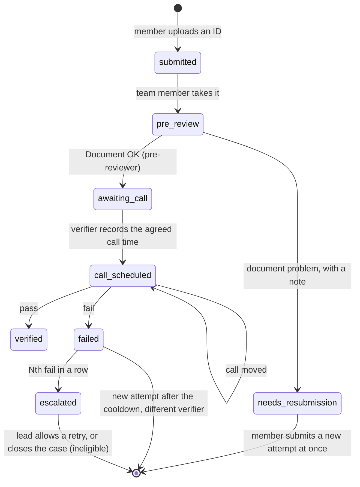

- `Verification` is one row per attempt. `previous_attempt_id` links each attempt to the one before it, so the history reads as one chain.
- `VerificationFlow` holds the steps. Each step adds a `VerificationEvent`.
- Scheduling is manual. The pre-reviewer ends pre-review with "Document OK" (`VerificationFlow.approve_document`, event `document_approved`). At once, `IdDocumentVault.seal!` seals the image (see "The ID image and break-glass"), and nobody can see it in pre-review. The attempt waits in `awaiting_call`, and the member gets an email that says the team will contact them. A verifier agrees a time with the member by email or Slack. Then the verifier records the time as a separate step (`VerificationFlow.schedule_call`). This step does not touch the image. "Send back" (`reject_document`) still works during pre-review.
- Hand-over: any other identity team member can click "Take over pre-review" on an attempt in pre-review (`VerificationFlow.take_over_pre_review`). They become the pre-reviewer. The `pre_review_taken_over` event logs the old and the new pre-reviewer. Only the current pre-reviewer can see the image and mark "Document OK".
- `verification_method` is `document_call` (an ID image, then a live call) or `digital_id_call` (a digital ID, then a live call). See "Digital ID" below.
- The member page is `/verification`. The profile page links to it.
- The member gets an email at each step (`VerificationMailer#status_changed`). The text is in `config/locales/verification.en.yml`.

### The audit record

`VerificationEvent` rows are append-only. A row is read-only after it is created, and the app can't delete one. The foreign key to `verifications` has no cascade, so a verification can't be deleted while its audit rows exist.

The `decided` event holds:

- who attended: the member, the verifier, an optional second verifier, and whether a guardian attended (and which guardian consent);
- the document type (type only), the method, the outcome, and the written reason;
- the age and region consistency attestation.

The decision columns on `Verification` can't change after the decision.

The call is never recorded. There is no video or recording column. The record is the written attestation of the verifier.

### Retry rules

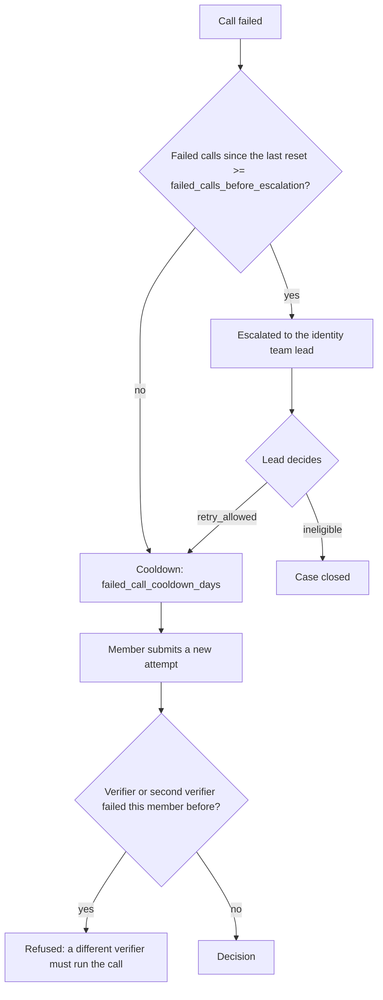

- Nobody who failed a member, as the verifier or the second verifier, can verify that member again (`VerificationFlow.excluded_verifier_ids`).
- A key holder may run or join a call. All three key holders are also verifiers, so the only limit is in break-glass: the lead verifier on a member's calls can't approve that member's request.
- A lead's `retry_allowed` resets the count of failed calls.

### Status

`User#verification_status` is derived from the attempts each time. It is never stored.

| Status | When |
| --- | --- |
| `needs_submission` | No attempt, or the last attempt needs a new document or failed, or a trigger ended the last pass (see "Re-verification"). |
| `pending` | An attempt is in progress, or a failed attempt waits for the lead. |
| `verified` | The last attempt passed, and no trigger ended the pass. |
| `ineligible` | The lead closed the case. |

Apps read it as:

- the `verification_status` field in the directory API (`DirectoryUserSerializer`);
- the `verification_status` claim, with the `verification` scope (`config/initializers/doorkeeper_openid_connect.rb`).

Neither holds a value from the ID.

### Re-verification

A pass has no time limit. Weave has no expiry job and no expiry value in config. Only these triggers end a pass:

| Trigger | Reason | Where it fires |
| --- | --- | --- |
| The birthday changes | `birthday_changed` | `User` `after_update` callback, for every change (member, admin, console). |
| The legal name changes | `legal_name_changed` | `User` `after_update` callback on `legal_first_name` or `legal_last_name`, and `KnotChanges.sign_off` of a Knot name change. |
| A blacklist review | `blacklist_review` | `KnotChanges.sign_off`, when a two-key change to the blacklist flag (set or clear) is applied. A declined request is not a trigger. |

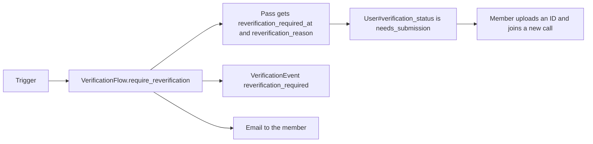

- The attempt stays `verified`, because the call did pass. `Verification#standing_pass?` is false after a trigger.
- `Verification::REVERIFICATION_REASONS` holds the only reasons. An unknown reason raises an error.
- Only a standing pass can end. A second trigger on the same pass does nothing.
- The member page and the email give the reason. The text is in `config/locales/verification.en.yml`.
- Apps see `needs_submission` until the member passes a new call.

### The app gate

An app opts in with `oauth_applications.requires_verification` (off by default). A superadmin changes it on the app page. `AppAccess` then refuses members who are not `verified`, at every place that hands out or honors a token. Opting in starts `RevokeLostAppAccessJob`. Use it only for apps that give program resources.

### Pass rules

A pass needs all of these:

- a written reason;
- a yes for age consistency and a yes for region consistency;
- for a member under 18, a granted guardian consent (`User#guardian_consent_missing?` is false);
- for a member under 18, a parent or guardian on the call. The verifier ticks "A parent or guardian attended" in the outcome form (`guardian_attended`). A minor can't pass without it. A minor can still fail without a guardian. "Under 18" is `User#minor?`, the same rule as guardian consent;
- for a document call, the identifiers for the Knot (see below);
- for a document call, a legal name and a date of birth that match the account (see "Name and birthday match").

### Name and birthday match

The verifier types the legal name and the date of birth from the ID. The form does not show the account values. On a pass, `VerificationFlow.account_mismatches` compares them with the account:

- The name must match `User#legal_full_name` (the preferred name when the account has no legal name) after `KnotHasher.normalize_name`. Case, accents, punctuation and word order do not count.
- The date of birth must match `users.birthday` exactly.

A mismatch blocks the pass. The form shows again with what the verifier typed and says which field differs (the name, the birthday or both). It never shows the account value. The verifier can correct the entry, or fail the call with "Failed: details don't match the account" (`details_mismatch`). A fail is always allowed: this fail needs no attestation, and its reason starts with `VerificationFlow::DETAILS_MISMATCH_REASON`. The `decided` event records `details_mismatch`.

Weave keeps document and national ID numbers only as one-way hashes for the fraud check (the Knot). It does not store the typed name or birth date.

### Age and region consistency

The verifier answers yes or no: the self-reported age, and the self-reported region, do not contradict the ID. No value from the ID is written down. Gender is never checked. An age mismatch can't pass: the verifier fails the call, or the member fixes their birthday first.

### Identifiers for the Knot

The Knot (see "The Knot" below) needs the document type, issuing country, document number, national identity number (where present), legal name and date of birth. Weave never stores these values.

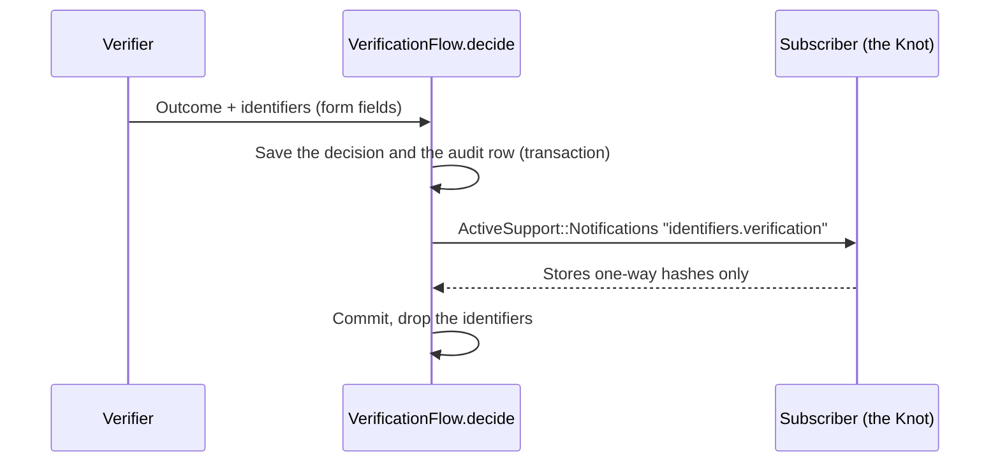

- `VerificationIdentifiers` is a value object. `#inspect` hides the values. The request log filters the fields (`config/initializers/filter_parameter_logging.rb`).
- The event fires inside the transaction of the decision. A subscriber that raises rolls back the decision.
- A subscriber must store only one-way hashes.

### The ID image and break-glass

`IdDocumentVault` (`app/services/id_document_vault.rb`) is the one interface to stored images. An image has two forms in its life:

1. **Waiting for pre-review.** The image is an Active Storage attachment encrypted with Lockbox (`encrypts_attached :id_document`), so the pre-reviewer can see it before any key holder is involved. Only the pre-reviewer can open it, and only while the attempt is in pre-review. Each view adds a `document_viewed` event before Weave decrypts the image. The board report counts these views.
2. **Sealed.** When pre-review ends ("Document OK", or the member must submit again), `IdDocumentVault.seal!` encrypts the image with a fresh data key, seals the data key to the master public key and destroys the Lockbox copy (`SealedIdDocument`). After that, only break-glass opens it. See "Key custody" below.

Pre-review can't end before the key ceremony: with no key set, Weave can't seal the image, so `approve_document` and `reject_document` refuse and the page says why.

- **Any other decryption** needs break-glass (`BreakGlass`, issue #92):

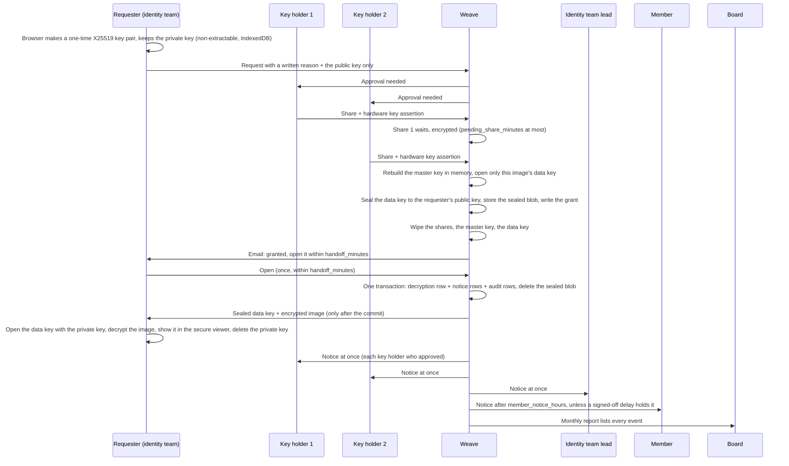

- Break-glass is only for an attempt that passed, failed or was escalated: a fraud review, an appeal or a blacklist check (`BreakGlass.request_blocker`). Before the decision (submitted, pre-review, waiting for the call time, call set), the page does not show the button, and Weave refuses a request with the reason.
- Two different key holders must approve. An approval is the submission of the holder's share with a hardware key (see "Key custody"). The requester can be a key holder, and may approve their own request (locked, 2026-10-13).
- The lead verifier on a member's calls (the one who recorded a decision) can't approve or deny a break-glass request for that member, and gets no approval email for it (`BreakGlass.may_approve?`). A second verifier is not excluded.
- The sealed handoff (2026-10-20, replaces "the second approver sees the image"). See "The sealed handoff" below. The requester sees the image. The second approver does not.
- Quiet use is not possible. `BreakGlass.open!` writes the decryption (the requester as the viewer) and its `BreakGlassNotice` rows in one transaction. It returns the sealed data key and the encrypted image only after the commit. If a notice can't be written, nothing is written, nothing is returned and the sealed blob stays. `DeliverBreakGlassNoticesJob` sends each notice when it is due. It runs after each decryption and every 15 minutes, so a lost enqueue does not lose a notice.
- An identity team member can ask to delay the member notice for an active fraud investigation. A reason is required. The delay holds the notice only after an owner or an identity team lead signs it off. The person who asked for the delay, the person who asked for the access and the member can never sign it off (`BreakGlass.may_sign_off_delay?`). It holds the notice for at most `break_glass.max_fraud_delay_days` after the notice was first due. Then the notice goes out, also when nobody lifts the delay. The lead gets an email, and the board report lists every delayed notice.
- The board report is the admin page `/admin/break_glass_report` (identity team and board members) and a monthly email to each board member (`BreakGlassBoardReportJob`).

### Upload conversion

`IdDocumentConverter` turns each upload into the one image Weave keeps. It runs at upload, in memory, before anything is stored or sealed, so only the converted image is ever stored (and later sealed).

| Upload | Stored as |
| --- | --- |
| JPEG | JPEG, re-encoded |
| PNG | PNG, re-encoded |
| HEIC or HEIF | JPEG |
| PDF | PNG of the FIRST page only |

- The type comes from the file's bytes (Marcel), not from its name or the browser's content type. Any other type (for example WebP) is refused. A file that fails to convert is refused. The member sees one clear message (`verification.errors.document_unsupported`) and nothing is stored.
- Every output is re-encoded without metadata: no EXIF, no GPS, no XMP, no ICC profile, and no PDF title or author. The EXIF orientation is applied to the pixels first, so the image stays upright.
- The size limit (`max_image_megabytes`) applies to the upload. An image that decodes to more than 50 megapixels is refused.
- HEIC decodes in libvips with libheif and its HEVC decoder plugin. A PDF page is rendered by poppler's `pdftoppm` in a child process, from stdin to stdout, with a 20-second timeout. Active Storage blocks the untrusted libvips loaders (`Vips.block_untrusted`), and the PDF loader is one of them, so Weave does not turn it back on in the web process.
- The Docker image needs `poppler-utils` and `libheif-plugin-libde265` (see the Dockerfile).
- The specs use small fixtures in `spec/fixtures/files`. The HEIC spec skips where libvips can't decode HEIC, and the PDF specs skip where `pdftoppm` is not installed.

### The sealed handoff

Who can ask: any identity team member who is not the member (`BreakGlass.request`). The requester does not need a hardware key, so every requester gets the browser key pair, also a requester who is not a key holder.

1. Ask. The requester's browser makes a one-time X25519 key pair with WebCrypto (`app/javascript/key_custody/handoff.js`). The private key is a NON-EXTRACTABLE `CryptoKey`. The browser keeps it in IndexedDB (database `weave-break-glass`), under the request id. Only the public key goes to Weave, with the reason (`requester_public_key`). A request without a valid public key is refused.
2. Grant. On the second approval, Weave rebuilds the master key in memory and opens ONLY that image's data key. It seals the data key to the requester's public key (`KeyCustody::Crypto.seal`, HKDF info `weave key custody handoff v1`, aad `BreakGlass.handoff_aad`: the request id and the requester's p_id). It stores the sealed blob on the record (`handoff_sealed_key`) and wipes the master key, the shares and the data key. The second approver does not see the image. The requester gets an email (`BreakGlassMailer#handoff_ready`).
3. Open. On the break-glass page, the requester clicks "Open" under "Ready for you to open". Their browser posts to `/identity/break_glass_records/:id/open` and gets the sealed data key and the encrypted image (JSON, `Cache-Control: no-store`). It opens the data key with the private key from IndexedDB, decrypts the image, and shows it in the secure viewer (see "The ID image viewer"). Then the browser deletes the private key.
4. Open is allowed only once, only for the requester, and only within `break_glass.handoff_minutes` (30, locked). At the open, Weave deletes the sealed blob (`opened_at`). `SweepPendingSharesJob` deletes an expired blob every minute (`BreakGlass.sweep_expired_handoffs!`, event `break_glass_handoff_expired`).
5. If the time passes, or the browser lost the private key (another browser, cleared site data, a private window), the requester must ask again.

The decryption row, the notices and the board report record the requester as the viewer. Each key holder who approved gets the key holder notice.

A leak of the database and the Lockbox master key can't open the image: the blob is sealed to a key that only the requester's browser holds, and the waiting shares are deleted at the grant. A spec scans every table for the data key in raw, Base64 and hex form, after the grant and after the open (`spec/services/break_glass_spec.rb`, "a database and Lockbox leak"). The browser test (`spec/javascript/break_glass_handoff.test.js`) opens a Ruby-made vector (`spec/fixtures/files/key_custody/handoff_vectors.json`). Bun 1.2 has no X25519, so it skips those tests. `node spec/javascript/break_glass_handoff_node_check.mjs` runs the same check in Node 22.

What it does not stop: the requester's own computer sees the image. Malware on it, or a person at it, could copy it. The watermark makes a copy traceable to the requester.

### The ID image viewer

Every view of an ID image uses the same secure viewer: the pre-reviewer's view and the break-glass view (`app/javascript/lib/secure_viewer.js`, `secure-image` Stimulus controller, `shared/_secure_image_viewer` partial).

- There is no raw image URL. The old `GET .../document` routes are removed. The viewer script sends a `POST .../image`. The answer is JSON with the bytes in Base64, and only the viewer reads it. The access checks and the log rows are the same as before.
- The answer has `Cache-Control: no-store` (Rails drops the weaker `no-cache`), `Pragma: no-cache` and `Content-Disposition: attachment`, so no cache keeps it and a browser never shows it as an image. The request also sends `Cache-Control: no-store, no-cache` and `Pragma: no-cache`.
- The image is drawn in a `<canvas>` in the page. There is no ``, no new tab, no "Save image" and no drag.
- Right-click, drag, select and copy are blocked on the viewer. A print stylesheet hides it.
- A watermark is tiled across the image: the viewer's name, the viewer's p_id, the UTC time of the view (from the server) and the public id of the verification or the break-glass request.
- The image blurs when the page is hidden or the window loses focus. It unblurs on focus.
- A browser that can't decode the file type (for example a PDF) shows an error, not the file.
- Nothing stops a screenshot or a phone camera. The watermark makes a copy traceable to the viewer.

### Purging images

`PurgeVerificationDocumentsJob` runs every day. The verification and its audit rows stay.

| Attempt | Image purged |
| --- | --- |
| Passed | `purge_image_days_after_pass` after the decision |
| Document problem or failed call | `purge_image_days_after_close` after it closed, not while an escalation is open |
| Account deleted | At the next run |

The job purges both forms: the Lockbox copy and the sealed copy (`IdDocumentVault.purge!`). The deletion pipeline and the retention sweep use the same call.

### Digital ID

`DigitalIdProvider` is the interface for a digital ID path, for example the EU digital identity wallet. No provider exists yet, so members can't choose the path. A provider implements `start` and `result`. `result` gives a `VerificationIdentifiers`, which goes to the same hook as a document call.

### Open values

The values are in `config/kyc/verification.yml`. Values marked `LOCKED` were decided on 2026-10-12. Values marked `PLACEHOLDER` are not decided yet. Counsel can change any value there: no code change is necessary.

| Key | Value | State |
| --- | --- | --- |
| `failed_call_cooldown_days` | 14 | Locked |
| `failed_calls_before_escalation` | 2 | Locked |
| `purge_image_days_after_pass` | 7 | Locked |
| `purge_image_days_after_close` | 30 | Locked |
| `break_glass.member_notice_hours` | 72 | Locked |
| `break_glass.max_fraud_delay_days` | 30 | Locked |
| `key_custody.hardware_keys_per_holder` | 2 | Locked |
| `key_custody.pending_share_minutes` | 60 | Locked |
| `key_custody.challenge_minutes` | 5 | Default |
| `key_custody.require_user_verification` | true | Default |

The retention window for verification audit records is part of the retention question in the proposal. The deletion part sets it.

## US residency

OSPool (the Open Science Pool) lets only US residents use its capacity. It approves each user and project after Patchwork's own review. So every verified member gets a US residency result: yes (with the US state) or no. The check is about where the member lives. Weave never asks about citizenship.

### Evidence

| Evidence type | What the verifier sees |
| --- | --- |
| `id_document` | The member's US driver's license, learner's permit or state ID, with a current US address. On the identity call this is the ID itself, so there is no extra upload. |
| `school_enrollment` | A current US school enrollment record |
| `guardian_state_id` | The guardian's US driver's license or state ID, with a current US address |
| `guardian_id_and_proof_of_address` | The guardian's ID and a proof of a current US address |
| `member_statement` | The member says they do not live in the US. This gives a no, with no document. |

A US passport alone is not on the list: it does not show where the member lives. A member without accepted evidence gets a no. A no is not "not eligible": it only keeps the member out of programs that need a US resident.

### Two ways to a result

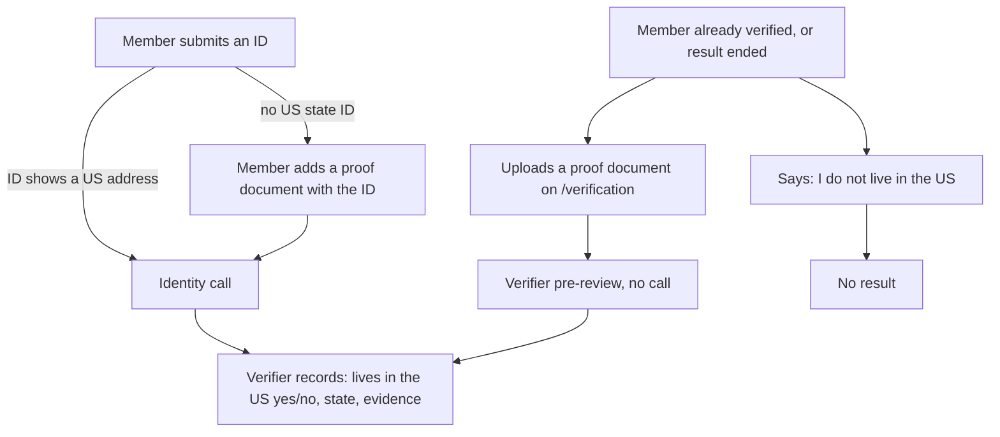

- **On the identity call** (`source: identity_call`). A pass needs a residency result. The pre-reviewer sees the proof document next to the ID image, and "Document OK" seals both. The verifier records the result in the call outcome form. A failed call records no result.
- **Without a call** (`source: document_review`). A member who already passed identity verification uploads a proof document on `/verification`. A verifier takes it on `/identity/residency_checks`, opens it in the secure viewer, and records yes (with the state) or no, or sends it back with a note. Identity is already proven, so there is no call.

### What is stored

`residency_checks` keeps the result (`us_resident`), the US state (`us_state`, only for yes), the evidence type, the source, who decided and the dates. Weave stores no copy of the evidence. The proof document follows the ID image rules (`ResidencyDocumentVault`): Lockbox during pre-review, then sealed to the master public key, re-wrapped at a key rotation, and purged by `PurgeVerificationDocumentsJob` on the ID image windows (a yes counts as a pass, a no or a sent-back document as a close). Break-glass does not open a residency document: after pre-review nobody can read it.

Account deletion purges the document at once and keeps the check without a link, like the verification audit records. The retention sweep deletes it on the same window.

### How long a result stands

- A yes stands for `residency.valid_months` (12) after the decision. `RenewResidencyChecksJob` emails the member `residency.renewal_reminder_days` (30) before it ends, and the member can renew in that window.
- A change of the state or country of the member's shipping address ends a yes at once (`UserAddress`, `ResidencyFlow.address_changed!`). The shipping address is the only address a member keeps in Weave. A move inside the same state keeps the result.
- A no has no time limit. The member can upload a document at any time, for example after a move to the US.
- A new result replaces the old one (`end_reason: replaced`).

### Where apps see it

| Where | Field |
| --- | --- |
| Directory API | `us_resident` (true, false or null) and `us_residency_checked_on` |
| OIDC, scope `residency` | `us_resident` and `us_residency_checked_on`. An admin adds the scope to an app that needs it. |
| `/verification` | The member's status, the state and the end date |
| Admin user page | The status, the state and the end date |

The state never leaves Weave. Krater filters OSPool submissions to members with `us_resident: true`.

### Open values

| Key | Value | State |
| --- | --- | --- |
| `residency.valid_months` | 12 | Decided 2026-10-21 |
| `residency.renewal_reminder_days` | 30 | Default |

## Roles

Jasper locked this design on 2026-10-20. Staff and identity roles are rows in a table, not boolean columns on `users`. The number of roles will grow, and each role has its own grant rule.

- The roles and their rules are in `config/roles.yml`. `RoleRegistry` (`app/services/role_registry.rb`) reads the file. Weave checks the file at boot (`config/initializers/roles.rb`). An unknown key, rule, precondition, required role or scope source stops the boot with `RoleRegistry::ConfigError`.
- The table `roles` has one row for each role in the file (`key`, `name`, `description`, `scopable`, `system`). The migration `MigrateRoleBooleansToUserRoles`, `bin/rails roles:sync` and `Role.fetch!` fill it. Each of them is idempotent. A role that leaves the file keeps its row.
- The table `user_roles` has one row for each assignment: `user_id`, `role_id`, `scope` (empty for a global role), `granted_by_id`, `granted_at`, `reason`, `revoked_at`, `revoked_by_id`, `revoke_reason` and `identity_governance_proposal_id` (the proposal that applied it, if any).
- One person has at most one active assignment of a role and scope. A partial unique index on `(user_id, role_id, COALESCE(scope, ''))` where `revoked_at IS NULL` enforces this.
- Rows are never deleted. A revoke sets `revoked_at`, `revoked_by_id` and `revoke_reason` one time. A trigger refuses every other `UPDATE`, and `DELETE` and `TRUNCATE`. The database empties `user_id`, `granted_by_id` and `revoked_by_id` when the account goes, and the row stays as history.
- The admin tier (`users.role`: user, admin, superadmin, owner) is not a role in this table. It stays a column.

### The roles and their rules

| Role | Key | Scope | Grant | Revoke |
| --- | --- | --- | --- | --- |
| Verifier (the identity team) | `verifier` | none | an owner proposes, a different board member approves. At the approval: verified by another verifier, 18 or older, NDA on record | one owner or identity lead, at once |
| Identity lead | `identity_lead` | none | an owner proposes, a different board member approves. Verified by another verifier | an owner proposes, a different board member approves |
| Key holder | `key_holder` | none | an owner proposes, every board member approves. Verified by another verifier. At most `max_key_holders` (3) | an owner proposes, every board member approves |
| Board member | `board` | none | one owner, at once, for any person (other owners too). Logged and emailed to the board | one owner, at once, for any person. Logged and emailed |
| Staff | `staff` | none | any admin, at once | any admin, at once |
| Contractor | `contractor` | none | any admin, at once | any admin, at once |
| Patch lead | `patch_lead` | a program key from `config/kyc/knot.yml` | an owner proposes, a different board member approves. Verified by another verifier | one owner, at once |

- The identity lead and the key holder need the verifier role first (`requires`). A revoke of the verifier role also revokes them.
- The rules `owner` and `admin` also need the actor to manage the person in the admin panel (`UserAdminPermissions#manage?`): an admin changes only people below them, or themselves. The board role uses `any_owner` instead (locked 2026-10-20): any owner changes the board role of any person, other owners too.
- A new identity lead, key holder or patch lead must be ID-verified by another verifier. Weave checks this at the proposal and again at the approval (`preconditions_at_proposal` and `preconditions_at_approval`).
- A key holder change sends `key_holders_changed.identity` (see "The key holder hook"). A board change logs a governance event and emails the board (see "The board").

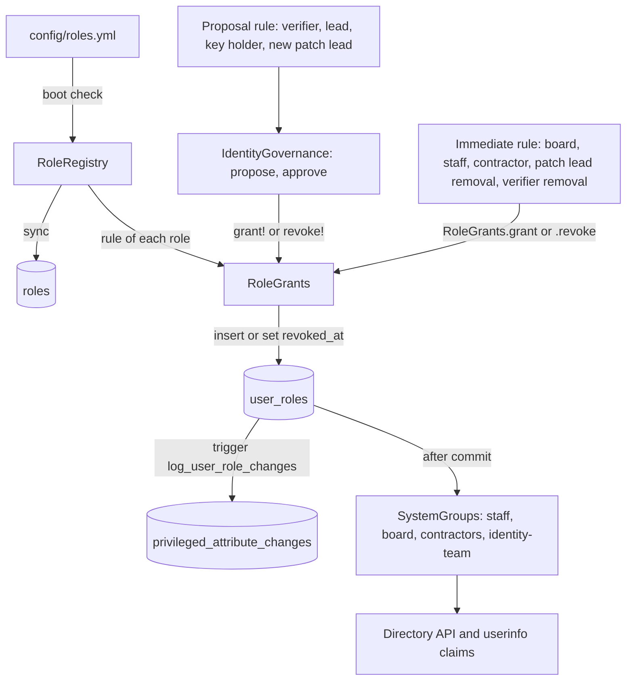

### Where roles change

- A proposal role (verifier, identity lead, key holder, a new patch lead) changes on `/identity/governance`. A patch lead proposal (`add_patch_lead`) names the program.
- Staff and contractor change on `/admin/role_assignments` (the staff and contractors page), or in the roles section of the admin user page (`/admin/users/:id`).
- Board member and the removal of a patch lead change in the roles section of `/admin/users/:id`. Only an owner sees the forms. The roles section is on the user page, not the edit page, because an owner can open the page of another owner but not edit it.
- A verifier is removed with the removal form on `/identity/governance`. `RoleGrants.revoke` sends a verifier removal to `IdentityGovernance.remove_member`.
- The governance page lists each role, its holders (with the scope) and its rules.

### How the code reads roles

The old accessors still work, and read the roles: `user.identity_team`, `user.identity_lead`, `user.identity_key_holder`, `user.is_board`, `user.is_staff`, `user.is_contractor` (each also with `?`), `user.board?`, `user.staff?` and `user.contractor?`. The scopes `User.identity_team`, `User.identity_key_holders` and `User.identity_leads` still work. New scopes: `User.board_members`, `User.staff_members`, `User.contractors` and `User.with_role(key, scope:)`.

- `user.has_role?(key, scope:)` and `user.role_scopes(key)` read the roles of one user. `KnotGrants.patch_lead?(user, program)` reads the patch lead role.
- The roles of a user load in one query and stay cached (`active_user_roles`). For a list of users, use `User.with_roles` (preload), or Bullet reports an N+1.
- The old boolean columns are still in the table, but `User.ignored_columns` hides them. Weave does not read or write them. Never query them with `where(is_board: true)`: the values are old. Use the scopes.
- The compatibility setters (`user.is_board = true`, `user.update!(identity_team: true)`) stage the role and grant or revoke it at the save, with no rule check. They are for the console and the specs, like the old column writes. The app grants roles only through `RoleGrants.grant`, `RoleGrants.revoke` and `IdentityGovernance`.

## Identity team governance

Jasper locked these rules on 2026-10-12. `IdentityGovernance` (`app/services/identity_governance.rb`) holds them. The identity team can open ID images and approve break-glass access, so no one person can change who is on it.

### Who changes what

| Change | Who asks | Who approves | When it applies |
| --- | --- | --- | --- |
| Add a verifier | an owner, with a reason | one board member who is not the proposer and not the candidate | at the approval, if the preconditions are met |
| Make or unmake a lead | an owner, with a reason | one board member who is not the proposer and not the subject | at the approval |
| Add or remove a key holder | an owner, with a reason | every board member at proposal time | after the last approval |
| Remove a member | any one owner or identity team lead, with a reason | nobody | at once |
| Make someone the patch lead of a program | an owner, with a reason and the program | one board member who is not the proposer and not the subject | at the approval |
| Remove a patch lead | any one owner, with a reason | nobody | at once |

- The rule of each change comes from `config/roles.yml` (see "Roles"). A proposal kind is offered only while the rule of its role is a proposal rule (`IdentityGovernance.proposable_kinds`).
- A new lead (`set_lead`), a new key holder (`add_key_holder`) and a new patch lead (`add_patch_lead`) must be verified by another verifier. Weave checks this at the proposal and again at the approval (`preconditions_at_proposal` and `preconditions_at_approval` in `config/roles.yml`).
- Nobody approves their own proposal. Nobody approves a proposal about themselves, except for a key holder change: there every board member must approve, the subject too if they are on the board.
- A key holder change snapshots the board at proposal time (`required_approver_ids`). A person who joins the board later can't approve it. A person who leaves the board can't approve it any more, so the proposal waits until it expires.
- A key holder change needs at least 2 board members (`MINIMUM_BOARD_FOR_KEY_HOLDERS`). With one board member, that person could approve the change alone, so the proposal is refused.
- Approvals of key holder changes and removals take one database lock (`KEY_HOLDER_LOCK`), so two changes at the same time can't go over the limit of key holders.
- A pending proposal expires after `proposal_expiry_days`. `ExpireIdentityGovernanceProposalsJob` marks it every hour. An approval also refuses an expired proposal.
- A board member can reject a proposal with a reason. The proposer or an owner can withdraw it.
- Removal also revokes the key holder and lead roles, and cancels the open proposals about that person. Each board member gets an email (`IdentityGovernanceMailer#member_removed`).
- The approvers of a new proposal get an email (`IdentityGovernanceMailer#approval_needed`).
- When the deletion pipeline deletes the account of an identity team member, `IdentityGovernance.account_deleted!` removes them from the team first. It logs a `member_removed` event, cancels the open proposals about them and tells the board. For a key holder, it sends `key_holders_changed.identity`.

### The board

The board (the `board` role) approves every change to the identity team, so the board itself is protected:

- Only an owner can grant or revoke the board role, in the roles section of `/admin/users/:id` (the `any_owner` rule in `config/roles.yml`). Any owner can change it for any person, other owners too. Other admins see the role but no form. An owner can mark their own account: that adds an approver, and nobody approves their own proposal.
- Each change adds a `board_member_added` or `board_member_removed` event, in the same transaction as the change.
- Every board member before and after the change gets an email (`IdentityGovernanceMailer#board_changed`).

An owner can still change the board and then propose. The log, the emails and the monthly board report make this visible to the other board members.

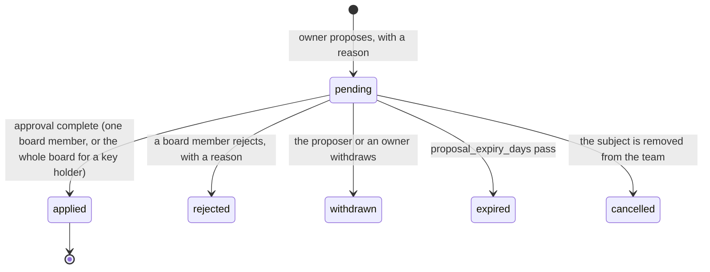

### Preconditions for a verifier

`IdentityGovernance.preconditions` checks these at the approval, and the proposal page shows each one:

1. The candidate is verified: `verification_status` is `verified`, and another person recorded the decision.
2. The candidate is at least `verifier_minimum_age` (18).
3. The candidate has a signed NDA on record.

A proposal can wait for a missing precondition. When the owner records the NDA, a board member can approve the same proposal.

### NDA records

NDAs are signed with Adobe Acrobat Sign. An owner records each signed NDA on the governance page: the date it was signed, the NDA version and the Adobe Acrobat Sign agreement ID (`IdentityNda`). There is no upload, and Weave keeps no copy of the document.

- The rows are append-only. A newer row supersedes an older one (`User#current_identity_nda`).
- The rows stay after the account is deleted. The database empties `user_id`. They are staff records, not member data, so they are not in the data-category registry.

### Verifiers and the admin role

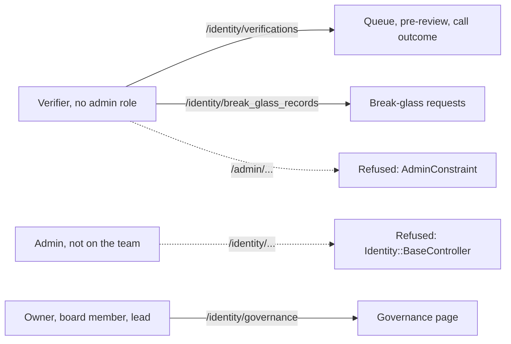

- `Identity::BaseController` lets in only identity team members. It does not ask for the admin role. It also refuses an admin who impersonates someone.
- The governance pages (`/identity/governance`) let in owners, board members and identity team leads. Each action checks its own rule.
- The deletion review (`/admin/deletion_requests`), the Knot pages and the board report stay in the admin panel. A verifier who reviews deletions still needs the admin role.

### The key holder hook

After the commit of every change to the key holder set, Weave sends the `ActiveSupport::Notifications` event `key_holders_changed.identity` (`IdentityGovernance::KEY_HOLDERS_CHANGED`). The payload has `user`, `change` (`:added` or `:removed`), `holder_ids` (the key holders after the change), `proposal` (empty for a removal from the team) and `actor`. Key custody subscribes to it (`config/initializers/key_custody.rb`): the current key set becomes compromised and must be rotated. See "Key custody" below.

### Bootstrap

Nobody is verified when the team starts, so nobody can meet the preconditions. `IdentityGovernance.bootstrap!` (`bin/rails identity:bootstrap`) adds the first verifiers at once. Each must be at least 18 and have an NDA on record. Then they verify each other in a circle, so each one is verified by another person. The bootstrap runs one time only: it refuses after its first run (a `bootstrap_member_added` event exists), and when any member of the identity team is verified. The steps are in `docs/KYC_ROLLOUT.md`.

`VerificationFlow.decide` enforces the circle. A member who joined in the bootstrap and is not verified yet can record a call outcome only for the person after them in the circle (`IdentityGovernance.bootstrap_decision_error`). When they are verified, this limit stops. A member who joined through a proposal was verified before they joined, so the limit does not apply to them.

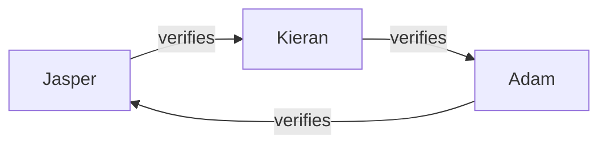

### Audit

- Every step adds an `IdentityGovernanceEvent` row: `proposed`, `approved`, `rejected`, `withdrawn`, `expired`, `cancelled`, `applied`, `member_removed`, `nda_recorded`, `bootstrap_member_added`, `board_member_added`, `board_member_removed`. The rows are append-only.
- PaperTrail records each change to a proposal. Each role row names who granted or revoked it, the reason and the proposal, and the permanent log records each grant and revoke.
- The governance page shows the team, the proposals, the NDA records and the log.
- The monthly board report (`BreakGlassReport`, the page and the email) lists every governance step of the month, every change in the permanent log of the month, and the team as it is now.

### The permanent log

Every grant and revoke of a role, and every change to `users.role`, goes into the table `privileged_attribute_changes`. Postgres triggers write the rows, not the app. Thus a console write, `update_column`, `update_all` and raw SQL are in the log too.

- The trigger `log_user_role_changes` on `user_roles` writes one row for each insert (operation `grant`) and for each update that sets `revoked_at` (operation `revoke`). The row has `role_key`, `role_scope` and `user_role_id`. `attribute_name` is `role:<key>`, or `role:<key>[<scope>]` for a scoped role.
- The trigger `log_privileged_attribute_changes` on `users` writes one row for each change to `role` (the admin tier).
- Before the roles table (2026-10-20), the users trigger also logged `is_board`, `identity_team`, `identity_key_holder` and `identity_lead`. Those rows stay.

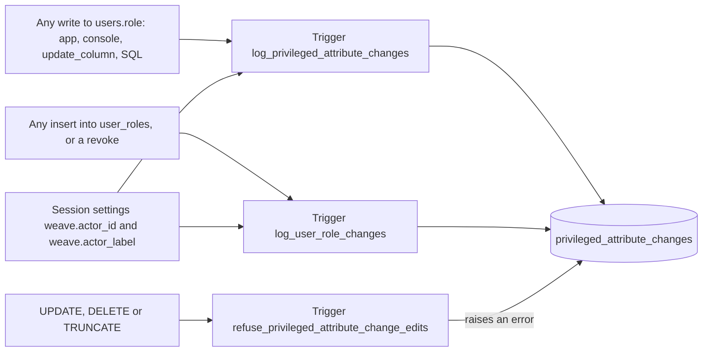

| Column | Meaning |
| --- | --- |
| `user_id` | The person. No foreign key, so the row stays after the account is deleted. |
| `user_p_id` | A copy of the person's p_id at the time of the change. |
| `attribute_name` | `role`, `role:<key>` or `role:<key>[<scope>]`. Older rows also name the four old role columns. |
| `old_value`, `new_value` | The values as text. `role` is the integer of the enum (0 user, 1 admin, 2 superadmin, 3 owner). The pages show the name too. |
| `operation` | `grant` or `revoke` for a role. `update`, or `insert` for a new user with a role above user. |
| `role_key`, `role_scope`, `user_role_id` | For a grant or revoke: the role, its scope and the `user_roles` row. |
| `changed_at` | The time of the transaction. |
| `db_user` | The database role that made the change. |
| `actor_id`, `actor_label` | Who acted, from the session settings `weave.actor_id` and `weave.actor_label`. Empty when nobody set them. |

- The users trigger writes one row for each changed `role`. A write that does not change the value writes no row.
- A second trigger refuses `UPDATE` and `DELETE` on each row, and `TRUNCATE` on the table. The rows are never deleted and never expire. The deletion pipeline and the retention jobs do not touch them. A spec runs the deletion pipeline and the retention jobs and checks that the rows stay.
- `PrivilegedAttributeChange` is a read-only model.
- `PrivilegedChangeActor` sets the actor. `ApplicationController` sets it for each request (the signed-in user, or the admin during an impersonation) and clears it after the request. `IdentityGovernance` and `RoleGrants` set it for each action that has an actor. The data migration sets the label to `migration MigrateRoleBooleansToUserRoles`. `ApplicationJob` sets the label to the job class. A console session sets the label to the Console1984 user name (`config/initializers/console.rb`).
- The governance page shows the newest 50 rows. The monthly board report (the page and the email) lists every row of the month.
- The log is a staff governance record. It is not one of the nine data categories of the member matrix, because it holds rows only for people who had one of these roles or flags. It keeps the p_id of a deleted account on purpose.

#### How fresh databases get the trigger

`db/schema.rb` is in Ruby format, and plain Rails can't dump triggers. Weave uses the `fx` gem: it dumps the functions (`create_function`) and the triggers (`create_trigger`) into `db/schema.rb`. Thus `db:schema:load` (the test database, CI, a fresh database) creates them too. The migration `CreatePrivilegedAttributeChanges` uses `execute` with a down method that drops the triggers, the functions and the table. The migration `CreateRoles` adds the `user_roles` triggers and narrows the users trigger to `role`. If you change the trigger, write a new migration and check that `db/schema.rb` gets the new definition.

### Open values

The values are in `config/kyc/identity_governance.yml`.

| Key | Value | State |
| --- | --- | --- |
| `proposal_expiry_days` | 14 | Locked |
| `verifier_minimum_age` | 18 | Locked |

## Key custody

Jasper locked this design on 2026-10-12. `KeyCustody` (`app/services/key_custody.rb` and `app/services/key_custody/`) holds it. The page is `/identity/key_custody`. Identity team members, owners and board members can open it.

### The design

- There are 3 key holders (Jasper, Kieran and Adam). Any 2 of the 3 open a stored image. The count is `break_glass.max_key_holders` and the threshold is `break_glass.approvals_required`.
- Each holder enrolls 2 hardware keys (YubiKeys): a primary and a backup. Either key opens the holder's share.
- Each ID image is encrypted with a fresh random data key (AES-256-GCM). The data key is sealed to the master public key (X25519, HKDF-SHA256, AES-256-GCM). Sealing needs only the public key, so no key holder takes part in a seal.
- Weave never stores the master private key. It exists only as Shamir shares, one for each holder (`KeyCustodyShare` keeps the x value and a SHA-256 digest of the share, not the share).
- Each share is sealed to a seal public key of each of its holder's hardware keys (`KeyCustodyWrappedShare`, see "Seal keys"). The seal private key comes from the key's WebAuthn PRF output (hmac-secret) through HKDF-SHA256, in the holder's own browser. The PRF output and the seal private key never leave that browser, so Weave can't open a sealed share.
- Every hardware key use needs the key's PIN (WebAuthn user verification, `key_custody.require_user_verification`). A stolen key alone opens nothing.
- All the cryptography on the server uses Ruby's OpenSSL. The browser uses WebCrypto (`app/javascript/key_custody/crypto.js`).
- Hardware keys and passkeys share one WebAuthn relying party (`config/initializers/webauthn.rb`, `Weave.webauthn_origin`). In development the origin is `http://localhost:` plus `PORT` (5000 under foreman's `bin/dev`), or port 3000 when `PORT` is unset. `WEBAUTHN_ORIGIN` overrides it. A key enrolled on one origin does not work on another.

### Shamir's Secret Sharing

The browser splits the master key with the JavaScript library `shamir-secret-sharing` (Privy). Cure53 and Zellic audited it. No Ruby library of the same standard exists. Thus the server side, which only combines shares, is a small port of the same algorithm (`KeyCustody::Shamir`): GF(2^8) with the AES polynomial 0x11b, the same field as the library and HashiCorp Vault, and the same share format (the y bytes, then one x byte).

The risk of the port and how the specs control it:

- The specs check the port against vectors from the library (`spec/fixtures/files/key_custody/shamir_vectors.json`), every 2-of-3 subset, every 3-of-5 subset, the field inverse of each value, and Ruby shares combined by the library.
- A wrong share gives a wrong key, not an error. Weave checks every share against its stored digest before it combines anything. Then it checks the rebuilt key against the stored master public key (`KeyCustody::Unlock`). A wrong key is refused, logged (`unlock_failed`) and reported to the board.
- Ruby gives no constant-time guarantee. The arithmetic has no branch or table lookup on a secret value. The combine runs only at a break-glass unlock or an activation, so an attacker gets few timing samples.

### Seal keys

Each hardware key has a seal key pair. The holder sets it up on their own computer, at enrollment. Enrollment takes one touch where the key and the browser can, and two touches otherwise:

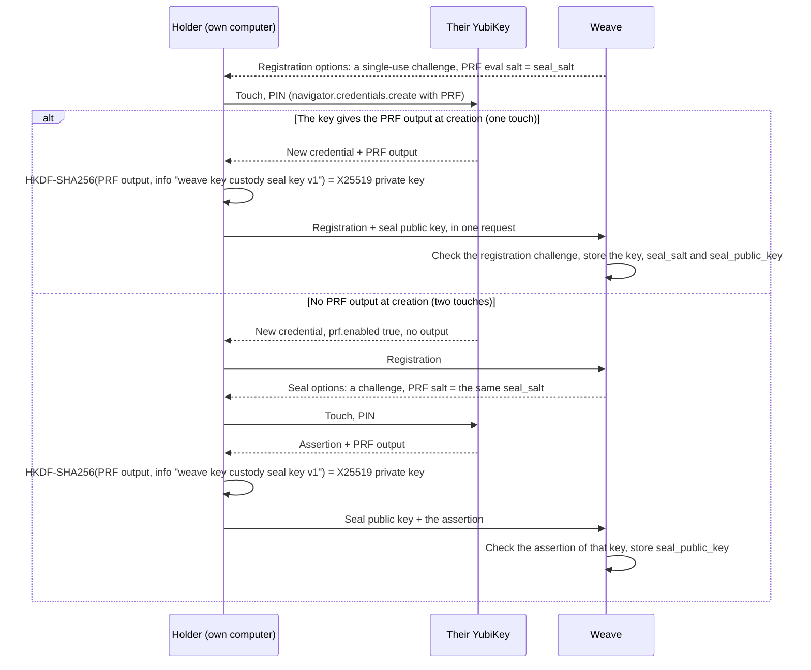

- Weave makes the seal salt before the create step (`KeyCustody::Enrollment.seal_salt_for`, a SHA-256 of the single-use registration challenge) and puts it in the registration options as `extensions.prf.eval.first`. Both paths use this one value, so the seal key is the same in both.
- One touch: a key that evaluates PRF at creation (`hmac-secret-mc`, for example YubiKey firmware 5.8) gives the output at once. The browser derives the seal key pair and sends the seal public key with the registration. The registration challenge is bound to the user, works once and is signed into the attestation, so it is the proof that the key was present.
- Two touches: a key that only has `hmac-secret` (for example YubiKey firmware 5.4), or a browser without PRF at creation, gives no output. Weave stores the key without a seal key and asks for one more touch (`register_seal_key!`).
- A key whose `prf.enabled` is false is refused at once, in the browser and in Weave.
- `IdentityHardwareKey.seal_salt` is different for each key. `seal_public_key` is the only part of the seal key that Weave stores. The private key exists only in the holder's browser, and only while a page needs it.
- `KeyCustody::Enrollment.register_seal_key!` takes the public key only with a fresh assertion of that same key. In both paths, Weave can't check that the public key comes from the PRF output, because only the holder's browser has the PRF output.
- A key with no seal key shows a "Set up the seal key" button. The ceremony refuses to start until each holder has 2 active keys with a seal key.

### The ceremony

The ceremony makes a key set. It runs at the first setup and at each rotation. Each holder has enrolled their 2 keys and set up their seal keys before, on their own computer.

Process rule (locked, 2026-10-13): one holder (the operator) runs each ceremony on a clean computer with no browser extensions. The other two holders watch on a call. Nobody sends a hardware key or brings it to another person's computer. Only the operator's own key touches the ceremony computer, one time.

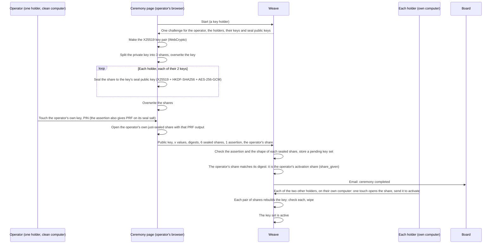

- A sealed share is `version | ephemeral X25519 public key | nonce | ciphertext | tag` (`KeyCustody::Crypto.seal_share`, HKDF info "weave key custody sealed share v1"). Its aad is `KeyCustodyWrappedShare.aad`: the key set's public key, the holder, the credential id and the share x. A sealed share that is moved to another key, holder, key set or x does not open.
- One-touch ceremony: the operator's one assertion asks PRF on the seal salt of the operator's keys. The ceremony page opens the operator's own share from the copy it just sealed to the key that signed, and sends it as `operator_share`. `KeyCustody::Ceremony.complete!` checks it against the operator's digest and gives it as the operator's activation share (`Activation.give_share!`, `via: "ceremony"`). So the operator does not activate a second time. The other holders still activate on their own computers. A key that gives no PRF output sends no share, and the operator activates later like the others. In a rotation, the operator still gives their old share at activation.
- Each holder opens their share at activation, approval and rewrap the same way: one touch with PRF on the key's seal salt gives the seal private key in their browser, which opens every share sealed to that key (also the old share in a rotation).

Where the plaintext master key exists during the ceremony:

- It exists only in the memory of the ceremony page, from the start of the ceremony to its end. The page splits it at once and overwrites it. The shares stay in plain form in the page until the last share is sealed, then the page overwrites them.
- Weave gets only the public key and the sealed shares. The server never sees the private key or a share at the ceremony.
- JavaScript can keep other copies until the page closes (the garbage collector and WebCrypto have their own buffers). Thus the operator uses a clean computer, with no browser extensions, and closes the browser after the ceremony. The other holders watch on a call. The ceremony trust is accepted: the operator's computer sees the master key once.
- The page can't prove to Weave that its shares belong to its public key. So a new key set starts as pending. ALL three holders must activate it (`KeyCustody::Activation`, locked 2026-10-13): each submits their own new share with a hardware key, from their own session. When all three shares wait, Weave checks each share: every pair must rebuild the key that matches the public key. So each share is proven before Weave seals any image to the set. Decryption still needs any 2 of the 3 shares.
- The key custody page shows each holder's activation status ("share given" or "not yet", from `KeyCustody::Activation.waiting_holder_ids`). A holder who gave their share sees "You gave your share" in place of the activate button. Each share that a holder gives for an activation adds a `share_given` row to the key custody log (`KeyCustody::Activation.give_share!`), with the holder, the key set and which share (new or old). The log shows who gave a share and who is still missing. The row holds no share. While a ceremony blocker exists (for example a pending set), the page shows the blocker text in place of the ceremony button.

The log has `ceremony_started`, `ceremony_completed` and `key_set_activated` events, and the board gets an email. An owner or a key holder can discard a pending set with a reason. A discard is a one-person action, so it logs `key_set_discarded` and the board gets an email each time. A hardware key revoke is also a one-person action, and the board gets an email each time.

### A break-glass decryption

```mermaid
sequenceDiagram
  participant R as Requester
  participant K1 as Key holder 1 (browser)
  participant K2 as Key holder 2 (browser)
  participant W as Weave
  participant M as key_custody_pending_shares
  R->>W: Request with a reason
  K1->>W: Approval options (POST)
  W-->>K1: Challenge "weave:break_glass:<request id>:<random>", sealed share, PRF salt (the key's seal salt)
  K1->>K1: Touch the key: PRF gives the seal key, which opens the share; check the digest
  K1->>W: Share + assertion (one request)
  W->>W: Check the assertion, the key, the challenge (once) and the digest
  W->>M: Keep share 1, Lockbox, bound to the request (pending_share_minutes at most)
  K2->>W: Share + assertion
  W->>W: Same checks, row lock on the request
  W->>M: Take share 1 (SELECT FOR UPDATE, delete)
  W->>W: Combine, check the public key, open the data key, decrypt the image
  W->>W: Grant + decryption + notice ladder in one transaction
  W-->>K2: The image, once, in this response
  W->>W: Wipe the shares, the master key and the data key
```

- Approval is the act of submitting the share. A key holder can't approve without their hardware key, and a hardware key can't approve without its holder's share.
- The challenge holds the id of the one request, and it works once (`KeyCustodyChallenge`). A replayed assertion finds its challenge used. When the hardware key keeps a sign count, the count must also go up.
- The key must be an active key of the approver that holds a sealed copy of their share of the image's key set. A key of another holder, a revoked key or a key with no share is refused.
- The share must match the stored digest of the approver's share. A share of another holder, a share of an old key set or random bytes is refused.
- `BreakGlass.may_approve?` still refuses the lead verifier on the member's calls. Weave does not even send them approval options.
- One share never opens anything. A request with one approval stays pending.

What happens to the secrets:

- A share in plain form is never written to the database, a log, the cache, a job or PaperTrail. The request log filters `share`, `credential`, `ciphertext`, `prf` and `wrapped` (`config/initializers/filter_parameter_logging.rb`). At the `debug` log level, Rails writes the raw body of a request whose JSON it can't parse. Keep production at `info` (the default of `RAILS_LOG_LEVEL`).
- The first share waits in the table `key_custody_pending_shares` (`KeyCustodyPendingShare`, `KeyCustody::PendingShares`), so every web process sees it. Weave does not depend on one Puma process. This is safe because one Shamir share alone reveals nothing about the master key. Each row is encrypted with Lockbox (`share_ciphertext`) and bound to its request: the plaintext starts with a digest of the memory key, so a row moved to another request does not open. The row has no PaperTrail, `filter_attributes` hides it in logs, and it is not member data, so it is not in the data-category matrix.
- A waiting share is deleted when the shares are combined, on a deny, and after `pending_share_minutes` (60, locked). `take` and `holder_ids` ignore an expired row, and `SweepPendingSharesJob` deletes expired rows every minute. When a share expires, the approval lapses (`break_glass_approval_lapsed`) and the holder submits again. The page shows who must approve again.
- Two web processes can't both combine the same shares: the approval holds a row lock on the request, and `take` locks the waiting rows (`SELECT ... FOR UPDATE`) and deletes them in the same transaction.
- A spec scans every table, the job queue and PaperTrail for each share. While a share waits, the only column that may hold it is the Lockbox ciphertext of `key_custody_pending_shares`. After the combine, that row is gone too.
- At the grant, Weave counts only the shares of approvers who may still approve. When an approver left the key holders, or became the lead verifier on the member's calls, after they gave their share, their approval lapses (`break_glass_approval_lapsed` with the reason `no_longer_eligible`) and their share is deleted.
- Weave keeps no data key it can open. The second share seals the data key to the requester's browser key (the sealed handoff). The requester's browser decrypts the image and shows it in the secure viewer (a canvas, no object URL, no download).
- The options actions (`approval_options`, `activation_options`, `rewrap_options`) are POST, because each one issues a challenge.
- Weave overwrites the shares, the master key and the data key with zero bytes when it is done (`KeyCustody::Crypto.wipe`). This is best effort. Ruby can keep other copies: the garbage collector can move a string before it is overwritten, OpenSSL has its own buffers, and the request body and the parsed parameters hold the share until the request ends. Weave does not write any of them to disk.

### A lost hardware key

The holder still has the other key:

1. The holder (or an owner) revokes the lost key on `/identity/key_custody`, with a reason. Its sealed share is deleted, so the key can't open a share if somebody finds it. The board gets an email.
2. The holder enrolls a new key. The board gets an email for each new key, so a stolen session that enrolls a key is seen.
3. The holder sets up the seal key of the new key (part of enrollment, on their own computer: in the same touch where the key can, otherwise with a second touch).
4. The holder clicks "Seal my share for this key", on their own computer. One touch of the remaining key opens the share. The browser checks its digest and seals it to the new key's seal public key. It sends the new sealed share and the assertion of the remaining key. The share itself is not sent, and the new key needs no touch for this step.

The log has `hardware_key_enrolled`, `hardware_key_revoked` and `share_rewrapped`, and the board gets an email for each.

### Rotation

A key set must be rotated when a holder lost both keys, or when the key holder set changed. Weave then marks it compromised (`holder_lost_all_keys`, `key_holder_removed` or `key_holder_added`), emails the board and shows a warning on the key custody page and the break-glass page. A compromised set still opens images (the master key is not known to be out), and new images are still sealed to it until the rotation is done.

When a holder has no key left that opens their share of a pending set, that set is also marked compromised, and it can't be activated. A new ceremony replaces it.

The key holder hook: `IdentityGovernance` sends `key_holders_changed.identity` after each change of the key holder set. `KeyCustody.key_holders_changed` marks the current set compromised, and also a pending set, which then can't be activated.

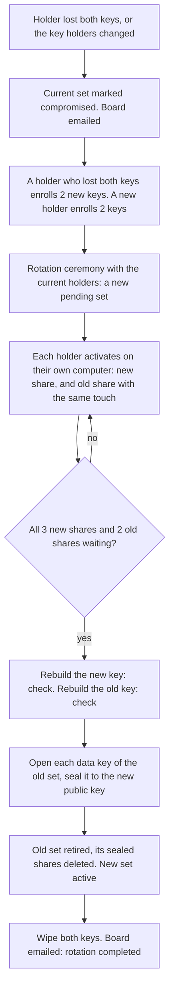

- One touch gives both shares: the key's seal private key opens every share sealed to that key, new and old.
- Every current holder gives their new share. A holder who lost both keys gives only their new share. A removed holder is no longer a key holder, so they can't take part. The other two holders give the old shares.
- The re-wrap, the retirement of the old set and the activation of the new set are one transaction. The rotation locks the old set, and a seal takes a shared lock on the set, so no image is sealed to the old set after the re-wrap has read the list.
- Images live at most 7 days after a pass, so there are few data keys to re-wrap.
- After the rotation, the old shares are useless: their sealed copies are deleted, and their digests belong to a retired set.
- If fewer than 2 holders of the old set remain, the old set can't be opened again. Its images can't be re-wrapped, and they expire with the purge job. This needs a decision (see "Open questions").

### Files

| File | What it does |
| --- | --- |
| `app/services/key_custody.rb` | Current and pending key set, compromise, the governance hook, board emails |
| `app/services/key_custody/shamir.rb` | Combine (and split, for specs) over GF(2^8) |
| `app/services/key_custody/crypto.rb` | X25519 seal, AES-256-GCM, share digests, wipe |
| `app/services/key_custody/assertions.rb` | Challenges and WebAuthn assertion checks (webauthn gem) |
| `app/services/key_custody/pending_shares.rb` | Waiting shares in the database (Lockbox), and the sweep |
| `app/services/key_custody/unlock.rb` | Rebuild a master key for one block, check it, wipe it |
| `app/services/key_custody/enrollment.rb` | Enroll and revoke hardware keys |
| `app/services/key_custody/ceremony.rb` | Start, complete and discard a key set |
| `app/services/key_custody/enrollment.rb` (seal keys) | Register a key's seal public key |
| `app/services/key_custody/activation.rb` | Activate a set, and the rotation re-wrap |
| `app/services/key_custody/recovery.rb` | Seal the share for a new key |
| `app/services/id_document_vault.rb` | Seal, decrypt with an opened data key, re-wrap, purge |
| `app/javascript/key_custody/` and `controllers/key_custody_controller.js` | The browser side: WebAuthn with PRF, seal keys, key pair, split, seal and open shares |
| `app/javascript/key_custody/handoff.js` and `controllers/break_glass_controller.js` | The requester's side of the sealed handoff: the one-time key pair, IndexedDB, open and decrypt |

The specs play the browser with the webauthn gem's fake client. The fake client has no PRF, so `spec/support/key_custody_helpers.rb` stubs it with an HMAC over the salt. `spec/javascript/key_custody_enrollment.test.js` checks the one-touch and two-touch enrollment paths. `spec/javascript/key_custody_crypto.test.js` (`bun test spec/javascript`) checks that the browser code derives the same seal key as Ruby, opens a share that Ruby sealed, and gives the same digests. `spec/services/key_custody/crypto_spec.rb` opens a share that the browser code sealed (a Node 22 vector). Bun 1.2 has no X25519 in WebCrypto, so it skips the X25519 tests: run them in a browser or a newer runtime.

### Open questions

- The pre-review copy is under Lockbox (the server key) until pre-review ends. Somebody with the database and the Lockbox master key can open an image that waits for pre-review. Jasper chose this so the pre-reviewer sees the image before any key holder is involved.
- A waiting share is in the database under Lockbox for at most 60 minutes (locked). One share alone reveals nothing, but a person with the database, the Lockbox master key and a second share (for example a stolen hardware key and its PIN) could rebuild the key in that time.
- When fewer than 2 holders of a compromised set remain, its images can't be re-wrapped. Weave has no "abandon the old set" step yet.

## The Knot

Proposal section 06, "The Knot". The Knot is a one-way fingerprint of a verified person. It identifies nobody, Weave can't reverse it into the identifiers behind it, and it stays after account deletion. It lets deletion be real for honest members and still stops a person from coming back under a new account to get a second grant.

### What a Knot holds

| Table | Holds | Never holds |
| --- | --- | --- |
| `knots` | `user_id` (only while the account is live) and `blacklisted` (yes or no) | a reason, a history, a name, timestamps |
| `knot_hashes` | `kind` and `digest` (a keyed HMAC) | a document number, a name, a birth date |
| `program_grants` | `program` and `granted_at`, keyed to the Knot | an amount, a reason, a user |

The Knot carries exactly two pieces of state: the blacklist flag and the program grants received. There is no return capsule. A returning member starts fresh, and the Knot gives back only the flag and the grants. `Knot` has no paper trail on purpose, because a history of the flag is a history. A spec checks the columns.

### Hashes

`KnotHasher` turns the identifiers that the verifier types at the decision (`VerificationIdentifiers`) into digests:

| Kind | Strength | Input |
| --- | --- | --- |
| `document` | strong | document type + issuing country + document number |
| `national_id` | strong | issuing country + national identity number (only where the country issues one for life) |
| `soft` | soft | normalized legal name + date of birth |

- Each digest is `HMAC-SHA256(pepper, kind + fields)`, never a plain hash. A plain hash of a passport number can be reversed by trying every number.
- The pepper is `knot.pepper` in the credentials of the deployment. Production refuses to pass a verification without it (`KnotHasher::MissingPepper`). Development and test derive a pepper from `Rails.application.key_generator`. **Set the pepper once and never rotate it.** A new pepper orphans every stored digest, and there is no plain value to hash again. Staging has its own credentials, so staging Knots never match production Knots.
- A strong digest belongs to one Knot only (a partial unique index). Many Knots can share a soft digest.

Normalization (tested in `spec/services/knot_hasher_spec.rb`):

| Field | Rule |
| --- | --- |
| Document and national ID numbers | Unicode NFKC (full-width digits become ASCII), upper case, remove each character that is not a letter or a digit |
| Legal name | Unicode NFKD, remove combining marks (diacritics), map the letters NFKD does not split (`ø`, `ł`, `đ`, `æ`, `œ`, `þ`, `ı`, `ħ`), Unicode case folding (`ß` becomes `ss`), make each run of other characters one space, sort the words |
| Date of birth | ISO 8601 |
| Issuing country | upper case |

The name rule makes "Zoë Ångström", "ZOE ANGSTROM" and "Angstrom, Zoe" the same. It does not transliterate: "Иван Петров" and "Ivan Petrov" are different. `ü` becomes `u`, not `ue`.

### Matching at a pass

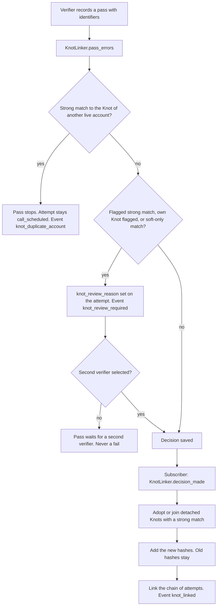

- The member's own live Knot never counts as a match.
- **Strong match** to a detached Knot: the same person. The member gets that Knot back, or it joins the member's Knot. Hashes, grants and the flag carry over, and its attempts link to the same history (`verifications.knot_id`). The per-program caps then apply.
- **Strong match** to the Knot of another live account: one person, one account. The pass stops. The verifier can still fail the call with a written reason. The Knot never fails anyone.
- **Soft-only match**: it routes the pass to manual review with a second verifier. That is all it can do. It never fails, blocks, flags or links. It also never carries a flag over, and the verifier does not learn whether the soft-matched Knot has the flag. A spec proves that a soft-only match can't produce a fail or a block.
- **Flagged match** (a strong match to a blacklisted Knot, or the member's own Knot is blacklisted): the pass needs a second verifier (extra scrutiny).
- The review reason stays on the attempt. Typing other identifiers does not remove it.
- A fail stores nothing. A digital ID pass with no identifiers stores nothing.
- The subscriber runs inside the decision transaction (`config/initializers/knot.rb`). An error rolls back the pass, so a pass never lands without its hashes.

### Accretion

The set grows. When a live member verifies again with a new document, the new hash joins the set and the old one stays. A member's set grows over their time with us. Deletion keeps the set, never the identity behind it.

### Two-key changes

`KnotChanges` handles every change to a Knot. One person asks with a written reason. A second, different person signs off. Nobody signs off their own request or a change to their own Knot.

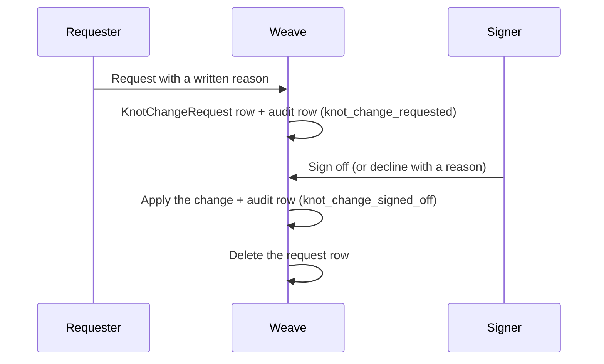

| Change | Requester | Signer |
| --- | --- | --- |
| Set or clear the fraud flag | identity team member | another identity team member |
| Legal name change | identity team member, after a continuity check | another identity team member |
| Grant over the cap | the program's patch lead | a board member (the `board` role) |

- The reason goes into the verification audit record (`VerificationEvent` on `Knot#audit_verification`, the newest decided attempt linked to the Knot), never onto the Knot. A Knot with no audit record left can't change.
- The request row is deleted after the sign-off or the decline, so the Knot keeps no history.
- A signed-off change to the fraud flag (set or clear) is a blacklist review. The member's pass stops standing, and the member needs a new call (see "Re-verification").
- A signed-off Knot name change ends the pass too (`legal_name_changed`), as does a change to `users.legal_first_name` or `users.legal_last_name`. Only a standing pass can end, so one name change fires the trigger once, also when both paths see it.
- A name change keeps only the new digests on the request, never the name. The member shows the new document or the change-of-name record. At the sign-off, the new hashes join the set. The old hashes, the flag and the grants stay.
- The queue is `/admin/knots`. The identity team, board members and patch leads can open it. The Knot page (`/admin/knots/:id`) is for the identity team only.
- Board members and patch leads must also have an admin role, because every `/admin` page needs one.
- When the audit record of a waiting request is destroyed (the retention window), the foreign key deletes the request too.

### Program grants and caps

`KnotGrants` records grants on the Knot and applies the caps in `config/kyc/knot.yml`.

- A grant needs a Knot (a passed verification), no fraud flag, and room under the cap. A cap of `null` means no cap.
- The program's patch lead (the `patch_lead` role scoped to the program, see "Roles") records a grant from the admin user page. An owner can too.
- Only the identity team sees the fraud flag on the admin user page. A patch lead or an owner sees only the eligibility text.
- Over the cap, the patch lead asks for an override with a written reason, and a board member signs it off. An override never lifts the fraud flag.
- Because grants are keyed to the Knot, a member who deletes the account and comes back with the same document has the same grant count.

### Account deletion

The deletion pipeline calls `KnotLinker.write_record_and_detach!(user)` as step 2 of 4, before it severs the identity. The flag and the grants are already on the Knot, so the call drops the requests that need a live member (name change, grant override), empties `user_id` and returns a `KnotLinker::Record` (Knot, flag, grants received) for the deletion receipt. If a user row is deleted without the call, the foreign key empties `user_id` and the Knot stays.

### How long a Knot is kept

A Knot is kept for ever (`keep_years: ~`, locked). It has no expiry, and no job deletes it. The one-grant-for-life cap and the blacklist flag (which never fades) both depend on it. The Knot holds only one-way hashes, the flag and the grants, never a name or a reason.

### Two passes at the same time

The check before a pass and the write of the hashes are two steps. If another account takes the same document between them, the write raises `KnotLinker::DuplicateAccount`. `VerificationFlow.decide` rolls the pass back and returns the duplicate-account error. The attempt stays `call_scheduled`.

### Fraud-evidence hold

`Verification.under_fraud_hold` lists the attempts linked to a blacklisted Knot. A pass links the whole chain of attempts, failed calls too. The deletion part exempts these attempts from the 3-year retention window while the flag stands. When the flag is cleared, the normal window applies.

### Open values

The values are in `config/kyc/knot.yml`.

| Key | Value | State |
| --- | --- | --- |
| `programs.ganymede.grant_cap` | 1 | Locked: one grant per person per program, for life |
| `keep_years` | null (kept for ever) | Locked: a Knot has no expiry |
| The Ganymede patch lead | Adam (`PWL8724F96B89`) in production: a `patch_lead` role scoped to `ganymede`. The old `patch_lead_p_ids` key is gone, and `KnotSettings` refuses it | Locked |
| `knot.pepper` (credentials) | not set | Must be set in production before the first pass |

## Demographics vault

Funders ask for statistics: age bands, gender and similar fields. Members answer these questions themselves, and their answer is the only source of record. No document overwrites an answer. Weave never checks gender against a document. This section covers proposal sections 03 ("Demographics") and 06 ("The demographics vault"), and issue #110.

The rule: nobody can read one member's answers in the app. The only output is aggregate counts with small-count suppression.

### What the member sees

- `/profile/demographics` has the form. Every question needs an answer. There is no "Prefer not to say" option. Records saved before this change can still hold `prefer_not_to_say` or no answer, and reports count them as before.
- A member must answer before their first grant application. Krater reads `demographics_answered` in the directory API and sends the member to `/profile/demographics?return_to=<url>`. After a save, Weave sends the member back to `return_to` only when its origin matches a redirect URI of a registered OAuth app.
- The form has no consent box. The legal basis is the funder reporting obligation of the grant, not consent: consent that a grant depends on is not freely given (GDPR Art. 7(4)). Counsel must confirm this basis and the required gender question before rollout.
- The form always starts empty. Weave cannot show the answers back, not even to the member. The page shows only the date of the last answer.
- To change the answers, the member answers again. The new answers replace the old ones. No version history is kept.
- The member can delete the answers ("withdraw"). Withdrawn answers are not counted anywhere.
- The profile page and the `/slack` onboarding page do not mention the form. The community is not gated on it: only grants are.
- Every page that collects or shows this data links to the public page "What we do with your data" (`Weave.data_page_url`, `https://patchworklabs.org/your-data`).
- An admin who impersonates a member cannot save or delete the member's answers.

### What is stored

| Field | Source | Stored as |
| --- | --- | --- |
| Age band | Member's birthday, when the member saves | Band only, for example `16-17`, inside the envelope |
| Gender identity | Member's choice | Option key inside the envelope |
| Self-description | Member's own words, when the member picks "I describe it differently" | Text inside the envelope. Reports count it only as `self_describe` |
| Other funder fields | `config/demographics.yml` | Option keys inside the envelope |

The questions, the age bands and the small-count threshold are in `config/demographics.yml`. Labels are in `config/locales/demographics.en.yml`. To add a question, add it to both files. No code change is needed.

### How the vault works

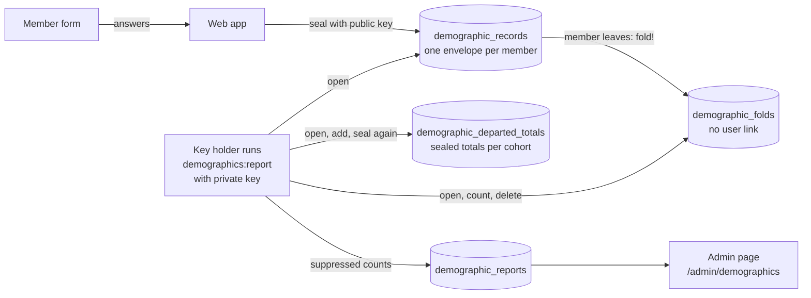

1. The web app seals the answers with a public key (`DemographicsVault::Envelope`): a random AES-256-GCM key encrypts the payload, and RSA-OAEP with SHA-256 wraps that key. The payload is padded to a fixed size, so the size of an envelope says nothing about the answers.
2. The web app has only the public key. It can write an envelope. It cannot open one. There is no read method in `DemographicsVault`.
3. A key holder runs the report (`bin/rails demographics:report`) with the private key. `DemographicsReport` opens the envelopes in memory, counts them, applies suppression, and saves only the counts in `demographic_reports`. Only one run can work at a time (a Postgres advisory lock).
4. The admin page `/admin/demographics` shows only the latest report.

Lockbox is not used for the vault. Lockbox keys are symmetric, so the app that writes a Lockbox field can also read it.

### Small-count suppression

`DemographicsReport.suppress` applies these rules, with the threshold `k` from `config/demographics.yml`:

- A count from 1 to `k - 1` is hidden. It is stored as `nil`, so the small number never reaches the database.
- When a question has exactly one hidden count, the next smallest count is hidden too. Without this rule, the hidden count is the total minus the others.
- When there are fewer than `k` respondents in total, all counts are hidden.
- A zero count is shown.

The admin page shows only the latest report, because two reports side by side can show one member's answer by their difference. Earlier reports stay in `demographic_reports`, and admins can read them through Blazer. The rule lowers the risk on the admin page only.

### Delete-time folding

The deletion pipeline calls `DemographicsVault.fold!(user, cohorts: [...])` before it severs the identity. `fold!`:

1. Moves the member's sealed envelope to `demographic_folds`. That table has no `user_id`, no timestamps, and a random UUID as its id, so the row order does not show the order of deletions.
2. Destroys the member's `demographic_records` row.
3. Returns `DemographicsVault::Fold` with `folded: true`, or `folded: false` when the member had no answers. A second call is safe.

The next reporting run opens the departed totals, adds the bands of each parked envelope for each cohort (for example `2026` or `ganymede-2026`), deletes the parked envelope, and seals the totals again. The totals have no rows per person. Reports show them per cohort with the same suppression.

The departed totals are raw counts, so they are sealed too: one row in `demographic_departed_totals`, sealed with the same key pair and padded to a multiple of 4 KB. Neither the app nor Blazer can read the small counts. If the run cannot open the totals with its key, it stops and changes nothing (`DemographicsReport::DepartedTotalsUnreadable`).

A parked envelope stays in `demographic_folds` until the next reporting run. Run a report soon after deletions, so parked envelopes do not stay for long.

`User#destroy` also calls `fold!` with the current year as the cohort, so any delete path folds before the user row goes. The foreign key cascades too, so no envelope stays linked to a deleted user.

`fold!` does not return the member's bands. The web app and the job worker cannot open the envelope, because they do not have the private key. The proposal asks that aggregates are updated before the link is severed. Here the envelope is detached from the identity before the link is severed, and the bands are counted at the next reporting run. The pipeline must pass the cohorts it wants the member counted in.

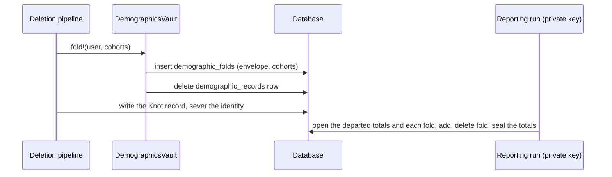

### Keys and the reporting run

The private key must never be in Rails credentials or in the `weave-env` file. Every Weave process reads those: the web container, and the job worker (production also runs Solid Queue inside Puma). That is why the reporting run is a rake task and not a background job.

1. Make a key pair on a trusted machine: `bin/rails demographics:generate_keypair DIR=~/weave-demographics-key`. The task writes `private.pem` (mode 600) and prints the public key.
2. Put the public key in each deployment's credentials as `demographics.public_key`. Staging uses its own key pair.
3. Keep the private key offline with the key holders.
4. To make a report, run the task in a one-off container with the key mounted only for that run, for example `WEAVE_DEMOGRAPHICS_PRIVATE_KEY_FILE=/run/key/private.pem bin/rails demographics:report RUN_BY=<name>`. The task prints only suppressed totals.

Development makes a throwaway key pair in `tmp/demographics-dev/` on first use. Specs make their own key pair in `spec/support/demographics_keys.rb`.

### Threat model

What the design protects against:

- An admin, a superadmin or an owner in the admin panel. No admin page, serializer, API, mailer, export or console helper reads the vault. `spec/security/demographics_vault_guard_spec.rb` fails if one starts to.
- A database dump or a Blazer query. The dump has only ciphertext, a key id, a `user_id` and timestamps.
- A compromise of the web app or the worker that reads the stored data. Those processes do not have the private key.
- Logs. The form parameters are filtered (`demographic` in `filter_parameter_logging.rb`). The models hide `envelope` from `inspect`.

What the design does not protect against. These are real limits:

- **The private key holders.** Anyone with the private key and the database can open every envelope and see one member's answers. The code only counts, but the key does not enforce that. Keep the key offline, give it to few people, and record every run (`run_by`). Treat a use of this key like a break-glass event.
- **A compromised web app at write time.** The web app sees the answers in memory when the member submits the form. An attacker who controls the web app can record new answers as members submit them. Stored answers stay safe.
- **Metadata.** The database shows which members answered and when (`user_id`, `created_at`, `updated_at`). It does not show the answers.
- **Age band.** The age band comes from the birthday, which Weave already stores in plain form for age checks.
- **Small cohorts and differencing.** Suppression lowers the risk but does not remove it. Two reports from different dates can differ by one member, and Blazer can read every earlier report. Two cohorts where one contains the other (for example `2026` and `ganymede-2026`) can differ by one member.
- **Same answer for everyone.** If all respondents in a group give the same answer, the report shows that answer for each of them. Blazer shows who answered (`demographic_records.user_id`). Suppression does not hide this.
- **Staleness.** The age band is fixed when the member saves. A member who answered at 17 stays in `16-17` until they answer again.
- **Key loss.** If the private key is lost, no report can open the stored envelopes. The report counts these as "unreadable". The departed totals are lost too, and the run stops until someone removes the sealed totals row.
- **Key change.** No tool re-seals the stored envelopes or the departed totals with a new key pair yet. Plan a key change before you make one.

### Files

- `app/services/demographics_vault.rb`: the write-only API (`record`, `withdraw!`, `answered_at`, `fold!`).
- `app/services/demographics_vault/envelope.rb`, `reader.rb`: sealing and opening.
- `app/services/demographics_report.rb`: the reporting run and suppression.
- `app/controllers/demographics_controller.rb`, `app/controllers/admin/demographics_controller.rb`.
- `lib/tasks/demographics.rake`: `demographics:report`, `demographics:generate_keypair`.
- `config/demographics.yml`: questions, age bands, threshold, public key.

### Open questions

The small-count threshold `k` is locked at 10 (2026-10-12) in `config/demographics.yml`. The test environment uses 3.

The age bands are locked (2026-10-13): `age_band_starts: [0, 13, 16, 18, 25, 35]`. The bands are under 13, 13-15, 16-17, 18-24, 25-34 and 35+. The split at 18 keeps minors apart. The adult bands follow common census brackets. The vault stores the band as `0-12`, `13-15` and so on. `DemographicsHelper#demographic_age_band_label` shows "Under 13", "13 to 15" and "35 and older" (copy in `config/locales/demographics.en.yml`).

The value below is still a placeholder in `config/demographics.yml`:

- Which other fields funders need. Race, ethnicity and sexual orientation are special category data under GDPR Article 9. Ask counsel before you add one.

## Thread Count (TC)

Thread Count is the internal trust score of a member (proposal section 05). It is a different layer from verification. A high score without verification gives no access.

### Rules

- TC is staff only. The member never sees their own score. TC is never in a member-facing view, an OAuth claim, the directory API, a webhook, or a serializer. `spec/services/thread_count_internal_spec.rb` fails when code outside the staff tools uses TC.
- Admins see the score of a member they can view. Only superadmins and owners see the entries that make the score.
- Nobody sees their own score, staff included. Nobody adds or reverses an entry about their own account.
- There is no column on `users` for TC. The score is computed from the ledger each time, so a serializer can not expose it by accident.

### The ledger

Each trust signal is one row in `thread_count_entries` (`ThreadCount::Entry`). The table is append-only. The app does not change or delete a saved row. To take an entry back, Weave adds a `reversal` row that points to it. The rows go only when the member's account is deleted.

| Kind | Sign | Who records it | Level |
| --- | --- | --- | --- |
| `board_vouch` | + | Board member (staff can record it for them) | none |
| `staff_vouch` | + | Staff or admin | `senior_staff` or `staff` |
| `member_vouch` | + | Member with a score at or above the threshold | none |
| `project_approved` | + | Service API, or staff by hand | none |
| `project_exceptional` | + | Service API, or staff by hand. Added on top of the approval. | none |
| `project_denied` | - | Service API, or staff by hand (only for users below their access level) | none |
| `project_blacklisted` | - | Service API, or staff by hand (only for users below their access level) | none |
| `moderation_case` | - | Staff, only for users below their access level | `minor`, `major`, `severe` |
| `external_signal` | + | Staff (for example GitHub Student) | `github_student`, `other_program` |
| `reversal` | 0 | Superadmin, or the voucher for their own vouch | none |

Each entry has:

- an author: the person who puts their name on it.
- `recorded_by`: the staff member who typed it in, or empty when a service sent it.
- `service`: the service that sent it, for project events.
- a written reason. It is required for every manual entry. Lockbox encrypts it.
- an optional evidence link: a URL (encrypted) or a record (`evidence_type` and `evidence_id`).

### The score

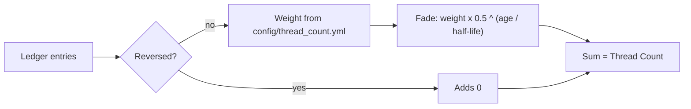

- `ThreadCount.score(user)` adds up the entries. Each entry fades by half after each half-life.
- The weight is not stored on the entry. It comes from `config/thread_count.yml` through the kind and the level. A change to a weight or a half-life applies to all entries, old and new.
- `no_decay_kinds` lists the kinds that never fade. It holds `project_blacklisted`: a blacklist entry keeps its full -40 for ever. Every other kind keeps the 3-year half-life.
- `half_life_days_by_kind` sets a different half-life for one kind. A null value means the entry never fades.
- An entry whose level is removed from the config adds 0, and Weave logs a warning.

### Vouch rules

`ThreadCount::Ledger.vouch` holds the rules.

```mermaid
flowchart TD
  A[Vouch request] --> B{Voucher is the member?}
  B -- yes --> X[Refused]
  B -- no --> C{Tier}
  C -- board --> K[board_vouch]
  C -- senior staff role --> K2[staff_vouch / senior_staff]
  C -- staff or admin --> K3[staff_vouch / staff]
  C -- member --> T{Own score >= threshold?}
  T -- no --> X
  T -- yes --> K4[member_vouch]
  K & K2 & K3 & K4 --> V{Active vouch from this voucher?}
  V -- no --> OK[Entry added]
  V -- yes, renew --> RN[Old vouch reversed, new entry added]
  V -- yes, no renew --> X
```

- The voucher's tier sets the kind and the weight: board, then staff, then member. `senior_staff_roles` in the config can list admin roles for a senior staff tier. It is empty now, so no admin role is senior staff.
- A member can vouch only when their own score is at or above `member_vouch_threshold`.
- Each voucher has one active vouch per member. To renew a vouch that faded, vouch again with "renew". Weave reverses the old vouch and adds a new one.
- A board member or a member with no admin access can not use the admin panel. Staff record the vouch for them ("On behalf of"). The voucher is the author. The staff member is `recorded_by`.
- A voucher with admin access records their own vouch. Weave refuses an "On behalf of" vouch for them, so nobody can use the name and the weight of another admin.
- An advisory lock per member stops two requests from both passing the one-vouch check.

### Project events API

Krater and other services send project review outcomes.

```mermaid
sequenceDiagram
  participant K as Krater
  participant W as Weave
  K->>W: POST /api/v1/thread_count/project_events (X-Api-Key)
  W->>W: Key valid and service name in project_event_services?
  W->>W: ThreadCount::Ledger.record_project_event
  W-->>K: 201 { id, project_ref, kind, created_at }
```

- Auth: the service API key in `X-Api-Key` (`Api::V1::BaseController`). The service name must also be in `project_event_services` in `config/thread_count.yml`. The list is empty in production until an admin names a service.
- Body: `sub` (the member's Weave ID), `project_ref` (the service's own project ID), `outcome` (`approved`, `exceptional`, `denied`, or `blacklisted`), and optional `reason` and `evidence_url`.
- A retry with the same service, `project_ref`, and outcome is recorded once (a unique index).
- `exceptional` records the approval and the extra entry, so it adds more than an approval.
- The response is a receipt only. It never holds the score or a weight.
- The API usage row (`service_key_usages`) for this endpoint does not keep the request body or the response body. The body ties a member to an outcome.

### Logs

`config/initializers/filter_parameter_logging.rb` filters `reason`, `evidence_url`, `voucher` and `outcome`. These values do not go to the Rails log or to an API usage row.

### Staff tools

- The admin user page shows the score and a link to "Open Thread Count" (`/admin/users/:id/thread_count`).
- The Thread Count page has a vouch form, a form to record other entries, and, for superadmins, the table of entries with the weight, the value now, the author, the reason, and a "Reverse" action.
- An admin can withdraw their own vouch from the same page.

### Settings

Jasper locked these values on 2026-10-12. They are in `config/thread_count.yml`. Counsel can change them there: no migration is necessary.

| Setting | Value |
| --- | --- |
| Board vouch | +30 |
| Staff vouch | +15 (no separate senior staff tier: `senior_staff_roles` is empty) |
| Member vouch | +5 |
| Approved project | +10 |
| Exceptional project | +20, on top of the approval |
| Denied project | -5 |
| Blacklisted project | -40 |
| Moderation case | -10 (minor) to -40 (severe). Staff pick the level. The middle level (major, -25) is a placeholder. |
| Half-life | 3 years (1095 days) for every component except blacklist entries |
| No decay | `project_blacklisted` entries never fade (`no_decay_kinds`) |
| Member vouch threshold | 75 |

The external signal weights (`github_student` 5, `other_program` 3) are still placeholders. Thread Count is read by staff only. It gates nothing automatically.

### Known limits

- Blazer (`/admin/blazer`) lets every admin run SQL on the whole database. An admin can read the kinds and the levels in `thread_count_entries` there. The reason and the evidence link are encrypted.
- The retention matrix in the proposal has no row for TC entries. Now they are deleted with the account.

## Data handling, takeout and deletion

Proposal section 06 ("Data handling") and issue #94. Each kind of data has a written answer to three questions: can the member export it, can the member delete it, and if not, which obligation keeps it and for how long.

### The data-category registry

`DataCategories` (`app/services/data_categories.rb`) lists the nine categories of the v0.8 matrix. Takeout and deletion both read it. The member-facing name and the legal basis of each category are in `config/locales/data_handling.en.yml` (`data_categories.<key>`).

| Category | On delete | Exported | Source models | Why / window |
| --- | --- | --- | --- | --- |
| `raw_id_images` | deleted | no | `Verification#id_document` | Purged 7 days after a pass. A stored image goes at once at deletion. |
| `account_profile` | deleted | yes | `User`, `EmailAddress`, `UserAddress`, sessions, magic links, Ahoy rows, group memberships, app grants and roles, OAuth tokens, takeouts, dormancy warnings, TC entries, PaperTrail rows | No obligation. |
| `guardian_contact` | deleted | yes | `GuardianConsent` | Only while a minor takes part. Also deleted when the member turns 18. |
| `demographics` | folded | no | `DemographicRecord` | `DemographicsVault.fold!`, then the sealed record goes. |
| `verification_audit` | retained | yes | `Verification`, `VerificationEvent`, `BreakGlassRecord` | Fraud and compliance. 3 years after deletion, then destroyed. Fraud-evidence hold. |
| `financial` | retained | yes | `GrantDisbursement` | IRS, audit, funder terms. 7 years in full (longer per funder), then anonymized: the person's details go, the dates move to January 1 of their year, and the amount, the program and the year stay. |
| `participation` | folded | yes | `ProgramParticipation` | Bands fold into the delete-time aggregates, then the row goes. |
| `funder_records` | retained | yes | `ProgramParticipation` (funder requires it) | The funder's window, then folded. |
| `knot` | retained | no | `Knot`, `KnotHash`, `ProgramGrant` | One-way hashes, the flag and the grants. Identifies nobody. |

`spec/services/deletion_pipeline_matrix_spec.rb` has one example for each category. It is the acceptance test of the pipeline.

The proposal has no row for Thread Count entries. They are in `account_profile`: deleted with the account and never exported (members never see TC).

### Deletion requests and the human review

```mermaid
stateDiagram-v2
  [*] --> pending_review: member asks, or the dormancy job asks
  pending_review --> approved: identity team, authenticity check passed, note
  pending_review --> rejected: identity team, check failed, reason
  pending_review --> cancelled: member cancels, or a sign-in (dormancy)
  approved --> running: RunDeletionPipelineJob
  running --> completed: all four steps done
  running --> failed: a step raised
  failed --> running: identity team runs it again
  completed --> [*]
```

- The member asks on `/profile/delete`. The member ticks a box and types `DELETE`.
- A human on the identity team reviews every request (`/admin/deletion_requests`). It is an authenticity check, not a judgment call. The reviewer must be on the identity team, have the admin role, not be the member, and outrank the member (`UserAdminPermissions#manage?`).
- The review is due `deletion.review_sla_days` (14) after the request. The deletion is complete by `deletion.complete_within_days` (30). The member page, the admin queue and the admin page show the dates. `DeletionReviewReminderJob` emails the identity team leads each day while a review is overdue.
- After completion the `deletion_requests` row stays as the log of the deletion. It has no `user_id`, the receipt address is emptied after the receipt is sent, and the receipt lists categories, not values. No other row about the member stays: there is no return capsule, no recovery code and no archive row.

### The pipeline

`DeletionPipeline.run!` runs exactly four steps, in this order. Steps 1 to 3 run in one database transaction, so a failure before step 3 ends leaves the identity intact. Step 4 runs after the commit.

```mermaid
sequenceDiagram
  participant J as RunDeletionPipelineJob
  participant P as DeletionPipeline
  participant A as delete_time_aggregates
  participant V as DemographicsVault
  participant K as KnotLinker
  participant DB as Database
  participant M as Member (email)
  J->>P: run!(request)
  Note over P,DB: one transaction
  P->>A: 1. add bands of each participation (not funder-kept rows)
  P->>V: 1. fold!(user, cohorts: year + program-year)
  P->>K: 2. write_record_and_detach!(user)
  P->>DB: 3. purge the ID image, start the audit window
  P->>DB: 3. delete guardian contact, detach funder-kept rows and disbursements
  P->>DB: 3. destroy the user (PaperTrail off), scrub PaperTrail rows
  Note over P,DB: commit
  P->>M: 4. deletion receipt (no Ahoy history)
  P->>DB: forget the receipt address, log the run
```

- Every run is a `DeletionRun` row with each step and its status (`done`, `failed`, `rolled_back`, `done_earlier`) and the first line of the error. The row stays after the account is gone, so it does not keep the next lines: a database error puts row values there.
- Step 3 is real deletion: `user.destroy!`, not a soft delete. It deletes the PaperTrail rows of the user and of the records that belong to them (email addresses, group memberships, sessions, app grants, app roles, guardian consents), and empties `whodunnit` where the user was the author. It also finds the PaperTrail rows of those records that the member deleted earlier (an old email address, a signed-out session) by the account id in the stored object, and deletes them. It deletes the Ahoy events of the user, the receipt address on earlier rejected or cancelled requests, and the takeout files.
- A retry after a failed step 4 sends only the receipt again. The aggregates are not counted twice.
- The receipt email turns off Ahoy history, so the address of a deleted member is not stored in `ahoy_messages`.
- The admin panel has no delete action. An account is deleted only through a deletion request, so every deletion runs the pipeline and sends the receipt.

### Delete-time aggregates

`DeleteTimeAggregates` keeps running totals in `delete_time_aggregates`: one count for each combination of program, year, outcome, age band, region (country of the address) and amount band. The table has no `user_id`, no timestamps and a random UUID id. Demographic bands do not come here: the app can't open the vault, so `DemographicsVault.fold!` parks the envelope for the next reporting run (see "Delete-time folding" above).

Reports (`/admin/delete_time_aggregates`) read the totals through `DemographicsReport.suppress` with the vault's threshold, so both use the same small-count suppression.

Known limit: Blazer can read the raw counts. A new cell with a count of 1 right after a deletion can show that a member left. The counts hold only bands.

### Takeout

```mermaid
flowchart LR
  A[Member: /profile/export] --> B[Takeout.request!]
  B --> C[BuildTakeoutJob]
  C --> D[Takeout.build: every exportable category]
  D --> E[(Encrypted JSON attachment)]
  E --> F[Email: your copy is ready]
  F --> G[Member signs in and downloads]
  E --> H[DataRetention::Sweeps deletes it after takeout.download_days]
```

- One export at a time, and not more often than `takeout.cooldown_hours`.
- Not in the export: demographics (no read path for one member), raw ID images, the Knot, Thread Count. The file lists what is not included and why.
- An admin who impersonates a member can't ask for an export or a deletion.

### Funder profiles

No funder has signed yet. The design covers the usual contract terms now, so the first funder needs only config. Each funder is a profile under `funders` in `config/kyc/data_retention.yml`, and `program_funders` maps each program to a list of funder keys (a program can have more than one funder). `FunderProfiles` reads them.

```yaml
funders:
  example_funder:
    name: Example Foundation               # required
    contract_reference: "Grant 2027-014"   # where the contract is
    financial_keep_years: 10               # disbursements kept in full
    individual_record_years: 3             # individual participation records kept after deletion
    award_ends_on: 2028-06-30              # with post_award_keep_years
    post_award_keep_years: 5
    report_fields: [age_band, gender_identity]
    small_count_threshold: 20
    amount_reporting: bands                # or totals
    report_cadence: quarterly              # monthly, quarterly, annual or end_of_award
    requires_member_consent: true
    eligibility:
      min_age: 13
      max_age: 18
      countries: [US, CA]
program_funders:
  ganymede: [example_funder]
```

| Key | Meaning | Default |
| --- | --- | --- |
| `name` | The funder's name. Required. | none |
| `contract_reference` | Where the contract is (for example the Adobe Sign or Drive reference). | empty |
| `financial_keep_years` | Years a grant disbursement is kept in full. | `financial.keep_years` (7) |
| `individual_record_years` | Years an individual participation record is kept after the account is deleted. Empty: the record folds into the aggregates at deletion. | empty |
| `award_ends_on`, `post_award_keep_years` | A record is kept until the later of its window and `award_ends_on` + `post_award_keep_years`. | empty |
| `report_fields` | The demographic fields the funder may receive, in aggregate only: `age_band` and the questions in `config/demographics.yml`. | none (member counts only) |
| `small_count_threshold` | The funder's threshold. It can only be stricter (higher) than the global `small_count_threshold`, never lower. | the global value (10) |
| `amount_reporting` | `bands` (members per amount band) or `totals` (sums per program and year, never a per-person amount). | `bands` |
| `report_cadence` | `monthly`, `quarterly`, `annual` or `end_of_award`. Recorded for the report schedule. | `annual` |
| `requires_member_consent` | When true, a member counts in the funder's report only with a live `FunderConsent`. | false |
| `eligibility` | `min_age`, `max_age`, `countries`. Recorded and shown on the report only. Weave does not enforce it, because grants stay manual. | empty |

Rules:

- Weave checks the profiles at boot (`config/initializers/funder_profiles.rb`). An unknown key, a bad value, a report field that is not in `config/demographics.yml`, a threshold below the global one, or a program funder with no profile stops the app with an error that names the funder and the key.
- Each `ProgramParticipation` and `GrantDisbursement` keeps its own `funder`. For a program with one funder, the record keeps that funder. For a program with more than one, the record names its funder (`ProgramParticipation.record!(..., funder:)`), or it names none.
- Retention always uses the longest window that applies: the record's own funder, or every funder of its program when it names none (`DataRetention.financial_retention_ends_on`, `DataRetention.individual_record_until`).
- `FunderConsent` (member, funder, `given_at`, `withdrawn_at`) holds the consent. The member gives or withdraws it on the demographics page. The copy is in `config/locales/demographics.en.yml` (`funder_consents`). The rows are account data: deletion removes them, and takeout exports them.

```mermaid
flowchart TD
  P[Funder profile] --> M{requires_member_consent?}
  M -- yes --> C[Live members with a FunderConsent]
  M -- no --> A[Live members of the funder's programs]
  C --> R[FunderReport]
  A --> R
  A --> D[Departed totals and delete-time aggregates]
  D --> R
  R --> F[Only report_fields]
  F --> T[The funder's threshold]
  T --> X[Amounts: bands or totals]
  X --> V[Admin preview: /admin/funder_reports]
```

- `FunderReport.build(funder)` builds the aggregate report. The demographic counts come from the reporting run (`DemographicsReport.generate!` saves each funder's counts under `results["funders"]`), because only that run can open the vault. The delete-time aggregates and the amounts come from the database.
- The members of a funder's report are the live members with a participation that names the funder, or that names no funder in a program whose only funder is this one.
- For a consent funder, departed members and the delete-time aggregates are left out, because their consent can't be shown.
- With `totals`, a sum shows only when at least the threshold number of members got money, so a total can't be one person's amount.
- The admin page `/admin/funder_reports` previews each report. There is no export and no send yet.

### Retention jobs

| Job | When | What |
| --- | --- | --- |
| `DataRetentionJob` | Daily | `DataRetention::Sweeps`: audit records past their window (not under the fraud-evidence hold), financial anonymization, funder records that fold, guardian contact of adults, expired takeouts. |
| `DormancyJob` | Daily | Warnings 60 and 7 days before the 5-year cutoff. Then a dormancy deletion request, through the same human review. |
| `DeletionReviewReminderJob` | Daily | Emails the identity team leads about overdue reviews. |

The fraud-evidence hold: an attempt linked to a blacklisted Knot stays while the flag stands. When a two-key sign-off clears the flag, the normal 3-year window applies at the next run.

Dormancy: the clock starts at `User#last_active_at` (the newest session activity, or the sign-up). Any sign-in resets it: old warnings stop counting and an open dormancy request is cancelled. The request is made only after the last warning went out at least 7 days before.

### "What we do with your data"

Every place that collects or handles this data links to `Weave.data_page_url`: the site-wide footer (`shared/_data_footer`, in every layout and on the home page), sign-up, the profile page, verification, the demographics form, the guardian consent step and page, the takeout and deletion pages, and every email (the mailer layout). `spec/requests/data_page_links_spec.rb` and `spec/mailers/data_handling_mailer_spec.rb` check each one.

### Open values

The values are in `config/kyc/data_retention.yml`.

| Key | Value | State |
| --- | --- | --- |
| `deletion.review_sla_days` | 14 | Locked |
| `deletion.complete_within_days` | 30 | Locked |
| `dormancy.inactive_years` | 5 | Locked |
| `dormancy.warning_days_before` | 60, 7 | Locked |
| `verification_audit.keep_years_after_deletion` | 3 | Locked |
| `financial.keep_years` | 7 | Locked (longer per funder) |
| `guardian_contact_until_age` | 18 | Locked |
| `takeout.download_days` | 7 | Locked |
| `takeout.cooldown_hours` | 24 | Locked |
| `amount_band_starts` | 0, 1, 100, 250, 500, 1000, 2500, 5000: $0 (stored as `none`), $1-99, $100-249, $250-499, $500-999, $1,000-2,499, $2,500-4,999, $5,000+ | Locked |
| `funders`, `program_funders` | empty | No funder has signed. See "Funder profiles" and the checklist in `docs/KYC_ROLLOUT.md`. |

### Known gaps

- `GrantDisbursement` and `ProgramParticipation` have no admin screens yet. `KnotGrants.record` writes a participation row. Finance records disbursements in code until a screen exists.
- `GuardianConsent::KEEP_AFTER_ACCOUNT_DELETION` (1 year) still applies to accounts deleted outside the pipeline. The pipeline deletes the guardian contact at once, as the matrix says.
- Deletion does not remove the member from the Slack workspace.
