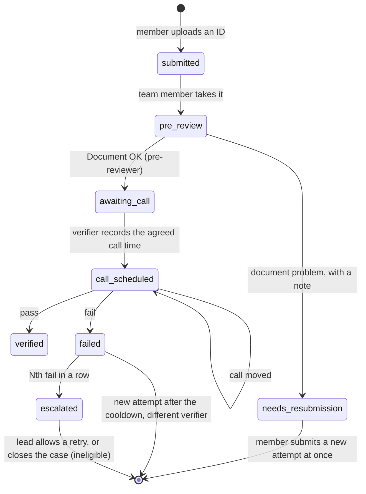
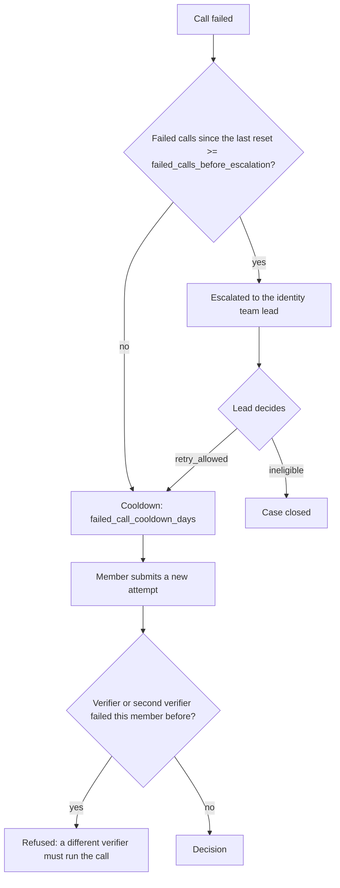
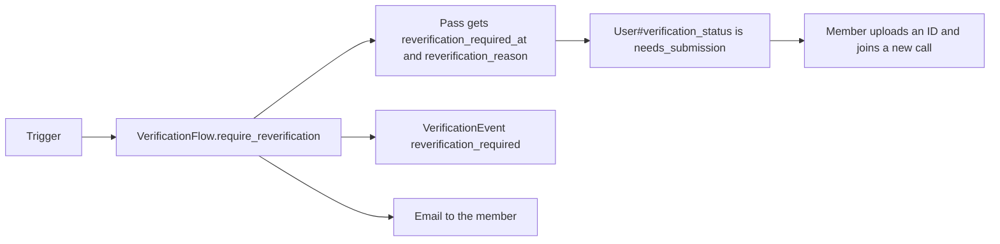
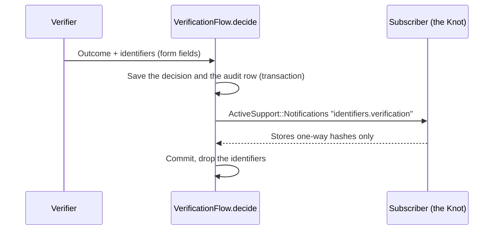
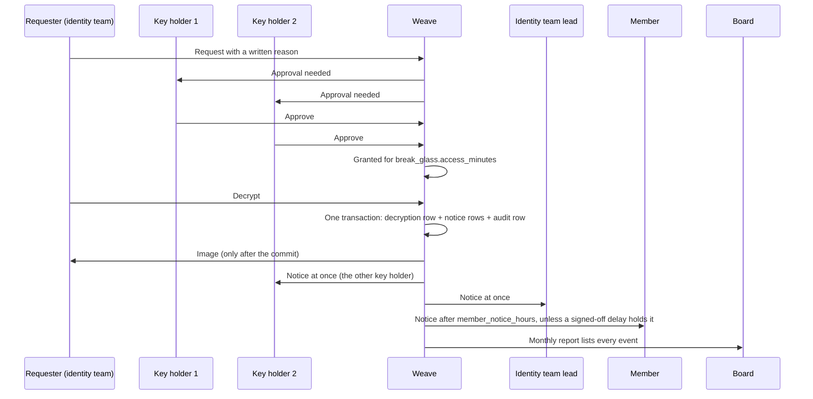
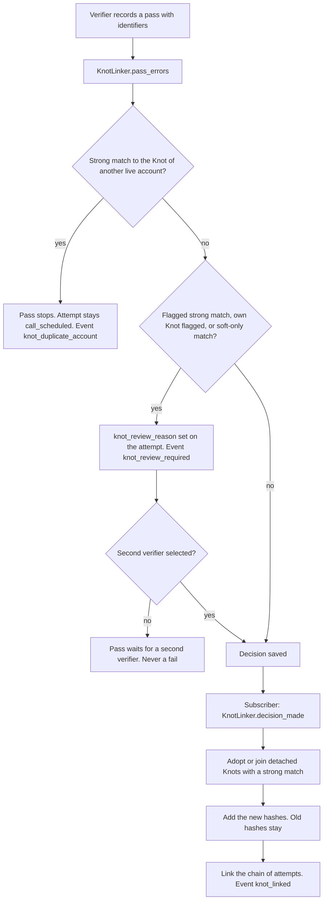
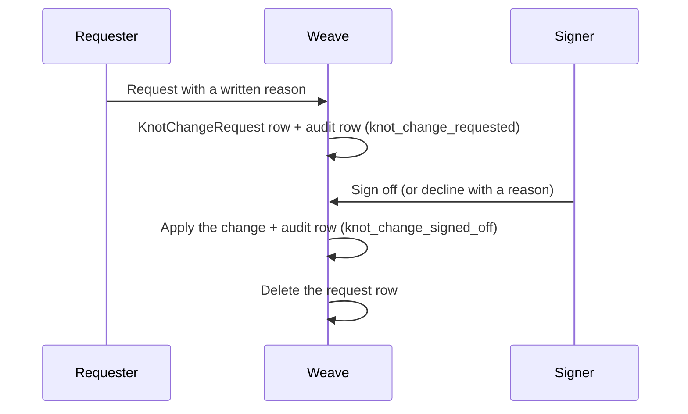
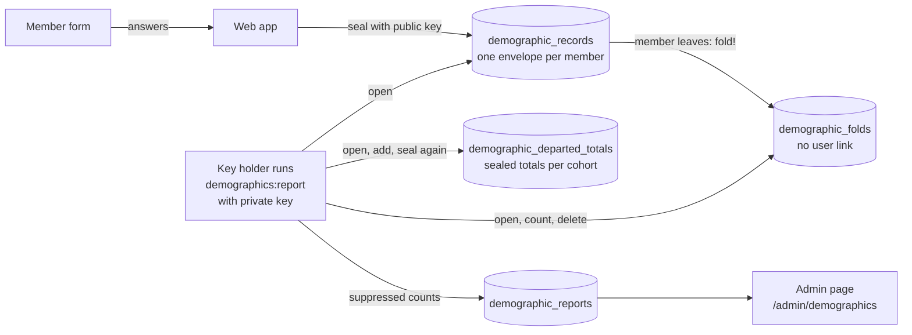
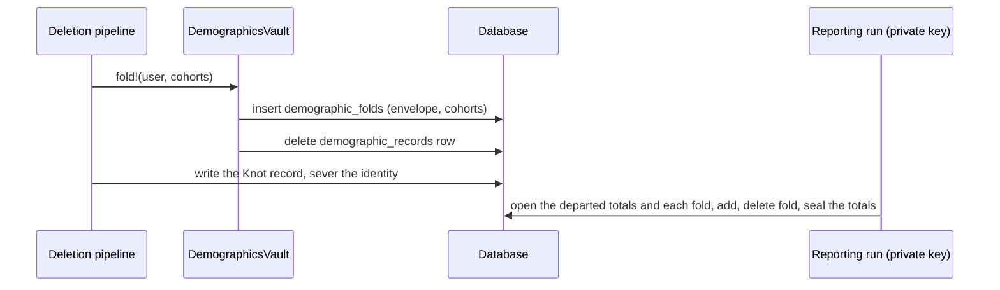

# KYC

Weave runs identity verification and trust for Patchwork Labs programs. The design is the internal proposal "Identity, verification, and trust" (draft v0.8). This file has one section for each part of the build.

Identity verification gates program resources only: compute, servers and grant money. The community and the Slack invite are not gated by KYC.

Every page that collects or handles identity data links to the public page "What we do with your data". Read the URL through `Weave.data_page_url` (`lib/weave.rb`). Do not write the URL in a view.

## Verification

Layer 1 of the proposal (section 03). It answers three questions: is this a real person, how old and where, and is it the same person who signed. The flow is the same for everyone, staff included. Nobody verifies their own account.

### The identity team

The identity team is a flag on the user, not a role rank:

| Column | Meaning |
| --- | --- |
| `users.identity_team` | Runs verification: pre-review, calls, break-glass requests. |
| `users.identity_key_holder` | Approves break-glass access to stored ID images. At most `break_glass.max_key_holders` (3) people. Any 2 of them approve a request. |
| `users.identity_lead` | Gets every break-glass notice and resolves escalations. |

- `SystemGroups` mirrors `identity_team` into the `identity-team` system group, so access rules and apps can ask "is the user in group X?" like the other built-in groups.
- The identity team pages live in the admin panel (`/admin/verifications`). A team member also needs the admin role to reach them.
- Only an owner changes these flags (`Admin::UserIdentityTeamController`), and never on their own account. PaperTrail records each change.

### The flow

- `Verification` is one row per attempt. `previous_attempt_id` links each attempt to the one before it, so the history reads as one chain.
- `VerificationFlow` holds the steps. Each step adds a `VerificationEvent`.
- Scheduling is manual. The pre-reviewer ends pre-review with "Document OK" (`VerificationFlow.approve_document`, event `document_approved`). After that, nobody can see the image in pre-review. The attempt waits in `awaiting_call`, and the member gets an email that says the team will contact them. A verifier agrees a time with the member by email or Slack. Then the verifier records the time as a separate step (`VerificationFlow.schedule_call`). This step does not touch the image. "Send back" (`reject_document`) still works during pre-review.
- Hand-over: any other identity team member can click "Take over pre-review" on an attempt in pre-review (`VerificationFlow.take_over_pre_review`). They become the pre-reviewer. The `pre_review_taken_over` event logs the old and the new pre-reviewer. Only the current pre-reviewer can see the image and mark "Document OK".
- `verification_method` is `document_call` (an ID image, then a live call) or `digital_id_call` (a digital ID, then a live call). See "Digital ID" below.
- The member page is `/verification`. The profile page links to it.
- The member gets an email at each step (`VerificationMailer#status_changed`). The text is in `config/locales/verification.en.yml`.

### The audit record

`VerificationEvent` rows are append-only. A row is read-only after it is created, and the app can't delete one. The foreign key to `verifications` has no cascade, so a verification can't be deleted while its audit rows exist.

The `decided` event holds:

- who attended: the member, the verifier, an optional second verifier, and whether a guardian attended (and which guardian consent);
- the document type (type only), the method, the outcome, and the written reason;
- the age and region consistency attestation.

The decision columns on `Verification` can't change after the decision.

The call is never recorded. There is no video or recording column. The record is the written attestation of the verifier.

### Retry rules

- Nobody who failed a member, as the verifier or the second verifier, can verify that member again (`VerificationFlow.excluded_verifier_ids`).
- A key holder may run or join a call. All three key holders are also verifiers, so the only limit is in break-glass: the lead verifier on a member's calls can't approve that member's request.
- A lead's `retry_allowed` resets the count of failed calls.

### Status

`User#verification_status` is derived from the attempts each time. It is never stored.

| Status | When |
| --- | --- |
| `needs_submission` | No attempt, or the last attempt needs a new document or failed, or a trigger ended the last pass (see "Re-verification"). |
| `pending` | An attempt is in progress, or a failed attempt waits for the lead. |
| `verified` | The last attempt passed, and no trigger ended the pass. |
| `ineligible` | The lead closed the case. |

Apps read it as:

- the `verification_status` field in the directory API (`DirectoryUserSerializer`);
- the `verification_status` claim, with the `verification` scope (`config/initializers/doorkeeper_openid_connect.rb`).

Neither holds a value from the ID.

### Re-verification

A pass has no time limit. Weave has no expiry job and no expiry value in config. Only these triggers end a pass:

| Trigger | Reason | Where it fires |
| --- | --- | --- |
| The birthday changes | `birthday_changed` | `User` `after_update` callback, for every change (member, admin, console). |
| The legal name changes | `legal_name_changed` | `User` `after_update` callback on `legal_first_name` or `legal_last_name`, and `KnotChanges.sign_off` of a Knot name change. |
| A blacklist review | `blacklist_review` | `KnotChanges.sign_off`, when a two-key change to the blacklist flag (set or clear) is applied. A declined request is not a trigger. |

- The attempt stays `verified`, because the call did pass. `Verification#standing_pass?` is false after a trigger.
- `Verification::REVERIFICATION_REASONS` holds the only reasons. An unknown reason raises an error.
- Only a standing pass can end. A second trigger on the same pass does nothing.
- The member page and the email give the reason. The text is in `config/locales/verification.en.yml`.
- Apps see `needs_submission` until the member passes a new call.

### The app gate

An app opts in with `oauth_applications.requires_verification` (off by default). A superadmin changes it on the app page. `AppAccess` then refuses members who are not `verified`, at every place that hands out or honors a token. Opting in starts `RevokeLostAppAccessJob`. Use it only for apps that give program resources.

### Pass rules

A pass needs all of these:

- a written reason;
- a yes for age consistency and a yes for region consistency;
- for a member under 18, a granted guardian consent (`User#guardian_consent_missing?` is false);
- for a member under 18, a parent or guardian on the call. The verifier ticks "A parent or guardian attended" in the outcome form (`guardian_attended`). A minor can't pass without it. A minor can still fail without a guardian. "Under 18" is `User#minor?`, the same rule as guardian consent;
- for a document call, the identifiers for the Knot (see below);
- for a document call, a legal name and a date of birth that match the account (see "Name and birthday match").

### Name and birthday match

The verifier types the legal name and the date of birth from the ID. The form does not show the account values. On a pass, `VerificationFlow.account_mismatches` compares them with the account:

- The name must match `User#legal_full_name` (the preferred name when the account has no legal name) after `KnotHasher.normalize_name`. Case, accents, punctuation and word order do not count.
- The date of birth must match `users.birthday` exactly.

A mismatch blocks the pass. The form shows again with what the verifier typed and says which field differs (the name, the birthday or both). It never shows the account value. The verifier can correct the entry, or fail the call with "Failed: details don't match the account" (`details_mismatch`). A fail is always allowed: this fail needs no attestation, and its reason starts with `VerificationFlow::DETAILS_MISMATCH_REASON`. The `decided` event records `details_mismatch`.

Weave keeps document and national ID numbers only as one-way hashes for the fraud check (the Knot). It does not store the typed name or birth date.

### Age and region consistency

The verifier answers yes or no: the self-reported age, and the self-reported region, do not contradict the ID. No value from the ID is written down. Gender is never checked. An age mismatch can't pass: the verifier fails the call, or the member fixes their birthday first.

### Identifiers for the Knot

The Knot (see "The Knot" below) needs the document type, issuing country, document number, national identity number (where present), legal name and date of birth. Weave never stores these values.

- `VerificationIdentifiers` is a value object. `#inspect` hides the values. The request log filters the fields (`config/initializers/filter_parameter_logging.rb`).
- The event fires inside the transaction of the decision. A subscriber that raises rolls back the decision.
- A subscriber must store only one-way hashes.

### The ID image and break-glass

The image is an Active Storage attachment encrypted with Lockbox (`encrypts_attached :id_document`).

- **Pre-review.** Only the pre-reviewer can open the image, only while the attempt is in pre-review. Each view adds a `document_viewed` event before Weave decrypts the image. The board report counts these views.
- **Any other decryption** needs break-glass (`BreakGlass`, issue #92):

- Break-glass is only for an attempt that passed, failed or was escalated: a fraud review, an appeal or a blacklist check (`BreakGlass.request_blocker`). Before the decision (submitted, pre-review, waiting for the call time, call set), the page does not show the button, and Weave refuses a request with the reason.
- Two different key holders must approve. The requester can be a key holder.
- The lead verifier on a member's calls (the one who recorded a decision) can't approve or deny a break-glass request for that member, and gets no approval email for it (`BreakGlass.may_approve?`). A second verifier is not excluded.
- Only the requester can decrypt, and only until the grant expires. Each decryption is a `BreakGlassDecryption` row.
- Quiet use is not possible. `BreakGlass.decrypt!` writes the decryption and its `BreakGlassNotice` rows in one transaction. It reads the image only after the commit. `DeliverBreakGlassNoticesJob` sends each notice when it is due. It runs after each decryption and every 15 minutes, so a lost enqueue does not lose a notice.
- An identity team member can ask to delay the member notice for an active fraud investigation. A reason is required. The delay holds the notice only after an owner or an identity team lead signs it off. The person who asked for the delay, the person who asked for the access and the member can never sign it off (`BreakGlass.may_sign_off_delay?`). It holds the notice for at most `break_glass.max_fraud_delay_days` after the notice was first due. Then the notice goes out, also when nobody lifts the delay. The lead gets an email, and the board report lists every delayed notice.
- The board report is the admin page `/admin/break_glass_report` (identity team and board members) and a monthly email to each board member (`BreakGlassBoardReportJob`).
- The key holders approve with a signed-in click. Hardware keys are not built yet.

### Upload conversion

`IdDocumentConverter` turns each upload into the one image Weave keeps. It runs at upload, in memory, before anything is stored or sealed, so only the converted image is ever stored (and later sealed).

| Upload | Stored as |
| --- | --- |
| JPEG | JPEG, re-encoded |
| PNG | PNG, re-encoded |
| HEIC or HEIF | JPEG |
| PDF | PNG of the FIRST page only |

- The type comes from the file's bytes (Marcel), not from its name or the browser's content type. Any other type (for example WebP) is refused. A file that fails to convert is refused. The member sees one clear message (`verification.errors.document_unsupported`) and nothing is stored.
- Every output is re-encoded without metadata: no EXIF, no GPS, no XMP, no ICC profile, and no PDF title or author. The EXIF orientation is applied to the pixels first, so the image stays upright.
- The size limit (`max_image_megabytes`) applies to the upload. An image that decodes to more than 50 megapixels is refused.
- HEIC decodes in libvips with libheif and its HEVC decoder plugin. A PDF page is rendered by poppler's `pdftoppm` in a child process, from stdin to stdout, with a 20-second timeout. Active Storage blocks the untrusted libvips loaders (`Vips.block_untrusted`), and the PDF loader is one of them, so Weave does not turn it back on in the web process.
- The Docker image needs `poppler-utils` and `libheif-plugin-libde265` (see the Dockerfile).
- The specs use small fixtures in `spec/fixtures/files`. The HEIC spec skips where libvips can't decode HEIC, and the PDF specs skip where `pdftoppm` is not installed.

### The ID image viewer

Every view of an ID image uses the same secure viewer: the pre-reviewer's view and the break-glass view (`app/javascript/lib/secure_viewer.js`, `secure-image` Stimulus controller, `shared/_secure_image_viewer` partial).

- There is no raw image URL. The old `GET .../document` routes are removed. The viewer script sends a `POST .../image`. The answer is JSON with the bytes in Base64, and only the viewer reads it. The access checks and the log rows are the same as before.
- The answer has `Cache-Control: no-store` (Rails drops the weaker `no-cache`), `Pragma: no-cache` and `Content-Disposition: attachment`, so no cache keeps it and a browser never shows it as an image. The request also sends `Cache-Control: no-store, no-cache` and `Pragma: no-cache`.
- The image is drawn in a `<canvas>` in the page. There is no ``, no new tab, no "Save image" and no drag.
- Right-click, drag, select and copy are blocked on the viewer. A print stylesheet hides it.
- A watermark is tiled across the image: the viewer's name, the viewer's p_id, the UTC time of the view (from the server) and the public id of the verification or the break-glass request.
- The image blurs when the page is hidden or the window loses focus. It unblurs on focus.
- A browser that can't decode the file type (for example a PDF) shows an error, not the file.
- Nothing stops a screenshot or a phone camera. The watermark makes a copy traceable to the viewer.

### Purging images

`PurgeVerificationDocumentsJob` runs every day. The verification and its audit rows stay.

| Attempt | Image purged |
| --- | --- |
| Passed | `purge_image_days_after_pass` after the decision |
| Document problem or failed call | `purge_image_days_after_close` after it closed, not while an escalation is open |
| Account deleted | At the next run |

### Digital ID

`DigitalIdProvider` is the interface for a digital ID path, for example the EU digital identity wallet. No provider exists yet, so members can't choose the path. A provider implements `start` and `result`. `result` gives a `VerificationIdentifiers`, which goes to the same hook as a document call.

### Open values

The values are in `config/kyc/verification.yml`. Values marked `LOCKED` were decided on 2026-10-12. Values marked `PLACEHOLDER` are not decided yet. Counsel can change any value there: no code change is necessary.

| Key | Value | State |
| --- | --- | --- |
| `failed_call_cooldown_days` | 14 | Locked |
| `failed_calls_before_escalation` | 2 | Locked |
| `purge_image_days_after_pass` | 7 | Locked |
| `purge_image_days_after_close` | 30 | Locked |
| `break_glass.access_minutes` | 30 | Placeholder |
| `break_glass.member_notice_hours` | 72 | Locked |
| `break_glass.max_fraud_delay_days` | 30 | Locked |

The retention window for verification audit records is part of the retention question in the proposal. The deletion part sets it.

## The Knot

Proposal section 06, "The Knot". The Knot is a one-way fingerprint of a verified person. It identifies nobody, Weave can't reverse it into the identifiers behind it, and it stays after account deletion. It lets deletion be real for honest members and still stops a person from coming back under a new account to get a second grant.

### What a Knot holds

| Table | Holds | Never holds |
| --- | --- | --- |
| `knots` | `user_id` (only while the account is live) and `blacklisted` (yes or no) | a reason, a history, a name, timestamps |
| `knot_hashes` | `kind` and `digest` (a keyed HMAC) | a document number, a name, a birth date |
| `program_grants` | `program` and `granted_at`, keyed to the Knot | an amount, a reason, a user |

The Knot carries exactly two pieces of state: the blacklist flag and the program grants received. There is no return capsule. A returning member starts fresh, and the Knot gives back only the flag and the grants. `Knot` has no paper trail on purpose, because a history of the flag is a history. A spec checks the columns.

### Hashes

`KnotHasher` turns the identifiers that the verifier types at the decision (`VerificationIdentifiers`) into digests:

| Kind | Strength | Input |
| --- | --- | --- |
| `document` | strong | document type + issuing country + document number |
| `national_id` | strong | issuing country + national identity number (only where the country issues one for life) |
| `soft` | soft | normalized legal name + date of birth |

- Each digest is `HMAC-SHA256(pepper, kind + fields)`, never a plain hash. A plain hash of a passport number can be reversed by trying every number.
- The pepper is `knot.pepper` in the credentials of the deployment. Production refuses to pass a verification without it (`KnotHasher::MissingPepper`). Development and test derive a pepper from `Rails.application.key_generator`. **Set the pepper once and never rotate it.** A new pepper orphans every stored digest, and there is no plain value to hash again. Staging has its own credentials, so staging Knots never match production Knots.
- A strong digest belongs to one Knot only (a partial unique index). Many Knots can share a soft digest.

Normalization (tested in `spec/services/knot_hasher_spec.rb`):

| Field | Rule |
| --- | --- |
| Document and national ID numbers | Unicode NFKC (full-width digits become ASCII), upper case, remove each character that is not a letter or a digit |
| Legal name | Unicode NFKD, remove combining marks (diacritics), map the letters NFKD does not split (`ø`, `ł`, `đ`, `æ`, `œ`, `þ`, `ı`, `ħ`), Unicode case folding (`ß` becomes `ss`), make each run of other characters one space, sort the words |
| Date of birth | ISO 8601 |
| Issuing country | upper case |

The name rule makes "Zoë Ångström", "ZOE ANGSTROM" and "Angstrom, Zoe" the same. It does not transliterate: "Иван Петров" and "Ivan Petrov" are different. `ü` becomes `u`, not `ue`.

### Matching at a pass

- The member's own live Knot never counts as a match.
- **Strong match** to a detached Knot: the same person. The member gets that Knot back, or it joins the member's Knot. Hashes, grants and the flag carry over, and its attempts link to the same history (`verifications.knot_id`). The per-program caps then apply.
- **Strong match** to the Knot of another live account: one person, one account. The pass stops. The verifier can still fail the call with a written reason. The Knot never fails anyone.
- **Soft-only match**: it routes the pass to manual review with a second verifier. That is all it can do. It never fails, blocks, flags or links. It also never carries a flag over, and the verifier does not learn whether the soft-matched Knot has the flag. A spec proves that a soft-only match can't produce a fail or a block.
- **Flagged match** (a strong match to a blacklisted Knot, or the member's own Knot is blacklisted): the pass needs a second verifier (extra scrutiny).
- The review reason stays on the attempt. Typing other identifiers does not remove it.
- A fail stores nothing. A digital ID pass with no identifiers stores nothing.
- The subscriber runs inside the decision transaction (`config/initializers/knot.rb`). An error rolls back the pass, so a pass never lands without its hashes.

### Accretion

The set grows. When a live member verifies again with a new document, the new hash joins the set and the old one stays. A member's set grows over their time with us. Deletion keeps the set, never the identity behind it.

### Two-key changes

`KnotChanges` handles every change to a Knot. One person asks with a written reason. A second, different person signs off. Nobody signs off their own request or a change to their own Knot.

| Change | Requester | Signer |
| --- | --- | --- |
| Set or clear the fraud flag | identity team member | another identity team member |
| Legal name change | identity team member, after a continuity check | another identity team member |
| Grant over the cap | the program's patch lead | a board member (`is_board`) |

- The reason goes into the verification audit record (`VerificationEvent` on `Knot#audit_verification`, the newest decided attempt linked to the Knot), never onto the Knot. A Knot with no audit record left can't change.
- The request row is deleted after the sign-off or the decline, so the Knot keeps no history.
- A signed-off change to the fraud flag (set or clear) is a blacklist review. The member's pass stops standing, and the member needs a new call (see "Re-verification").
- A signed-off Knot name change ends the pass too (`legal_name_changed`), as does a change to `users.legal_first_name` or `users.legal_last_name`. Only a standing pass can end, so one name change fires the trigger once, also when both paths see it.
- A name change keeps only the new digests on the request, never the name. The member shows the new document or the change-of-name record. At the sign-off, the new hashes join the set. The old hashes, the flag and the grants stay.
- The queue is `/admin/knots`. The identity team, board members and patch leads can open it. The Knot page (`/admin/knots/:id`) is for the identity team only.
- Board members and patch leads must also have an admin role, because every `/admin` page needs one.
- When the audit record of a waiting request is destroyed (the retention window), the foreign key deletes the request too.

### Program grants and caps

`KnotGrants` records grants on the Knot and applies the caps in `config/kyc/knot.yml`.

- A grant needs a Knot (a passed verification), no fraud flag, and room under the cap. A cap of `null` means no cap.
- The program's patch lead records a grant from the admin user page. An owner can too.
- Only the identity team sees the fraud flag on the admin user page. A patch lead or an owner sees only the eligibility text.
- Over the cap, the patch lead asks for an override with a written reason, and a board member signs it off. An override never lifts the fraud flag.
- Because grants are keyed to the Knot, a member who deletes the account and comes back with the same document has the same grant count.

### Account deletion

The deletion pipeline calls `KnotLinker.write_record_and_detach!(user)` as step 2 of 4, before it severs the identity. The flag and the grants are already on the Knot, so the call drops the requests that need a live member (name change, grant override), empties `user_id` and returns a `KnotLinker::Record` (Knot, flag, grants received) for the deletion receipt. If a user row is deleted without the call, the foreign key empties `user_id` and the Knot stays.

### How long a Knot is kept

A Knot is kept for ever (`keep_years: ~`, locked). It has no expiry, and no job deletes it. The one-grant-for-life cap and the blacklist flag (which never fades) both depend on it. The Knot holds only one-way hashes, the flag and the grants, never a name or a reason.

### Two passes at the same time

The check before a pass and the write of the hashes are two steps. If another account takes the same document between them, the write raises `KnotLinker::DuplicateAccount`. `VerificationFlow.decide` rolls the pass back and returns the duplicate-account error. The attempt stays `call_scheduled`.

### Fraud-evidence hold

`Verification.under_fraud_hold` lists the attempts linked to a blacklisted Knot. A pass links the whole chain of attempts, failed calls too. The deletion part exempts these attempts from the 3-year retention window while the flag stands. When the flag is cleared, the normal window applies.

### Open values

The values are in `config/kyc/knot.yml`.

| Key | Value | State |
| --- | --- | --- |
| `programs.ganymede.grant_cap` | 1 | Locked: one grant per person per program, for life |
| `keep_years` | null (kept for ever) | Locked: a Knot has no expiry |
| `programs.ganymede.patch_lead_p_ids` | `["PWL8724F96B89"]` (Adam) in `production`, empty elsewhere | Locked |
| `knot.pepper` (credentials) | not set | Must be set in production before the first pass |

## Demographics vault

Funders ask for statistics: age bands, gender and similar fields. Members answer these questions themselves, and their answer is the only source of record. No document overwrites an answer. Weave never checks gender against a document. This section covers proposal sections 03 ("Demographics") and 06 ("The demographics vault"), and issue #110.

The rule: nobody can read one member's answers in the app. The only output is aggregate counts with small-count suppression.

### What the member sees

- `/profile/demographics` has the form. Every question is optional, and every question has "Prefer not to say". The member must tick a consent box each time they save.
- The form always starts empty. Weave cannot show the answers back, not even to the member. The page shows only the date of the last answer.
- To change the answers, the member answers again. The new answers replace the old ones. No version history is kept.
- The member can delete the answers ("withdraw"). Withdrawn answers are not counted anywhere.
- The profile page and the `/slack` onboarding page show an optional invitation to the form. It never blocks a step: the community is not gated on it.
- Every page that collects or shows this data links to the public page "What we do with your data" (`Weave.data_page_url`, `https://patchworklabs.org/your-data`).
- An admin who impersonates a member cannot save or delete the member's answers.

### What is stored

| Field | Source | Stored as |
| --- | --- | --- |
| Age band | Member's birthday, when the member saves | Band only, for example `16-17`, inside the envelope |
| Gender identity | Member's choice | Option key inside the envelope |
| Self-description | Member's own words, when the member picks "I describe it differently" | Text inside the envelope. Reports count it only as `self_describe` |
| Other funder fields | `config/demographics.yml` | Option keys inside the envelope |

The questions, the age bands and the small-count threshold are in `config/demographics.yml`. Labels are in `config/locales/demographics.en.yml`. To add a question, add it to both files. No code change is needed.

### How the vault works

1. The web app seals the answers with a public key (`DemographicsVault::Envelope`): a random AES-256-GCM key encrypts the payload, and RSA-OAEP with SHA-256 wraps that key. The payload is padded to a fixed size, so the size of an envelope says nothing about the answers.
2. The web app has only the public key. It can write an envelope. It cannot open one. There is no read method in `DemographicsVault`.
3. A key holder runs the report (`bin/rails demographics:report`) with the private key. `DemographicsReport` opens the envelopes in memory, counts them, applies suppression, and saves only the counts in `demographic_reports`. Only one run can work at a time (a Postgres advisory lock).
4. The admin page `/admin/demographics` shows only the latest report.

Lockbox is not used for the vault. Lockbox keys are symmetric, so the app that writes a Lockbox field can also read it.

### Small-count suppression

`DemographicsReport.suppress` applies these rules, with the threshold `k` from `config/demographics.yml`:

- A count from 1 to `k - 1` is hidden. It is stored as `nil`, so the small number never reaches the database.
- When a question has exactly one hidden count, the next smallest count is hidden too. Without this rule, the hidden count is the total minus the others.
- When there are fewer than `k` respondents in total, all counts are hidden.
- A zero count is shown.

The admin page shows only the latest report, because two reports side by side can show one member's answer by their difference. Earlier reports stay in `demographic_reports`, and admins can read them through Blazer. The rule lowers the risk on the admin page only.

### Delete-time folding

The deletion pipeline calls `DemographicsVault.fold!(user, cohorts: [...])` before it severs the identity. `fold!`:

1. Moves the member's sealed envelope to `demographic_folds`. That table has no `user_id`, no timestamps, and a random UUID as its id, so the row order does not show the order of deletions.
2. Destroys the member's `demographic_records` row.
3. Returns `DemographicsVault::Fold` with `folded: true`, or `folded: false` when the member had no answers. A second call is safe.

The next reporting run opens the departed totals, adds the bands of each parked envelope for each cohort (for example `2026` or `ganymede-2026`), deletes the parked envelope, and seals the totals again. The totals have no rows per person. Reports show them per cohort with the same suppression.

The departed totals are raw counts, so they are sealed too: one row in `demographic_departed_totals`, sealed with the same key pair and padded to a multiple of 4 KB. Neither the app nor Blazer can read the small counts. If the run cannot open the totals with its key, it stops and changes nothing (`DemographicsReport::DepartedTotalsUnreadable`).

A parked envelope stays in `demographic_folds` until the next reporting run. Run a report soon after deletions, so parked envelopes do not stay for long.

`User#destroy` also calls `fold!` with the current year as the cohort, so any delete path folds before the user row goes. The foreign key cascades too, so no envelope stays linked to a deleted user.

`fold!` does not return the member's bands. The web app and the job worker cannot open the envelope, because they do not have the private key. The proposal asks that aggregates are updated before the link is severed. Here the envelope is detached from the identity before the link is severed, and the bands are counted at the next reporting run. The pipeline must pass the cohorts it wants the member counted in.

### Keys and the reporting run

The private key must never be in Rails credentials or in the `weave-env` file. Every Weave process reads those: the web container, and the job worker (production also runs Solid Queue inside Puma). That is why the reporting run is a rake task and not a background job.

1. Make a key pair on a trusted machine: `bin/rails demographics:generate_keypair DIR=~/weave-demographics-key`. The task writes `private.pem` (mode 600) and prints the public key.
2. Put the public key in each deployment's credentials as `demographics.public_key`. Staging uses its own key pair.
3. Keep the private key offline with the key holders.
4. To make a report, run the task in a one-off container with the key mounted only for that run, for example `WEAVE_DEMOGRAPHICS_PRIVATE_KEY_FILE=/run/key/private.pem bin/rails demographics:report RUN_BY=<name>`. The task prints only suppressed totals.

Development makes a throwaway key pair in `tmp/demographics-dev/` on first use. Specs make their own key pair in `spec/support/demographics_keys.rb`.

### Threat model

What the design protects against:

- An admin, a superadmin or an owner in the admin panel. No admin page, serializer, API, mailer, export or console helper reads the vault. `spec/security/demographics_vault_guard_spec.rb` fails if one starts to.
- A database dump or a Blazer query. The dump has only ciphertext, a key id, a `user_id` and timestamps.
- A compromise of the web app or the worker that reads the stored data. Those processes do not have the private key.
- Logs. The form parameters are filtered (`demographic` in `filter_parameter_logging.rb`). The models hide `envelope` from `inspect`.

What the design does not protect against. These are real limits:

- **The private key holders.** Anyone with the private key and the database can open every envelope and see one member's answers. The code only counts, but the key does not enforce that. Keep the key offline, give it to few people, and record every run (`run_by`). Treat a use of this key like a break-glass event.
- **A compromised web app at write time.** The web app sees the answers in memory when the member submits the form. An attacker who controls the web app can record new answers as members submit them. Stored answers stay safe.
- **Metadata.** The database shows which members answered and when (`user_id`, `created_at`, `updated_at`). It does not show the answers.
- **Age band.** The age band comes from the birthday, which Weave already stores in plain form for age checks.
- **Small cohorts and differencing.** Suppression lowers the risk but does not remove it. Two reports from different dates can differ by one member, and Blazer can read every earlier report. Two cohorts where one contains the other (for example `2026` and `ganymede-2026`) can differ by one member.
- **Same answer for everyone.** If all respondents in a group give the same answer, the report shows that answer for each of them. Blazer shows who answered (`demographic_records.user_id`). Suppression does not hide this.
- **Staleness.** The age band is fixed when the member saves. A member who answered at 17 stays in `16-17` until they answer again.
- **Key loss.** If the private key is lost, no report can open the stored envelopes. The report counts these as "unreadable". The departed totals are lost too, and the run stops until someone removes the sealed totals row.
- **Key change.** No tool re-seals the stored envelopes or the departed totals with a new key pair yet. Plan a key change before you make one.

### Files

- `app/services/demographics_vault.rb`: the write-only API (`record`, `withdraw!`, `answered_at`, `fold!`).
- `app/services/demographics_vault/envelope.rb`, `reader.rb`: sealing and opening.
- `app/services/demographics_report.rb`: the reporting run and suppression.
- `app/controllers/demographics_controller.rb`, `app/controllers/admin/demographics_controller.rb`.
- `lib/tasks/demographics.rake`: `demographics:report`, `demographics:generate_keypair`.
- `config/demographics.yml`: questions, age bands, threshold, public key.

### Open questions

The small-count threshold `k` is locked at 10 (2026-10-12) in `config/demographics.yml`. The test environment uses 3.

The age bands are locked (2026-10-13): `age_band_starts: [0, 13, 16, 18, 25, 35]`. The bands are under 13, 13-15, 16-17, 18-24, 25-34 and 35+. The split at 18 keeps minors apart. The adult bands follow common census brackets. The vault stores the band as `0-12`, `13-15` and so on. `DemographicsHelper#demographic_age_band_label` shows "Under 13", "13 to 15" and "35 and older" (copy in `config/locales/demographics.en.yml`).

The value below is still a placeholder in `config/demographics.yml`:

- Which other fields funders need. Race, ethnicity and sexual orientation are special category data under GDPR Article 9. Ask counsel before you add one.
