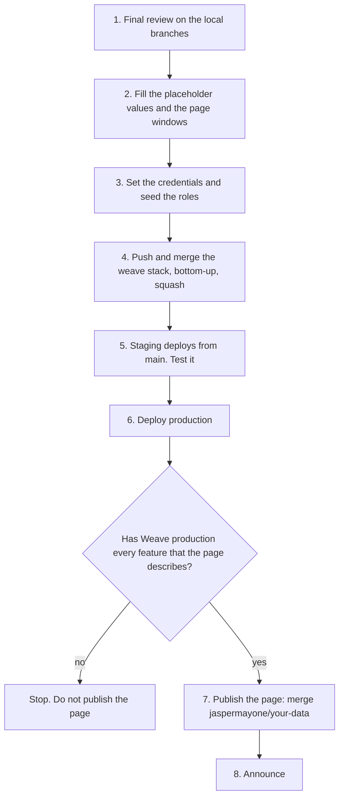
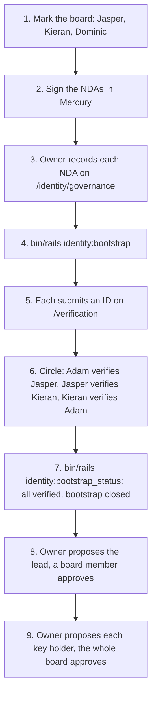
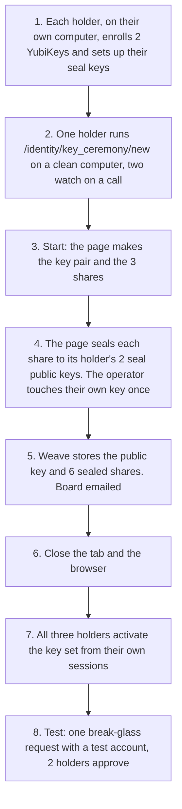

# KYC rollout

This document gives the rollout order for the KYC work: verification, the Knot, the demographics vault, Thread Count and the deletion pipeline. It also lists each value that a person must decide before rollout. The design is in `docs/KYC.md`.

## The work is secret until rollout

The KYC work is secret until rollout day. The `weave` repo and the `patchworklabs.org` repo are public. Thus the first push of any KYC branch to GitHub is the reveal.

- Do not push a KYC branch before rollout day. This includes a draft PR, a fork, a gist and a CI run.
- Do not open an issue or a comment that names the work.
- Do all review on the local branches.
- On rollout day, do the steps below in one session, in this order.

The local branches, from bottom to top:

| Order | Repo | Branch | Part |
| --- | --- | --- | --- |
| 1 | weave | `jaspermayone/97-kyc-verification` | Verification, break-glass, image purge |
| 2 | weave | `jaspermayone/kyc-knot` | The Knot hash set and program grants |
| 3 | weave | `jaspermayone/110-kyc-demographics` | The demographics vault |
| 4 | weave | `jaspermayone/kyc-thread-count` | Thread Count |
| 5 | weave | `jaspermayone/94-kyc-deletion` | Retention, takeout, deletion pipeline, dormancy |
| 6 | weave | `jaspermayone/kyc-identity-governance` | Identity team governance, the identity area, the bootstrap |
| 7 | weave | `jaspermayone/kyc-key-custody` | Key custody: hardware keys, the split master key, sealed images, rotation |
| 8 | patchworklabs.org | `jaspermayone/your-data` | The page https://patchworklabs.org/your-data |

## The order



### 1. Final review on the local branches

- Read each branch diff against its parent. Do not push to get a review.
- Run the full suite on the top branch with a private database:

  ```bash
  export DATABASE_URL=postgres://localhost/weave_kyc_rollout_test RAILS_ENV=test
  bin/rails db:drop db:create db:schema:load
  bundle exec rspec
  bin/rails test test/models/user_test.rb
  bin/rails zeitwerk:check
  ```

- Preview the page locally (`npm run dev` in the `patchworklabs.org` worktree, then open http://localhost:3000/your-data).

### 2. Fill the placeholder values and the page windows

Each value below is marked `PLACEHOLDER` in its file, or shows as a bracketed marker on the page. Decide each value, then change it on the lowest branch that owns the file and rebase the branches above.

**Weave config**

| File | Key | Now | Owner branch |
| --- | --- | --- | --- |
| `config/demographics.yml` | `fields` (other funder fields) | only `gender_identity`. Ask counsel first for GDPR Article 9 data. | demographics |
| `config/thread_count.yml` | `moderation_case_weights.major` | -25 (the locked range is -10 to -40) | thread-count |
| `config/thread_count.yml` | `external_signal_weights` | `github_student` 5, `other_program` 3 | thread-count |
| `config/thread_count.yml` | `project_event_services` | `[]` (add the real service, for example Krater) | thread-count |

These are locked now and need no decision: `purge_image_days_after_close` (30), `programs.ganymede.patch_lead_p_ids` (Adam, `PWL8724F96B89`, in production), the Knot is kept for ever, `age_band_starts` (`[0, 13, 16, 18, 25, 35]`), `takeout.download_days` (7), `takeout.cooldown_hours` (24), `key_custody.pending_share_minutes` (60) and `amount_band_starts` (`[0, 1, 100, 250, 500, 1000, 2500, 5000]`). `funders` and `program_funders` stay empty until a funder signs: see "When the first funder signs" below.

**Page markers** (`patchworklabs.org`, branch `jaspermayone/your-data`)

A Vercel production build fails while a marker is on the page. To list them: `grep -rn "<Placeholder" src`.

| Marker | Where | Depends on |
| --- | --- | --- |
| `[DATE: rollout day]` | `src/app/your-data/page.tsx` | The rollout date |

Also change the "Last updated" date on `src/app/privacy/page.tsx`, because the guardian retention text changed.

#### When the first funder signs

Funders are a long way off. When the first one signs, add it with config only:

1. Read the contract with counsel. Write down: the retention terms, the award end date, the fields the funder asks for, the reporting cadence, any consent term and any eligibility term.
2. Ask counsel before you add a new demographic field. Race, ethnicity and sexual orientation are special category data under GDPR Article 9.
3. If the funder needs a new field, add it to `config/demographics.yml` and its labels to `config/locales/demographics.en.yml` first (demographics branch or `main`).
4. Add the profile under `funders` in `config/kyc/data_retention.yml` (see `docs/KYC.md`, "Funder profiles"), in the `production` section or in `shared`. Set `name` and `contract_reference`, then only the keys the contract needs.
5. Add the funder to the list of each program it funds under `program_funders`. When a program gets a second funder, new records must name their funder (`ProgramParticipation.record!(..., funder:)`).
6. Boot the app (`bin/rails runner 'p FunderProfiles.all.map(&:key)'`). A typo stops the boot with the funder and the key in the error.
7. If `requires_member_consent` is true, check the consent copy in `config/locales/demographics.en.yml` (`funder_consents`) with counsel, and tell the members.
8. Run `bin/rails demographics:report`, then open `/admin/funder_reports/<key>` and check the preview: only the agreed fields, the funder's threshold, the amount setting and the consent rule.
9. Update the page "What we do with your data" if the funder's terms change a retention window that the page shows.

### 3. Set the credentials and seed the roles

Do these steps before the first verification pass in production. Secrets go in agenix in the infra repo, or in the Rails credentials. Never put a secret in this repo.

- Set `knot.pepper` in the production and staging credentials. Never rotate it. Without it, each pass fails with `KnotHasher::MissingPepper`.
- Generate the demographics key pairs. Put each public key in the production and staging credentials (`demographics.public_key`). Keep each private key off the server. Add a one-off unit that mounts the private key only for a report run.
- Restart the containers after a secret change. A container reads its env file only at start.
- Seed the roles and bootstrap the identity team. See "Seed the roles and bootstrap the identity team" below.
- Run the key ceremony. See "The key ceremony" below.

Key custody adds no secret to the credentials or to agenix. The master private key is never on the server, so there is no key file to mount and no credential to rotate. These are no longer needed for stored ID images:

- a server-side key that opens sealed images (the Lockbox key opens an image only while it waits for pre-review);
- a break-glass "approve" button with no hardware key (an approval is now a hardware key touch with the holder's share);
- a copy of the master private key in any password manager or safe. Do not make one: the 3 shares, each on 2 hardware keys, are the only copies.

The Lockbox master key (`lockbox.master_key`) is still needed for the pre-review copy, for a share that waits for the second share (at most 60 minutes), and for the other encrypted fields. The WebAuthn relying party is the public host (`Weave.url`), so no setting is needed for it. On staging, the relying party is the staging host, so staging needs its own ceremony with test keys.

#### Seed the roles and bootstrap the identity team

Do these steps in production after the deploy (step 6) and before the first member submits an ID. Do them on staging first, with test accounts.

Nobody is verified on day one, so nobody can meet the verifier preconditions (verified by another person, 18 or older, signed NDA). The bootstrap adds the first three verifiers at once. They then verify each other in a circle. The bootstrap runs one time only. It refuses to run a second time, and it refuses to run after any member of the identity team is verified.



The production p_ids of the people below (production values only; staging and development have other IDs):

| Person | Production p_id | Board | Identity team and key holder |
| --- | --- | --- | --- |
| Jasper | `PWL7A1CE1F3CB` | yes | yes |
| Kieran (krn) | `PWL0667B785FD` | yes | yes |
| Dominic | `PWL908148D41E` | yes | no |
| Adam | `PWL8724F96B89` | no | yes (also the Ganymede patch lead) |

1. An owner marks the board members (`is_board`) on `/admin/users/:id/edit`: Jasper (`PWL7A1CE1F3CB`), Kieran (`PWL0667B785FD`) and Dominic (`PWL908148D41E`). Adam (`PWL8724F96B89`) is not on the board. Only an owner can change this box. Each change is logged and emailed to the board. The board group drives the governance approvals, so do this first. A key holder change needs at least 2 board members.
2. Jasper (`PWL7A1CE1F3CB`), Kieran (`PWL0667B785FD`) and Adam (`PWL8724F96B89`) sign the NDA in Mercury.
3. An owner opens `/identity/governance` and records each signed NDA: the date, the NDA version and the Mercury reference. Do not upload the document.
4. Run the bootstrap in a one-off container, with the members in circle order:

   ```bash
   bin/rails identity:bootstrap BY=<owner email> MEMBERS=<jasper email>,<kieran email>,<adam email>
   ```

   The task adds the three to the identity team and prints the circle. Each person's verifier is the person before them in the list, and the first person's verifier is the last person:

   | Member | Verifier |
   | --- | --- |
   | Jasper (`PWL7A1CE1F3CB`) | Adam (`PWL8724F96B89`) |
   | Kieran (`PWL0667B785FD`) | Jasper (`PWL7A1CE1F3CB`) |
   | Adam (`PWL8724F96B89`) | Kieran (`PWL0667B785FD`) |

5. Each of the three submits an ID on `/verification`.
6. Do the circle with the normal flow on `/identity/verifications`: pre-review, call and decision. The verifier in the table records the decision. Nobody verifies their own account. Weave enforces the circle: until a bootstrap member is verified, they can record a decision only for the person after them.
7. Run `bin/rails identity:bootstrap_status`. Each member must show `verified` by their planned verifier, and the task must say "The bootstrap is closed".
8. Make the lead: an owner proposes `set_lead` on `/identity/governance`, and a different board member approves. The new lead must be verified first. A new key holder must also be verified first.
9. Make the three key holders (Jasper `PWL7A1CE1F3CB`, Kieran `PWL0667B785FD`, Adam `PWL8724F96B89`): an owner proposes `add_key_holder` for each one (the form takes the p_id), and every board member (Jasper, Kieran, Dominic `PWL908148D41E`) approves each proposal.

   Each key holder change marks the current key set compromised (see `docs/KYC.md`, "Key custody"). Before the ceremony there is no key set, so this has no effect. Thus make the three key holders before the ceremony.
10. Add any later verifier through a proposal: an owner proposes `add_member`, and a different board member approves. The candidate must be verified, 18 or older, and have an NDA on record at the approval.

#### The key ceremony

Do the ceremony after step 9 above (the three key holders exist) and before the first member submits an ID. Pre-review can't end without a key set: Weave refuses to set a call until the ceremony is done. Do it on staging first, with test keys and test accounts.

Process rule (locked, 2026-10-13): one holder runs each ceremony on a clean computer with no browser extensions, while the other two holders watch on a call. This applies to the first ceremony and to every rotation. Nobody sends a hardware key or brings it to another person's computer. Each holder sets up the seal keys of their own 2 keys on their own computer before the ceremony. The page seals each share to those seal public keys, so only the operator's own key touches the ceremony computer, one time.

You need: Jasper (`PWL7A1CE1F3CB`), Kieran (`PWL0667B785FD`) and Adam (`PWL8724F96B89`), 6 YubiKeys (a primary and a backup for each holder, with a PIN set, firmware 5.2 or later for hmac-secret), one clean computer with an up-to-date Chrome, Firefox or Safari and no browser extensions, and a video call for the two holders who watch.



1. Each key holder signs in on their own computer and enrolls their primary and their backup YubiKey on `/identity/key_custody`. Each enrollment asks for a second touch of the same key: that sets up its seal key. Weave refuses a key without PRF (hmac-secret).
2. One holder opens `/identity/key_ceremony/new` on the clean computer. The other two holders watch on the call.
3. Click "Start the ceremony". The page makes the master key pair and the shares in its memory.
4. The page seals each share to the seal public keys of its holder's 2 keys. Then the operator touches their own key and enters its PIN, one time.
5. Weave stores the public key and the 6 sealed shares and emails the board. The new key set is pending.
6. Close the tab and quit the browser. The private key existed only in that page.
7. All three holders each open `/identity/key_custody` from their own session and click "Activate with my hardware key" within `pending_share_minutes` (60) of each other. Weave checks each share. The key set becomes active only after the third share.
8. Test it: submit an ID with a test account, end pre-review (the image is sealed), ask for break-glass, and approve with two holders. Check that the second approver sees no image, that the requester gets the email, and that "Open" shows the image once in the requester's browser, within 30 minutes. Check that the notices go out. Reload the page: the image must be gone, and the request shows as opened.

### 4. Push and merge the weave stack, bottom-up

This is the reveal. Do it only on rollout day.

The `CLAUDE.md` rule "No stacked PRs" applies: each PR targets `main`. `gh stack` has no merge command. Thus merge one branch at a time:

1. Push branch 1 with `git push -u origin jaspermayone/97-kyc-verification`. Open its PR against `main` (`gh pr create --base main`).
2. Wait for CI. Squash-merge it (`gh pr merge --squash`).
3. Fetch `main`. Rebase the next branch onto `main`: `git rebase --onto origin/main <old tip of the branch below> <next branch>`.
4. Push the next branch, open its PR against `main`, wait for CI, and squash-merge it.
5. Do steps 3 and 4 again for each branch, up to branch 7.

Each push to `main` deploys staging (`.github/workflows/deploy-staging.yml`). A push to `main` does not deploy production.

### 5. Test staging

Staging is `weave-staging.patchworklabs.org` (see `docs/STAGING.md`). After branch 7 is on `main` and staging has deployed:

- Run the migrations, then check `/up`.
- The Docker image needs two system packages for ID uploads (`IdDocumentConverter`, see `docs/KYC.md`, "Upload conversion"): `poppler-utils` (already in the image, for `pdftoppm`) and `libheif-plugin-libde265` (added to the runtime stage of the Dockerfile, so libvips can decode HEIC). Build the image once before the rollout and check that `apt-get` finds the package for the image's Debian release.
- Upload one HEIC photo and one PDF with a test account. Check that each is stored as an image (JPEG or PNG) with no EXIF or GPS data.
- Check the permanent log: change the board box of a test account on `/admin/users/:id/edit`, and check that the row shows on `/identity/governance` with your name as the actor. In a console, run `User.find_by(email: "<test email>").update_column(:is_board, false)`, and check that a row with the label `console <name>` shows too.
- Do the bootstrap with three test accounts (step 3), and check that it refuses a second run.
- Check that a bootstrap member who is not verified can't record a decision for a person who is not next in the circle.
- Check that an admin who is not an owner can't change the board box on `/admin/users/:id/edit`.
- Propose a verifier with one owner and approve with another board member. Check that the owner can't approve their own proposal.
- Sign in as a verifier without the admin role. Check that `/identity/verifications` opens and `/admin` does not.
- Do one full verification with a test account: submit, pre-review, call, decision.
- Do the key ceremony with test keys (step 3, "The key ceremony"), and activate the key set.
- Do one break-glass request with two key holders and their hardware keys. Check that the requester opens the image once in their own browser (the second approver sees nothing), and check the notices.
- Run two web processes (for example two containers) and approve the two shares through different processes. The request must open: waiting shares are in the database.
- Revoke one test key, enroll a new one (with its seal key) and seal the share for it from the same holder's computer. Check the board email.
- Do one takeout and one deletion request with a test account. Check the receipt.

### 6. Deploy production

- Deploy with `bin/deploy-local`. The fallback is `gh workflow run deploy.yml`.
- The migration `CreatePrivilegedAttributeChanges` creates the permanent log and its triggers. The database role of the app must be able to create functions and triggers (the owner of the tables can). After the deploy, check that `/identity/governance` shows the section "Permanent log of privileged attributes". The seeding in step 3 writes the first rows.
- Check `/up`, the identity pages `/identity/verifications` and `/identity/governance`, and the admin pages `/admin/deletion_requests` and `/admin/break_glass_report`.
- Seed the roles and bootstrap the identity team (step 3, "Seed the roles and bootstrap the identity team").
- Run the key ceremony (step 3, "The key ceremony").

### 7. Publish the page

Do not publish the page before Weave production has every feature that the page describes. Check each item below in production first:

- [ ] The ID check: submit, pre-review, live call, decision, 14-day cooldown, lead review after 2 failed calls.
- [ ] ID images purged 7 days after a pass.
- [ ] Break-glass: two key holders approve. The notices go to the approvers and the lead at once, and to the member within 72 hours.
- [ ] The page says that the key holders use **hardware keys**. Check that the key ceremony is done in production and the key set is active (`/identity/key_custody`).
- [ ] Demographics: only totals, groups under 10 hidden.
- [ ] Takeout from the account, and the deletion request with the 14-day review and the 30-day completion.
- [ ] The dormancy job with its 60-day and 7-day emails.
- [ ] Every deletion path goes through the pipeline. The admin panel has no delete action (removed on 2026-10-12).

Then merge `jaspermayone/your-data` in the `patchworklabs.org` repo. Push it, open the PR against `main`, and squash-merge it. Check that https://patchworklabs.org/your-data loads, and that `Weave.data_page_url` gives the same URL.

### 8. Announce

- Post the announcement in the Slack. Link https://patchworklabs.org/your-data.
- Tell the members who are waiting for program resources how to start the ID check.
