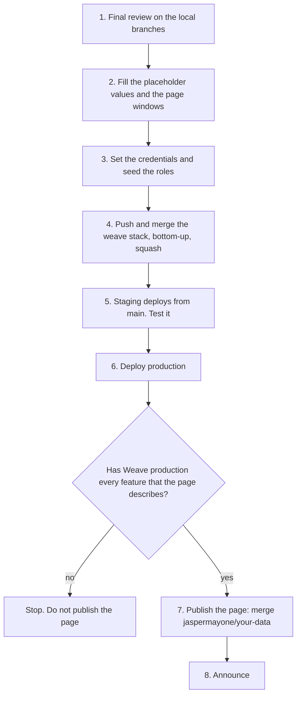

# KYC rollout

This document gives the rollout order for the KYC work: verification, the Knot, the demographics vault, Thread Count and the deletion pipeline. It also lists each value that a person must decide before rollout. The design is in `docs/KYC.md`.

## The work is secret until rollout

The KYC work is secret until rollout day. The `weave` repo and the `patchworklabs.org` repo are public. Thus the first push of any KYC branch to GitHub is the reveal.

- Do not push a KYC branch before rollout day. This includes a draft PR, a fork, a gist and a CI run.
- Do not open an issue or a comment that names the work.
- Do all review on the local branches.
- On rollout day, do the steps below in one session, in this order.

The local branches, from bottom to top:

| Order | Repo | Branch | Part |
| --- | --- | --- | --- |
| 1 | weave | `jaspermayone/97-kyc-verification` | Verification, break-glass, image purge |
| 2 | weave | `jaspermayone/kyc-knot` | The Knot hash set and program grants |
| 3 | weave | `jaspermayone/110-kyc-demographics` | The demographics vault |
| 4 | weave | `jaspermayone/kyc-thread-count` | Thread Count |
| 5 | weave | `jaspermayone/94-kyc-deletion` | Retention, takeout, deletion pipeline, dormancy |
| 6 | patchworklabs.org | `jaspermayone/your-data` | The page https://patchworklabs.org/your-data |

## The order



### 1. Final review on the local branches

- Read each branch diff against its parent. Do not push to get a review.
- Run the full suite on the top branch with a private database:

  ```bash
  export DATABASE_URL=postgres://localhost/weave_kyc_rollout_test RAILS_ENV=test
  bin/rails db:drop db:create db:schema:load
  bundle exec rspec
  bin/rails test test/models/user_test.rb
  bin/rails zeitwerk:check
  ```

- Preview the page locally (`npm run dev` in the `patchworklabs.org` worktree, then open http://localhost:3000/your-data).

### 2. Fill the placeholder values and the page windows

Each value below is marked `PLACEHOLDER` in its file, or shows as a bracketed marker on the page. Decide each value, then change it on the lowest branch that owns the file and rebase the branches above.

**Weave config**

| File | Key | Now | Owner branch |
| --- | --- | --- | --- |
| `config/demographics.yml` | `fields` (other funder fields) | only `gender_identity`. Ask counsel first for GDPR Article 9 data. | demographics |
| `config/thread_count.yml` | `moderation_case_weights.major` | -25 (the locked range is -10 to -40) | thread-count |
| `config/thread_count.yml` | `external_signal_weights` | `github_student` 5, `other_program` 3 | thread-count |
| `config/thread_count.yml` | `project_event_services` | `[]` (add the real service, for example Krater) | thread-count |

These are locked now and need no decision: `purge_image_days_after_close` (30), `programs.ganymede.patch_lead_p_ids` (Adam, `PWL8724F96B89`, in production), the Knot is kept for ever, `age_band_starts` (`[0, 13, 16, 18, 25, 35]`), `takeout.download_days` (7), `takeout.cooldown_hours` (24) and `amount_band_starts` (`[0, 1, 100, 250, 500, 1000, 2500, 5000]`). `funders` and `program_funders` stay empty until a funder signs: see "When the first funder signs" below.

**Page markers** (`patchworklabs.org`, branch `jaspermayone/your-data`)

A Vercel production build fails while a marker is on the page. To list them: `grep -rn "<Placeholder" src`.

| Marker | Where | Depends on |
| --- | --- | --- |
| `[DATE: rollout day]` | `src/app/your-data/page.tsx` | The rollout date |

Also change the "Last updated" date on `src/app/privacy/page.tsx`, because the guardian retention text changed.

#### When the first funder signs

Funders are a long way off. When the first one signs, add it with config only:

1. Read the contract with counsel. Write down: the retention terms, the award end date, the fields the funder asks for, the reporting cadence, any consent term and any eligibility term.
2. Ask counsel before you add a new demographic field. Race, ethnicity and sexual orientation are special category data under GDPR Article 9.
3. If the funder needs a new field, add it to `config/demographics.yml` and its labels to `config/locales/demographics.en.yml` first (demographics branch or `main`).
4. Add the profile under `funders` in `config/kyc/data_retention.yml` (see `docs/KYC.md`, "Funder profiles"), in the `production` section or in `shared`. Set `name` and `contract_reference`, then only the keys the contract needs.
5. Add the funder to the list of each program it funds under `program_funders`. When a program gets a second funder, new records must name their funder (`ProgramParticipation.record!(..., funder:)`).
6. Boot the app (`bin/rails runner 'p FunderProfiles.all.map(&:key)'`). A typo stops the boot with the funder and the key in the error.
7. If `requires_member_consent` is true, check the consent copy in `config/locales/demographics.en.yml` (`funder_consents`) with counsel, and tell the members.
8. Run `bin/rails demographics:report`, then open `/admin/funder_reports/<key>` and check the preview: only the agreed fields, the funder's threshold, the amount setting and the consent rule.
9. Update the page "What we do with your data" if the funder's terms change a retention window that the page shows.

### 3. Set the credentials and seed the roles

Do these steps before the first verification pass in production. Secrets go in agenix in the infra repo, or in the Rails credentials. Never put a secret in this repo.

- Set `knot.pepper` in the production and staging credentials. Never rotate it. Without it, each pass fails with `KnotHasher::MissingPepper`.
- Generate the demographics key pairs. Put each public key in the production and staging credentials (`demographics.public_key`). Keep each private key off the server. Add a one-off unit that mounts the private key only for a report run.
- Mark the board members (`is_board`): Jasper, Kieran (krn) and Dominic.
- An owner sets the identity team flags (`/admin/users/:id`): the team members, the lead and the key holders.
- Restart the containers after a secret change. A container reads its env file only at start.

### 4. Push and merge the weave stack, bottom-up

This is the reveal. Do it only on rollout day.

The `CLAUDE.md` rule "No stacked PRs" applies: each PR targets `main`. `gh stack` has no merge command. Thus merge one branch at a time:

1. Push branch 1 with `git push -u origin jaspermayone/97-kyc-verification`. Open its PR against `main` (`gh pr create --base main`).
2. Wait for CI. Squash-merge it (`gh pr merge --squash`).
3. Fetch `main`. Rebase the next branch onto `main`: `git rebase --onto origin/main <old tip of the branch below> <next branch>`.
4. Push the next branch, open its PR against `main`, wait for CI, and squash-merge it.
5. Do steps 3 and 4 again for each branch, up to branch 5.

Each push to `main` deploys staging (`.github/workflows/deploy-staging.yml`). A push to `main` does not deploy production.

### 5. Test staging

Staging is `weave-staging.patchworklabs.org` (see `docs/STAGING.md`). After branch 5 is on `main` and staging has deployed:

- Run the migrations, then check `/up`.
- The Docker image needs two system packages for ID uploads (`IdDocumentConverter`, see `docs/KYC.md`, "Upload conversion"): `poppler-utils` (already in the image, for `pdftoppm`) and `libheif-plugin-libde265` (added to the runtime stage of the Dockerfile, so libvips can decode HEIC). Build the image once before the rollout and check that `apt-get` finds the package for the image's Debian release.
- Upload one HEIC photo and one PDF with a test account. Check that each is stored as an image (JPEG or PNG) with no EXIF or GPS data.
- Do one full verification with a test account: submit, pre-review, call, decision.
- Do one break-glass request with two key holders, and check the notices.
- Do one takeout and one deletion request with a test account. Check the receipt.

### 6. Deploy production

- Deploy with `bin/deploy-local`. The fallback is `gh workflow run deploy.yml`.
- Check `/up` and the admin pages `/admin/verifications`, `/admin/deletion_requests` and `/admin/break_glass_report`.

### 7. Publish the page

Do not publish the page before Weave production has every feature that the page describes. Check each item below in production first:

- [ ] The ID check: submit, pre-review, live call, decision, 14-day cooldown, lead review after 2 failed calls.
- [ ] ID images purged 7 days after a pass.
- [ ] Break-glass: two key holders approve. The notices go to the approvers and the lead at once, and to the member within 72 hours.
- [ ] The page says that the key holders use **hardware keys**. Weave has signed-in clicks only now. The hardware-key branch (WebAuthn and the split master key) must be in production first, or change the page text.
- [ ] Demographics: only totals, groups under 10 hidden.
- [ ] Takeout from the account, and the deletion request with the 14-day review and the 30-day completion.
- [ ] The dormancy job with its 60-day and 7-day emails.
- [ ] Every deletion path goes through the pipeline. The admin panel has no delete action (removed on 2026-10-12).

Then merge `jaspermayone/your-data` in the `patchworklabs.org` repo. Push it, open the PR against `main`, and squash-merge it. Check that https://patchworklabs.org/your-data loads, and that `Weave.data_page_url` gives the same URL.

### 8. Announce

- Post the announcement in the Slack. Link https://patchworklabs.org/your-data.
- Tell the members who are waiting for program resources how to start the ID check.
