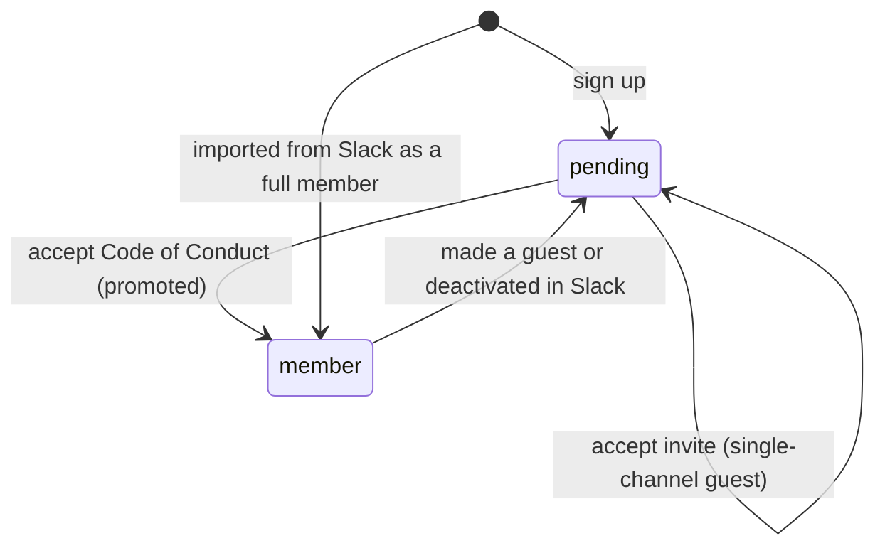
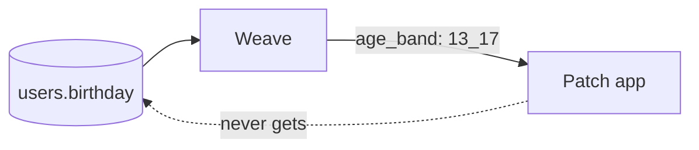
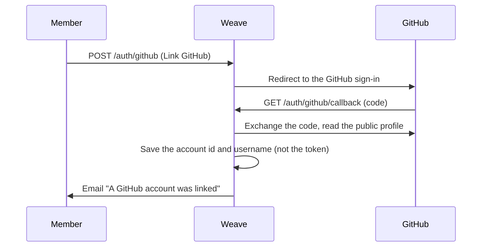
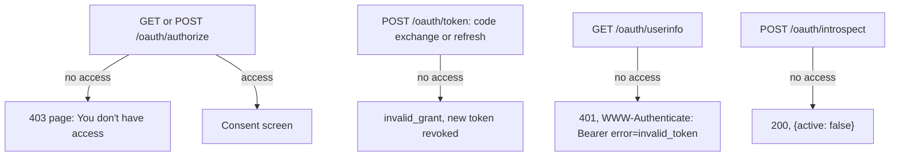
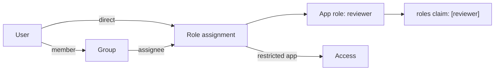
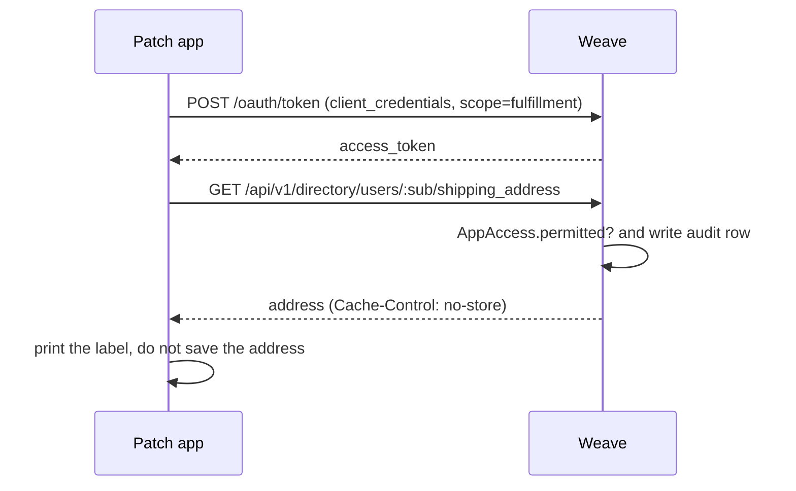
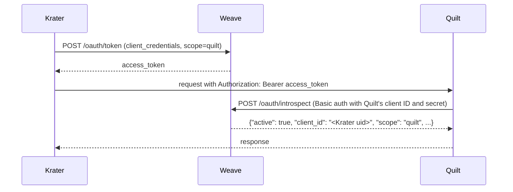

# OAuth 2.0 Provider Documentation

This Identity Provider (IDP) application uses [Doorkeeper](https://github.com/doorkeeper-gem/doorkeeper) to provide OAuth 2.0 authorization server functionality.

## Features

- **OAuth 2.0 Compliance**: Full RFC 6749 compliant authorization server
- **Multiple Grant Types**: Support for Authorization Code, Client Credentials, and Refresh Token flows
- **Scope-based Access Control**: Fine-grained permissions with scopes (profile, email, admin)
- **Token Management**: Access token generation, refresh, and revocation
- **Discovery Endpoints**: Standard OAuth 2.0 and OpenID Connect discovery support
- **PKCE Support**: Enhanced security for public clients

## OAuth 2.0 Endpoints

### Discovery Endpoints

- **OAuth 2.0 Server Metadata**: `GET /.well-known/oauth-authorization-server`
  - RFC 8414 compliant discovery endpoint
  - Returns server capabilities and endpoint URLs

- **OpenID Connect Discovery**: `GET /.well-known/openid-configuration`
  - OpenID Connect discovery endpoint
  - Returns OIDC-specific metadata

### Authorization Endpoints

- **Authorization Endpoint**: `GET /oauth/authorize`
  - Used to obtain authorization from the resource owner
  - Supports authorization code and implicit grant types

- **Token Endpoint**: `POST /oauth/token`
  - Used to exchange authorization codes for access tokens
  - Used to refresh access tokens
  - Used for client credentials grant

### Token Management

- **Revocation Endpoint**: `POST /oauth/revoke`
  - Revoke access or refresh tokens

- **Introspection Endpoint**: `POST /oauth/introspect`
  - Inspect token metadata and validity

- **Token Info**: `GET /oauth/token/info`
  - Get information about the current access token

### Resource Endpoints

- **UserInfo Endpoint**: `GET /oauth/userinfo`
  - Returns user information based on the access token
  - Respects granted scopes

## Supported Grant Types

1. **Authorization Code Grant** (Recommended for web applications)
   - Most secure OAuth 2.0 flow
   - Supports PKCE for additional security

2. **Client Credentials Grant** (For service-to-service communication)
   - Machine-to-machine authentication
   - No user interaction required

3. **Refresh Token Grant**
   - Obtain new access tokens without user interaction
   - Enabled by default

## Scopes

The OAuth provider supports the following scopes:

- `profile` (default): Access to basic profile information (name, username)
- `email`: Access to email address and verification status
- `admin`: Administrative privileges (restricted)
- `slack`: Patchwork Labs Slack membership (`slack_member`, `slack_id`)
- `groups`: the user's groups that are linked to this app (`groups`)
- `roles`: the user's roles in this app (`roles`)
- `age`: the user's age group, not the birthday (`age_band`, see "Age band claim")
- `social`: the accounts the user linked on other sites (`social_profiles`, see "Social profile claims")
- `directory`: the directory API, for `client_credentials` tokens only (see "Directory API")
- `fulfillment`: read a user's shipping address, for `client_credentials` tokens only (see "Shipping address API")
- `quilt`: the Quilt patch API, for `client_credentials` tokens only (see "Resource servers")
- `introspect`: introspect the `client_credentials` tokens of other apps (see "Resource servers")

`directory`, `fulfillment`, `quilt` and `introspect` are app scopes. A user
can't grant them: the authorization endpoint answers `invalid_scope` for each
one. Any admin can allow `directory`, `fulfillment` and `quilt` on an app. Only a superadmin can add or remove
`introspect`.

The `profile` scope also includes `pronouns`, a non-standard claim (a free-text
string such as `they/them`). It is in the ID token and the userinfo response.
It is omitted when the user has not set pronouns.

### Slack membership claims

Signing up for Weave does not make someone a full member of the Patchwork Labs
Slack. New users join Slack as single-channel guests and become full members
only after they accept the Code of Conduct. Request the `slack` scope to tell
the two apart:

| Claim | Type | Meaning |
|-------|------|---------|
| `slack_member` | boolean | `true` when the user is a regular (non-guest) member of the Slack workspace. |
| `slack_id` | string | The user's Slack user ID. Omitted until they join Slack. Guests have one too, so check `slack_member` before you invite it to a channel. |

Users with `slack_member: false` can still sign in. Each client decides what to
allow them to do. Send them to `https://slack.patchworklabs.org` to finish
joining.



### Age band claim

Each patch sets its own age rules. For example, a patch can have a minimum age
of 13 and give priority to high school students. Request the `age` scope to
check these rules. Weave sends the age group, never the birthday.

| `age_band` | Meaning |
|------------|---------|
| `under_13` | The user is younger than 13. |
| `13_17` | The user is 13 to 17. |
| `18_plus` | The user is 18 or older. |

Rules:

- The claim is in the ID token and the userinfo response. The directory API sends it as a field only when the app's scopes list `age`.
- Weave calculates the value from the birthday on each request and does not store it. The value changes on the day the user turns 13 or 18. Do not keep an old value for a long time.
- Weave omits the claim when it does not know the birthday. Weave asks for a missing birthday at the next sign-in.
- Weave never sends `birthday`, `slack_birthday` or `acknowledged_over_13_at` to an app.
- Guardian consent for users under 18 is a different check. Weave does it for all apps (see `docs/GUARDIAN_CONSENT.md`).



### Social profile claims

Members link accounts on other sites (GitHub for now) on
`/profile/social`. To link an account, the member signs in to the site, so a
linked account belongs to the member. Request the `social` scope to get them:

```json
"social_profiles": [
  { "provider": "github", "id": "583231", "username": "octocat" }
]
```

`id` is the site's account id. It does not change when the member changes
their username, so match on `id`. `username` is the username when the member
last linked or refreshed the account. A rename on the site does not reach
Weave until the member clicks "Refresh", so the old username can belong to
someone else by then. Do not use `username` to find the account. The list is empty when
the member linked no accounts. Each member can link one account of each site,
and each account can be linked to one member only.



Weave reads the GitHub OAuth app from `GITHUB_CLIENT_ID` and
`GITHUB_CLIENT_SECRET`, or from `github.client_id` and `github.client_secret`
in the credentials file. Set the callback URL of the GitHub OAuth app to
`https://<host>/auth/github/callback`. Without both values, the profile page
does not offer GitHub.

## Using the OAuth Provider

### 1. Register an OAuth Application

Administrators can register OAuth applications through the admin interface:

1. Navigate to `/admin/oauth_applications`
2. Click "New OAuth Application"
3. Fill in the application details:
   - **Name**: Application name
   - **Redirect URI**: Callback URL(s) for your application
   - **Scopes**: Requested scopes (space-separated)
   - **Confidential**: Whether the client can keep secrets secure

### 2. Authorization Code Flow Example

```
# Step 1: Redirect user to authorization endpoint
GET /oauth/authorize?
  client_id=YOUR_CLIENT_ID&
  redirect_uri=YOUR_REDIRECT_URI&
  response_type=code&
  scope=profile+email&
  state=RANDOM_STATE

# Step 2: User authorizes the application

# Step 3: Exchange authorization code for access token
POST /oauth/token
  grant_type=authorization_code&
  code=AUTHORIZATION_CODE&
  redirect_uri=YOUR_REDIRECT_URI&
  client_id=YOUR_CLIENT_ID&
  client_secret=YOUR_CLIENT_SECRET

# Response
{
  "access_token": "...",
  "token_type": "Bearer",
  "expires_in": 7200,
  "refresh_token": "...",
  "scope": "profile email"
}

# Step 4: Use access token to access resources
GET /oauth/userinfo
Authorization: Bearer ACCESS_TOKEN
```

### 3. Client Credentials Flow Example

```
POST /oauth/token
  grant_type=client_credentials&
  client_id=YOUR_CLIENT_ID&
  client_secret=YOUR_CLIENT_SECRET&
  scope=profile

# Response
{
  "access_token": "...",
  "token_type": "Bearer",
  "expires_in": 7200,
  "scope": "profile"
}
```

### 4. Using PKCE (Proof Key for Code Exchange)

For enhanced security, especially in public clients:

```
# Generate code verifier and challenge
code_verifier = BASE64URL(RANDOM(32))
code_challenge = BASE64URL(SHA256(code_verifier))

# Step 1: Authorization request with PKCE
GET /oauth/authorize?
  client_id=YOUR_CLIENT_ID&
  redirect_uri=YOUR_REDIRECT_URI&
  response_type=code&
  code_challenge=CODE_CHALLENGE&
  code_challenge_method=S256&
  scope=profile

# Step 2: Token request with code verifier
POST /oauth/token
  grant_type=authorization_code&
  code=AUTHORIZATION_CODE&
  redirect_uri=YOUR_REDIRECT_URI&
  client_id=YOUR_CLIENT_ID&
  code_verifier=CODE_VERIFIER
```

## Token Expiration

- **Access Tokens**: Expire after 2 hours
- **Refresh Tokens**: Can be used to obtain new access tokens without re-authorization

## Accounts that can no longer sign in

Locking, suspending or deactivating a user ends their access everywhere, not just in Weave:

- `/oauth/authorize` treats them as signed out, the same as every other Weave page. A browser session also has to be live (not signed out or expired) to count.
- All their access tokens (and with them, refresh tokens) and unredeemed authorization codes are revoked, for every client.
- As a backstop for changes that skip model callbacks, `/oauth/token` refuses to issue tokens for them (`invalid_grant`) and `/oauth/userinfo` answers `401` with `WWW-Authenticate: Bearer error="invalid_token"`.

Unlocking or reactivating the account doesn't bring old tokens back; the user signs in to each client again.

## Restricting an app to some users

Each application has an access policy:

- `everyone` (the default): every user who can sign in to Weave can use the app.
- `restricted`: only users with an access grant or a role in the app can use the app. A grant or a role assignment names a user or a group. Group members count only while their membership is not expired.

There is no admin bypass. An admin needs a grant like any other user. Only a superadmin can change the policy or the grants, on the app page in `/admin/oauth_applications`.

Weave checks access at every endpoint that issues or accepts a user's token:



- A user without access sees a Weave page. Weave does not redirect to the client with `error=access_denied`, because the client can't give access.
- `client_credentials` tokens have no user, so the policy does not apply to them.
- The admin user page shows, for each restricted app, whether the user has access and why.
- When a user loses access (a membership is removed or expires, a grant, role or role assignment is removed, or an app becomes restricted), `RevokeLostAppAccessJob` revokes their tokens and unredeemed codes for that app. The endpoints above refuse those tokens before the job runs, so the job is cleanup.

### Group claims

Request the `groups` scope to get a `groups` claim in the ID token and the
userinfo response. The value is a list of group slugs, for example
`["engineering", "staff"]`. It holds only the user's groups that are linked to
this app by an access grant or a role assignment. Weave never sends the full list of groups. An admin can
link a group to an app that is open to everyone, to send the claim without
limiting access. The list is empty when no linked group matches. Slugs never
change after a group is created, so clients can compare them safely.

### App roles

An app can define its own roles, for example `member`, `reviewer` and `admin`.
A superadmin adds roles in the "Roles" panel on the app page, and gives each
role to users or groups. A role key never changes after the role is created.

Request the `roles` scope to get a `roles` claim in the ID token and the
userinfo response. The value is the sorted list of the app's role keys that the
user holds, directly or through an unexpired group membership, for example
`["admin", "reviewer"]`. The list is empty when the user holds no role.

A role also gives access to a restricted app, so an app that gives every user
a role does not need separate access grants. Prefer `roles` over `groups` to
make decisions in the app: the app owns its role keys, and group slugs belong
to Weave.



### Directory API

An app can check a user again without a browser session, for example before a
state change or when someone clicks a button in Slack. It calls the directory
API with its own `client_credentials` token.

To turn it on for an app, add `directory` to the app's scopes in
`/admin/oauth_applications`. Then request a token:

```bash
curl -u "$CLIENT_ID:$CLIENT_SECRET" -d grant_type=client_credentials -d scope=directory \
  https://weave.patchworklabs.org/oauth/token
```

| Request | Result |
|---|---|
| `GET /api/v1/directory/users/:sub` | One user |
| `GET /api/v1/directory/users?role=<key>` | `{"users": [...]}`: users who hold this app role |
| `GET /api/v1/directory/users?group=<slug>` | `{"users": [...]}`: members of a group linked to this app |

Each user has the same fields as the claims:

```json
{
  "sub": "PWL1A2B3C4D5E",
  "name": "Ada Lovelace",
  "email": "ada@example.com",
  "email_verified": true,
  "slack_id": "U0123ABCD",
  "slack_member": true,
  "groups": ["krater-reviewers"],
  "roles": ["reviewer"],
  "active": true,
  "minor": false,
  "guardian_verified": false,
  "verification_status": "verified",
  "demographics_answered": true,
  "age_band": "18_plus"
}
```

Rules:

- `sub` is the Patchwork Labs ID. Use it as the key for users. Do not use `slack_id` or `email` as the key.
- A user that the app may not serve (see "Restricting an app to some users") gives `404`, the same as an unknown `sub`.
- `groups` and `roles` hold only the groups and roles linked to the calling app.
- `active` is `false` when the user can no longer sign in.
- `minor` is `true` when the user is under 18, from their birthday. It is `false` when Weave does not know the birthday yet. Weave asks for a missing birthday at the next sign-in. Only the directory sends this field. It is not a claim.
- `guardian_verified` is `true` for a minor whose guardian a Weave admin verified with a signed form and a call or video check. The email consent alone does not set it. Ask for it before your app gives a minor money or other risk. It is `false` for adults.
- `age_band` is in the response only when the app's scopes list `age` and Weave knows the birthday (see "Age band claim").
- `demographics_answered` is `true` when the user saved answers to the demographics form. Weave never sends the answers. Ask for it before a user's first grant application. To send the user to the form, link to `/profile/demographics?return_to=<url>`. After a save, Weave sends the user back to `return_to` when its origin matches a redirect URI of a registered app. Weave ignores any other `return_to`.
- `?group=` works only for a group linked to the app. `?role=` works only for a role of the app. Other values give `404`.
- Pass exactly one of `role` and `group`, or the API answers `400`.
- A token with a user, a token without the `directory` scope, or a token of an app whose scopes do not list `directory` gives `403`.

### Shipping address API

A patch app that ships hardware or other things to members reads the shipping
address from Weave when it ships. Weave keeps the only copy.

**Do not store the address.** Read it, print the label, and discard it. Read
it again for the next shipment. Do not write it to your database, your logs,
a cache, or a spreadsheet. A carrier or a fulfillment service can keep it only
as long as the shipment needs it. When a member changes or deletes the address
in Weave, the next read gets the change.

To turn it on for an app, add `fulfillment` to the app's scopes in
`/admin/oauth_applications`. Then request a token:

```bash
curl -u "$CLIENT_ID:$CLIENT_SECRET" -d grant_type=client_credentials -d scope=fulfillment \
  https://weave.patchworklabs.org/oauth/token
```



`GET /api/v1/directory/users/:sub/shipping_address` gives the fields that a
label needs:

```json
{
  "sub": "PWL1A2B3C4D5E",
  "name": "Ada Lovelace",
  "phone": "+15555550123",
  "id": "addr_...",
  "line1": "1 Main St",
  "line2": "Apt 2",
  "line3": null,
  "city": "Boston",
  "state": "MA",
  "postal_code": "02115",
  "country": "US"
}
```

Rules:

- `name` is the contact name on the address. When the address has no contact name, it is the user's first and last name. It is `null` when Weave has neither.
- `phone` is the contact phone number in E.164 format, or `null`. Carriers ask for it on most international labels.
- `country` is the ISO 3166-1 alpha-2 code.
- An unknown `sub`, a user that the app may not serve, and a user with no complete shipping address all give `404`.
- A token with a user, a token without the `fulfillment` scope, or a token of an app whose scopes do not list `fulfillment` gives `403`. The `directory` scope is not enough.
- Each read that gives an address writes an audit row with the app, the `sub`, the IP and the time. Admins see the reads on the user's page in `/admin/users`.
- The response has `Cache-Control: no-store`.
- The endpoint allows 30 requests per minute for each IP, and 30 for each token.

### Resource servers

A resource server is an app that other apps call with their own Weave token.
Quilt, the funding service, is one: Krater calls Quilt's patch API with a
`client_credentials` token that has the `quilt` scope. Weave tokens are opaque,
so the resource server checks each token at the introspection endpoint.

An app may introspect its own tokens. To introspect the tokens of other apps,
the resource server's app must be allowed the `introspect` scope. Even then,
Weave shows it only tokens that have no user (`client_credentials` tokens). It
gets `{"active": false}` for a user's token of another app.

Setup, in `/admin/oauth_applications`:

1. A superadmin adds `introspect` to the scopes of the resource server's app (Quilt).
2. An admin adds the resource server's scope (`quilt`) to each app that calls it (Krater).



The resource server sends the token with its own client credentials:

```bash
curl -u "$QUILT_CLIENT_ID:$QUILT_CLIENT_SECRET" -d token="$TOKEN" \
  https://weave.patchworklabs.org/oauth/introspect
```

```json
{
  "active": true,
  "client_id": "Krater's client ID",
  "scope": "quilt",
  "token_type": "Bearer",
  "exp": 1791234567,
  "iat": 1791227367
}
```

Rules for the resource server:

- Refuse the request unless `active` is `true`. An inactive, revoked, expired, unknown or hidden token gives only `{"active": false}`.
- Refuse the request unless `scope` (a space-separated list) includes `quilt`.
- Use `client_id` to find the calling app, for example the patch it belongs to. Keep this mapping in the resource server.
- Keep a result for up to 60 seconds, keyed by a hash of the token, and never past `exp`. A revoked token can then work for up to 60 seconds.
- Authenticate with HTTP Basic. A bearer token can introspect only tokens of its own app.

## Security Considerations

1. **HTTPS Required**: OAuth endpoints enforce HTTPS in production
2. **State Parameter**: Always use the state parameter to prevent CSRF attacks
3. **PKCE**: Recommended for all public clients
4. **Confidential Clients**: Store client secrets securely
5. **Token Storage**: Store tokens securely on the client side
6. **Scope Limitation**: Request only necessary scopes

## Admin Management

OAuth applications can be managed through the admin interface at `/admin/oauth_applications`:

- View all registered applications
- Create new applications
- Edit application details
- Regenerate client secrets
- Delete applications
- View application access tokens

## API Integration

For programmatic access, use the API endpoints with service key authentication or OAuth tokens:

```
# Using OAuth token
GET /api/v1/users/me
Authorization: Bearer YOUR_ACCESS_TOKEN

# Using service key (for service-to-service)
POST /api/v1/auth/authenticate
X-Service-Key: YOUR_SERVICE_KEY
```

## Troubleshooting

### Common Issues

1. **Invalid redirect_uri**: Ensure the redirect URI matches exactly what was registered
2. **Invalid client credentials**: Check client_id and client_secret
3. **Token expired**: Use refresh token to obtain a new access token
4. **Insufficient scope**: Request appropriate scopes during authorization

### Testing

You can test the OAuth flow using tools like:
- [OAuth 2.0 Playground](https://www.oauth.com/playground/)
- Postman
- cURL

Example cURL request:
```bash
curl -X POST https://your-idp-domain.com/oauth/token \
  -d "grant_type=client_credentials" \
  -d "client_id=YOUR_CLIENT_ID" \
  -d "client_secret=YOUR_CLIENT_SECRET" \
  -d "scope=profile"
```

## Further Reading

- [OAuth 2.0 RFC 6749](https://datatracker.ietf.org/doc/html/rfc6749)
- [OAuth 2.0 Server Metadata RFC 8414](https://datatracker.ietf.org/doc/html/rfc8414)
- [PKCE RFC 7636](https://datatracker.ietf.org/doc/html/rfc7636)
- [Doorkeeper Documentation](https://doorkeeper.gitbook.io/guides/)
