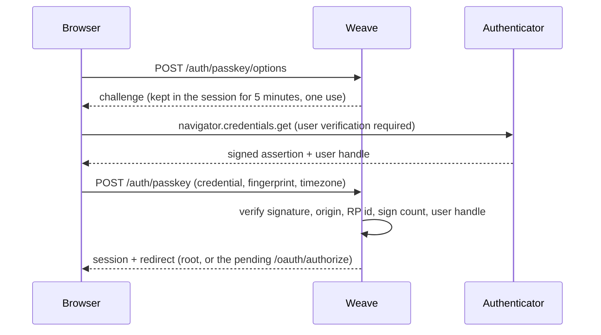

# Passkeys

Members can sign in with a passkey instead of an email link. A passkey is a WebAuthn credential that a device or a password manager keeps. Email links continue to work, so a member who loses a passkey can still sign in.

## Availability

Passkeys are on for every member. There is no feature flag.

- Each member can add passkeys at `/profile/passkeys`. The profile page links to it.
- The sign-in page shows the "Sign in with a passkey" button when the browser supports passkeys.
- The email field offers saved passkeys as autofill.

## Sign-in

Passkeys are discoverable. The authenticator keeps the user handle (`users.webauthn_id`), so sign-in starts without an email address.

The login page asks for options when it loads, for autofill (conditional mediation). The button asks again, and that request stops the autofill request.

A passkey sign-in ends in the same `complete_login` as a magic link: the session id rotates, a `user_sessions` row backs the login, and a pending OAuth authorization continues.

## Rules

- Both ceremonies require user verification (a PIN, fingerprint or face). A passkey alone is a full sign-in.
- A challenge is good for one check and for 5 minutes (`PasskeyChallenges`).
- The relying party id is `Weave.host`. A passkey made on staging does not work on production, and the reverse. Development and test use `localhost`. Test uses port 3000. Development uses `PORT` (foreman's `bin/dev` sets 5000), or port 3000 when `PORT` is unset. Set `WEBAUTHN_ORIGIN` to override it (`Weave.webauthn_origin`). Key custody (`KeyCustody.relying_party`) uses the same relying party.
- If the sign count of a passkey goes back, Weave marks the passkey compromised, and it cannot sign in. The member must remove it and add a new one.
- A locked, suspended or deactivated account cannot sign in with a passkey.
- An admin cannot add or remove passkeys while impersonating a member.
- The member gets an email when a passkey is added or removed.
- `Rack::Attack` limits passkey requests to 20 a minute for each IP.

## Code

| Part | File |
| --- | --- |
| Ceremonies | `app/services/passkey_authentication.rb` |
| Challenge storage | `app/controllers/concerns/passkey_challenges.rb` |
| Sign-in actions | `AuthController#passkey_options`, `AuthController#passkey_login` |
| Profile page | `app/controllers/passkeys_controller.rb` |
| Model | `app/models/user/passkey.rb` |
| Browser code | `app/javascript/controllers/passkey_*_controller.js`, `app/javascript/lib/webauthn.js` |
| Relying party | `config/initializers/webauthn.rb` |

## Later work

Issue #86 covers TOTP, backup codes and the login-attempt factor model. Issue #87 covers step-up re-authentication. Adding a passkey does not ask for a step-up yet. The email to the member is the control until #87 lands.
