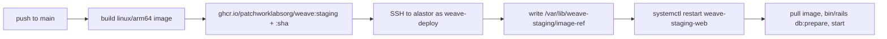
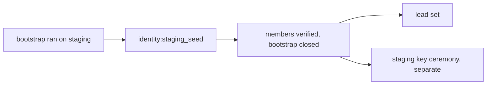

# Staging

Staging runs at **https://weave-staging.patchworklabs.org**. It is on the same host as
production (`alastor`), in separate containers with its own database and Redis.
Cloudflare Access sits in front of the hostname.

Staging runs the production image with `RAILS_ENV=production`. It behaves exactly like
production. Environment variables set the differences:

| Variable | Staging value | Effect |
| --- | --- | --- |
| `WEAVE_ENV` | `staging` | Reads `config/credentials/staging.yml.enc`, shows the "Staging" badge, prefixes mail subjects with `[staging] `, sends `X-Robots-Tag: noindex`. |
| `APP_HOST` | `weave-staging.patchworklabs.org` | Sets the OIDC issuer, mailer links, the canonical URL and the allowed `Host`. |
| `MAIL_DOMAIN` | the domain verified in Resend for staging | Sets the sender to `hi@<MAIL_DOMAIN>`. The staging Resend key is restricted to this domain. Unset means `weave.patchworklabs.org`. |
| `RAILS_MASTER_KEY` | contents of `config/credentials/staging.key` | Opens the staging credentials. |

When `WEAVE_ENV`, `APP_HOST` and `MAIL_DOMAIN` are unset, nothing changes. Code reads
them through `lib/weave.rb` (`Weave.staging?`, `Weave.host`, `Weave.url`,
`Weave.mail_allowlist`, `Weave.mail_from`). Do not read them from `ENV` directly.

## Deploys

Every push to `main` deploys staging (`.github/workflows/deploy-staging.yml`). Production
deploys stay manual.



## Credentials

Staging has its own credentials file and key. Create or edit them with:

```bash
WEAVE_ENV=staging bin/rails credentials:edit
```

This opens `config/credentials/staging.yml.enc` and creates `config/credentials/staging.key`
if it does not exist. Commit the `.yml.enc` file. Never commit the key: put it in agenix for
the staging container's `RAILS_MASTER_KEY`.

Use new values for staging. Do not copy production secrets. The app reads these keys:

```yaml
secret_key_base:        # generated by credentials:edit
lockbox:
  master_key:           # Lockbox.generate_key
hashid:
  salt:
openid_connect:
  signing_key: |        # openssl genrsa 2048
resend:
  api_key:
mail_allowlist:         # who may receive mail; see "Mail allowlist" below
  - "@patchworklabs.org"
okcomputer:
  username:
  password:
slack:                  # the staging Slack test workspace and app
  bot_token:
  user_token:
  browser_token:
  cookie:
  signing_secret:
  team_id:
  workspace_subdomain:
  coc_channel:
  coc_url:
  default_channels:     # channel ids a new member joins; production uses SlackService::DEFAULT_CHANNELS
```

## Mail allowlist

Staging sends through the same Resend account as production. The `mail_allowlist`
credential names who may receive mail from staging:

- An entry that starts with `@` is a domain. Any other entry is an exact address.
- Mail to other recipients is dropped and logged.
- An empty list means nobody gets mail.
- On staging, a missing `mail_allowlist` also means nobody gets mail.
- In production, a missing `mail_allowlist` means everyone gets mail.

To change the list, edit the staging credentials and redeploy:

```bash
WEAVE_ENV=staging bin/rails credentials:edit
```

## Identity team seed

Staging does not copy verifications from production. Production rows hold ID data, and production images are sealed to the production key set, so staging cannot open them.

To put the staging identity team in the production state without a second verification circle, run this in a one-off staging container:

```bash
bin/rails identity:staging_seed BY=<owner email> MEMBERS=<email>,<email>,<email> LEAD=<email>
```

- The task refuses to run unless `WEAVE_ENV=staging`.
- Each member gets a passed verification. The verifier is the person before them in `MEMBERS`, and the first member's verifier is the last member.
- A member who is already verified keeps their verification. A member who is not on the identity team joins it.
- `LEAD` is optional and must be one of the members.
- The task refuses a member whose account can't sign in, who is under the verifier minimum age (with no exception), or who has an open verification. Finish or close that verification first.
- The task writes no ID image, no document data and no residency check. Each verification and its `decided` event say "Staging seed", so the governance and verification logs show where the data came from.
- Key holders and the key ceremony stay separate. The staging key set must be its own.



## Test states

On staging, an owner can put a member's identity verification, US residency or guardian consent straight into a state, to test what each state does. The tools are on the admin user page, under "Staging test states". They work for any member, also for another owner and for your own account. Production does not show them, and the route answers 404 there.

| Area | States |
|---|---|
| Identity verification | Not submitted, Passed, Passed, needs a new call, Failed |
| US residency | Not checked, US resident (with a state), Not a US resident |
| Guardian consent (members under 18) | No consent, Granted, Granted and verified |

- Each change removes the member's records of that kind, then writes one record in the new state. On staging these records are test data, so their history goes too.
- A test pass has a Knot with no hashes, so program grants work. A test record has no ID image or document.
- No email goes out. The code is `StagingTestStates` (`app/services/staging_test_states.rb`).
- For the states in between (an ID upload, pre-review, a scheduled call), use the real flow.
