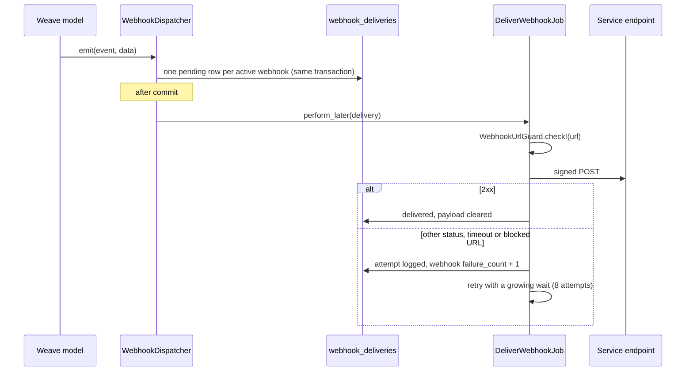

# Outbound webhooks

Weave sends events to the services that register a webhook for them. A service uses the events to keep its own data and access in sync with Weave.

A webhook belongs to one service and listens for one event type (`Service::Webhook::EVENT_TYPES`). To get more than one event, register one webhook for each event.

## Set up a webhook

Any admin can see services, API keys, webhooks and delivery logs at **Admin > Services** (`/admin/services`). Only a superadmin can change them or see a signing secret, because a webhook sends user data out of Weave.

1. Open the service, or create it with **New service**.
2. In **Webhooks**, click **New webhook**. Enter the URL and select the event.
3. On the webhook page, copy the **Signing secret** and give it to the service.
4. Click **Send test**. The **Delivery log** shows the response.

To change the secret, click **Rotate**. The old secret stops working at once, retries included.

## Flow



- The delivery rows are written in the transaction of the change. If the change rolls back, no event is sent.
- Only active webhooks of active services get deliveries.
- After 10 failed attempts in a row, Weave turns the webhook off (`status: inactive`). Pending deliveries of an inactive webhook are cancelled. An admin turns the webhook on again after the receiver is fixed.
- After 8 attempts, the delivery is `failed`.
- **Send test** on the webhook page (and `WebhookDispatcher.ping`) sends a `ping` event to that webhook only.
- **Deactivate** cancels the queued deliveries of the webhook.

## Request

Weave sends a `POST` with a JSON body:

```json
{
  "id": "6f1c2b9e-1d0a-4f4e-9a52-0f7c7a1d2e3b",
  "type": "group.member_added",
  "created_at": "2026-10-25T15:04:05.123Z",
  "data": { }
}
```

| Header | Value |
| --- | --- |
| `Content-Type` | `application/json` |
| `User-Agent` | `Weave-Webhooks/1.0` |
| `X-Weave-Event` | The event type, for example `group.member_added`. |
| `X-Weave-Event-Id` | The event `id`. It is the same on each retry. Use it as the idempotency key. |
| `X-Weave-Delivery` | The delivery ID (`whkdlr_...`). |
| `X-Weave-Timestamp` | Unix time of this attempt, in seconds. |
| `X-Weave-Signature` | `sha256=<hex HMAC-SHA256>` of `<timestamp>.<body>`. |

Answer with a `2xx` status in 10 seconds or less. Weave does not follow redirects. Do the slow work after you answer.

## Verify the signature

The key is the webhook's secret (`Service::Webhook#secret_token`). Weave signs the timestamp, a dot and the raw body.

1. Read the raw body before you parse it.
2. Compute `HMAC-SHA256(secret, "#{X-Weave-Timestamp}.#{raw_body}")` as hex.
3. Compare it with the part after `sha256=` in `X-Weave-Signature`. Use a constant-time compare.
4. Reject the request if the timestamp is more than 5 minutes old.
5. Drop the request if you already handled its `X-Weave-Event-Id`.

```ruby
expected = "sha256=#{OpenSSL::HMAC.hexdigest('SHA256', secret, "#{timestamp}.#{raw_body}")}"
valid = ActiveSupport::SecurityUtils.secure_compare(expected, signature) &&
        (Time.now.to_i - timestamp.to_i).abs <= 300
```

## Events

Users are named by their Patchwork Labs ID (`p_id`, the OAuth `sub` claim). Payloads do not hold addresses, IP addresses or locations.

### `user.created`, `user.updated`

```json
{
  "user": {
    "id": "PWL01HQXYZ...",
    "name": "Ada Lovelace",
    "email": "ada@example.com",
    "email_verified": true,
    "slack_id": "U012345",
    "active": true
  },
  "changed": ["name"]
}
```

`changed` is in `user.updated` only. It lists the `user` fields that the change touched. A change to other columns sends no `user.updated`. `active` is false when the account is locked or not active.

### `user.deleted`

```json
{ "user": { "id": "PWL01HQXYZ..." } }
```

The account and its data are gone. Delete your copy. Weave sends a `group.member_removed` (reason `account_deleted`) for each group of the user first. Queued `user.created` and `user.updated` deliveries for the account are cancelled, so a retry does not send its name and email after the deletion.

### `session.created`, `session.expired`

```json
{
  "session": {
    "id": "usess_...",
    "created_at": "2026-10-25T15:04:05Z",
    "expires_at": "2026-11-24T15:04:05Z",
    "signed_out_at": null,
    "impersonated": false,
    "ended_by": "time"
  },
  "user": { "id": "PWL01HQXYZ..." }
}
```

`ended_by` is in `session.expired` only: `sign_out` (the user signed out or the session was revoked) or `time` (the session ran out of time).

Weave sends `session.expired` once for each session. A sign-out sends it at once. For a session that runs out of time, `NotifyExpiredSessionsJob` sends it within 10 minutes. Sessions that expired more than one day before the job runs send no event.

### `group.member_added`, `group.member_removed`

```json
{
  "group": { "id": "grp_...", "slug": "eng" },
  "user": { "id": "PWL01HQXYZ..." },
  "source": "manual",
  "reason": "added",
  "expires_at": "2026-12-01T00:00:00Z",
  "actor": { "id": "PWL01ADMIN..." }
}
```

| Field | Values |
| --- | --- |
| `source` | `manual` (added in the admin panel) or `system` (the system group sync, see `SystemGroups`). |
| `reason` | `added`, or for a removal: `removed` (by hand or by the system sync), `expired`, `group_deleted` or `account_deleted`. |
| `expires_at` | The end of the membership, or `null`. |
| `actor` | The user who made the change, or `null` for a job (expiry, sync). |

Use the group `slug` as the stable name: it does not change after the group is created.

### `ping`

```json
{
  "webhook": { "id": "swh_...", "event_type": "group.member_added" },
  "service": { "id": "srvc_...", "name": "Krater" }
}
```

You cannot register a webhook for `ping`. **Send test** sends it.

## URL rules (SSRF guard)

`WebhookUrlGuard` checks the URL at each attempt, after DNS resolution:

- In production and staging, the URL must use `https`.
- Every address of the host must be public. Private, loopback, link-local, carrier-grade NAT, multicast and documentation ranges are blocked, also as IPv4-mapped IPv6 addresses.
- Weave connects to the checked address, so a second DNS answer cannot change the target.
- The URL must not hold a user name or a password.

In development, `http` and loopback addresses are allowed, so a receiver can run on `localhost`.

A blocked URL is a failed attempt. It counts toward the 10 failures that turn the webhook off.

## Delivery log and retention

Each `WebhookDelivery` row keeps the event, the URL, the number of attempts and the last response (status and the first 1000 characters of the body, or the error). The request body holds user data, so Weave clears it when the delivery is done. `DataRetentionJob` deletes the rows after 30 days (`WebhookDelivery::KEEP`).
