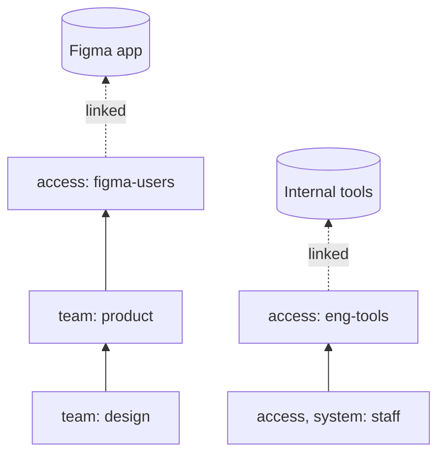

# Nested groups and access sets

*   **Author:** Jasper Mayone
*   **Status:** Proposed
*   **Date:** 2026-11-16
*   **Issue:** #294

--------------------------------------------------------------------------------

## Overview

A Weave group is a flat list of users today. Groups are the unit of access:
an app is opened to groups (`ApplicationAccessGrant`), app roles and patch
roles are given to groups, and an app sees the slugs of the groups linked to
it in the `groups` claim.

This design answers five questions from #294:

1.  Can a group contain other groups?
2.  Do teams (the org chart) and access sets (who may use an app) stay one
    kind of group, or become two kinds?
3.  Does each app pick the name it sees for a group, or does it see the
    global slug?
4.  Do group permissions (see members, manage members, connect to an app)
    become grants that can be delegated, or stay the `manager` membership
    role?
5.  How do the `groups`, `roles` and `patches` claims, access grants, app
    roles and patch roles move to the new model without a break for the
    apps that read them?

## The Problem

1.  **The same people are added in many places.** A person who joins the
    design team must be added to each group that opens an app to designers.
    When they leave, someone must remember each of those groups. A missed
    group keeps access open.
2.  **A reorg can lock people out.** Apps see group slugs. If an admin
    renames, splits or deletes a team group, every app linked to it changes
    at once. An app that keys roles on the slug `design` breaks when `design`
    becomes `product-design`.
3.  **Every app learns the same names.** All apps get the same global slug,
    so the slug must make sense to every app and can never change (the
    `Group` model forbids slug changes for this reason).
4.  **Only admins and group managers can change membership.** A manager can
    add and remove members of one group. Nobody below admin can connect a
    group to an app, and a manager of a parent team has no say over its
    sub-teams.
5.  **Groups carry more than membership.** A group can waive the Code of
    Conduct and Slack steps for a sponsored project, hold patch roles, and
    have managers. Nesting must say which of these pass to the members of a
    child group. A wrong answer gives a waiver or a patch role to people
    nobody chose.
6.  **No concrete case asks for nesting yet.** Weave has 8 system groups and
    few manual groups. Nesting adds a rebuild and a lock to each membership
    write. The design must show that the cost buys something now, or keep
    the cost low until it does.

## Goals

*   A group can contain other groups, and a member of a child group counts
    as a member of each ancestor group for access, with a fixed depth limit
    and no cycles.
*   Each place that reads membership (`AppAccess`, the claims, app roles,
    patch roles, the directory API, waivers) reads one source of effective
    membership. Each one states whether it uses direct or effective
    membership.
*   Waivers and patch roles never pass to people through nesting unless the
    design says so on purpose and the UI shows it.
*   A change to the org chart can not change what an app sees unless an
    admin links the changed group to that app.
*   An app can get stable names for the groups it is linked to, which do not
    depend on the global slug.
*   Group managers can do more without an admin, within limits that an admin
    sets, and every such change goes into the audit log.
*   Apps that read `groups`, `roles` or `patches` today see the same values
    on the day of the migration. Any later change is opt-in for each app.
*   Membership expiry (`Group::Membership#expires_at`) keeps working through
    nesting: an expired membership grants nothing at any level.
*   `AppAccess.explain` and `.permitted?` keep their signatures, so session
    revokers (#292) and the SAML design (`docs/designs/saml-idp.md`) need no
    change.

## Non-Goals

*   **Removal preview (#293).** It will read the effective membership this
    design adds, but it is a separate issue.
*   **Session revokers (#292).**
*   **Syncing groups from outside systems** (Google Workspace groups, Slack
    user groups, an HR tool).
*   **Self-service group creation.** Admins still create groups.
*   **Changing system group rules.** System groups stay rule-driven. This
    design only decides if they can be parents or children.
*   **Changing the `patches` claim shape.** It is a contract with Quilt.
    Only how patch roles reach people through groups is in scope.

## Open Questions

None. The author decided the six questions from #294 and one more during
drafting (see Decisions).

## Decisions

The author's choices during drafting (2026-11-16):

1.  **Teams vs. access sets**: two purposes. A group is a `team` or an
    `access` group. Apps link only to access groups.
2.  **Waivers and patch roles**: direct members only. Nesting never passes a
    Code of Conduct waiver, a Slack waiver or a patch role.
3.  **Storage**: a stored closure table and stored effective memberships,
    rebuilt under an advisory lock in the write transaction, with a nightly
    check that repairs drift.
4.  **Claim names**: opt-in per app, all-or-nothing. An app with no names
    keeps getting slugs.
5.  **Delegation**: full grants (`view`, `manage_members`, `link_apps`),
    optionally recursive. The `manager` membership role goes away.
6.  **System groups**: access groups that are leaves. They can be children of
    a manual access group, and they never hold children.
7.  **App owners**: new. A `link_apps` holder can link an access group only to
    apps they own. Admins name app owners.

## Critical User Journeys (CUJs)

### CUJ 1: A person joins a sub-team

*   **Given**: The team `design` is inside the team `product`, and `product`
    is inside the access group `figma-users`, which is linked to the Figma
    app.
*   **When**: A manager with `manage_members` on `design` adds a person to
    `design`.
*   **Then**: In the same transaction, Weave adds effective rows for the
    person in `design`, `product` and `figma-users`. Their next Figma sign-in
    passes `AppAccess`. The groups claim for Figma lists `figma-users` (or
    the Figma name for it). It does not list `design` or `product`, because
    Figma is not linked to them.

### CUJ 2: A reorg does not touch apps

*   **Given**: The same tree.
*   **When**: An admin moves `design` from `product` into a new team
    `brand`, and puts `brand` inside `figma-users`.
*   **Then**: The diff of effective rows shows no change for `figma-users`,
    so no token is revoked and Figma sees the same claim.

### CUJ 3: A person leaves through expiry

*   **Given**: A contractor in `design` with `expires_at` next Friday.
*   **When**: The expiry passes.
*   **Then**: The effective rows for `design`, `product` and `figma-users`
    expire at the same time, because each one carries the latest expiry of
    the paths that reach it. The expiry sweep removes the rows and starts
    `RevokeLostAppAccessJob` for the person.

### CUJ 4: An app switches to its own names

*   **Given**: An app linked to `staff` and `figma-users`, getting slugs.
*   **When**: An app owner sets names for both links (`employees`,
    `designers`) and turns on claim names.
*   **Then**: Weave refuses to turn it on while any linked access group has
    no name. After it is on, the claim is `["designers", "employees"]`.

### CUJ 5: A waiver does not leak

*   **Given**: A sponsored project group `hackboston` that waives the Code of
    Conduct, with the team `hackboston-mentors` inside it.
*   **When**: A person is added to `hackboston-mentors` only.
*   **Then**: The person still must accept the Code of Conduct, because the
    waiver applies to direct members of `hackboston` only. The group page of
    `hackboston-mentors` says so.

## Technical Plan (Architecture)

### Graph rules



*   Allowed parent and child pairs: a team inside a team, a team inside an
    access group, an access group inside an access group. An access group
    can not go inside a team, because then a team's members would depend on
    an access set.
*   A system group is an access group. It can be a child of a manual access
    group. It can not be a parent.
*   A group with a waiver or patch role assignments can be nested, but its
    waivers and patch roles apply to its direct members only (Decision 2).
*   Depth limit: 6 levels. No cycles. Both are checked in Ruby before the
    write and again by the rebuild, which raises inside the transaction.
*   Only access groups can be the grantee of an `ApplicationAccessGrant` or
    an `ApplicationRoleAssignment`. Patch role assignments can go to any
    group (they are not app links).

### Data model

*   **`groups.purpose`** (new column, `team` or `access`, not null). It is
    separate from `groups.kind` (`manual` or `system`), which says who
    manages the members.
*   **`group_nestings`** (new). `child_group_id`, `parent_group_id`,
    `created_by_id`, timestamps, `has_paper_trail`. Unique on the pair.
*   **`group_closures`** (new, derived). `ancestor_id`, `descendant_id`,
    `depth`. Includes a row for each group to itself (depth 0).
*   **`effective_group_memberships`** (new, derived). `user_id`, `group_id`,
    `expires_at`, `direct` (boolean). `expires_at` is the latest expiry of
    the direct memberships that reach the group (null if any path never
    expires). Unique on `user_id, group_id`. Readers filter
    `expires_at IS NULL OR expires_at > now()`.
*   **`group_grants`** (new). `grantee_type` (`User` or `Group`),
    `grantee_id`, `group_id` (the target), `permission` (`view`,
    `manage_members`, `link_apps`), `recursive` (boolean), `created_by_id`,
    `has_paper_trail`. A group grantee means the group's effective members.
    A recursive grant covers every descendant of the target.
*   **`app_owners`** (new). `application_id` (a foreign key to
    `oauth_applications`, which also holds SAML SPs), `user_id`,
    `created_by_id`.
*   **`app_group_names`** (new). `application_id`, `group_id`, `claim_name` (format `[a-z][a-z0-9_-]*`, unique for each
    app). Plus a boolean `uses_group_claim_names` on the app.
*   **`group_memberships.role`** goes away after the grant migration
    (Phase 4).

### The write path

```mermaid
sequenceDiagram
  participant C as Caller
  participant G as GroupGraph.mutate!
  participant DB as Postgres
  participant J as Jobs
  C->>G: mutate!(cause:) { change }
  G->>DB: BEGIN; pg_advisory_xact_lock
  G->>DB: snapshot effective rows of affected users
  G->>DB: the change (membership, nesting, purpose)
  G->>DB: rebuild closures + effective rows for the affected subtree
  G->>DB: diff old and new rows
  G->>DB: COMMIT
  G->>J: after commit: RevokeLostAppAccessJob(user_id) for each user who lost a group
```

*   Every write that changes membership or nesting goes through
    `GroupGraph.mutate!`: `Group::Membership` create, update (expiry) and
    destroy, `GroupNesting` create and destroy, group delete, the
    `purpose` change, and `SystemGroups` sync.
*   The rebuild is limited to the subtree above the changed group, and to the
    users in it. A full rebuild (`GroupGraph.rebuild_all!`) runs nightly
    inside the same lock and reports any row it had to change to Sentry.
    Those reports are bugs.
*   The diff gives the users who lost an effective group. Only they get a
    `RevokeLostAppAccessJob`, which checks `AppAccess.permitted?` again as
    today.
*   `ExpireGroupMembershipsJob` already handles direct expiry. It now calls
    `mutate!`, so effective rows follow.

### Readers: direct or effective

| Reader | Uses | Change |
| --- | --- | --- |
| `AppAccess.grant_decision` (group grants) | effective | `user.groups` becomes `user.effective_groups` |
| `AppAccess.linked_groups`, `.group_slugs` (`groups` claim) | effective | access groups only; names when the app opts in |
| `ApplicationRole.held_by` (`roles` claim) | effective | through `effective_group_memberships` |
| Directory API `?group=` | effective | same set as the claim |
| `PatchRole.held_by` (`patches` claim) | direct | no change (Decision 2) |
| `User#code_of_conduct_required?`, `#slack_required?` | direct | no change (Decision 2) |
| Access request approval | grant | `manage_members` on the request's group |
| Group pages | both | show direct members, then "through" rows with the path |
| Webhooks `group.member_added` / `removed` | direct | no change; effective changes are future work |

### Grants and app owners

*   `GroupPermissions.can?(user, permission, group)` answers every
    permission check. It looks for a grant on the group or, if recursive, on
    an ancestor, held by the user or by a group the user is effectively in.
    Admins pass every check. Superadmin-only rules stay (adding members to a
    group with patch roles).
*   `manage_members` lets a person add and remove members, set expiry and
    approve access requests. `view` lets a person see members and the
    "through" rows. `link_apps` lets a person link the group to an app they
    own, and set the app's claim name for it.
*   Nesting a group needs `manage_members` on both groups (and everything
    under the moved group). Nesting anything inside an access group, or
    changing `purpose`, is admins only.
*   Admins name app owners on the app page (OAuth and, later, SAML). App
    owners see their app's links and claim names on a new `/apps/:id/access`
    page. They can not change the app's access policy, flags or session
    revoker (#292 keeps revokers superadmin-only).

### Claims

*   `AppAccess.group_slugs(user, app)` keeps its name and signature. It
    returns the slugs of linked access groups the user is effectively in, or,
    when `uses_group_claim_names` is on, their claim names.
*   Turning `uses_group_claim_names` on fails while any linked access group
    has no name. Linking a new access group to such an app needs a name in
    the same form.

### Migration (no change for apps on day one)

1.  Every group that is the grantee of an `ApplicationAccessGrant` or an
    `ApplicationRoleAssignment` gets `purpose: access`. All system groups get
    `access`. Every other group gets `team`.
2.  `group_closures` and `effective_group_memberships` are built from the
    direct memberships. With no nesting yet, effective equals direct, so
    every claim keeps its value. A spec checks this on a copy of the
    fixtures: claims before equal claims after for each app and user.
3.  Each `manager` membership becomes a `manage_members` grant and a `view`
    grant for that user on that group (not recursive), and the membership
    becomes a plain `member`. Then the `role` column goes.
4.  No app gets claim names. `uses_group_claim_names` is false everywhere.

### Effect on other work

*   `AppAccess.explain` and `.permitted?` keep their signatures. They read
    effective membership, so a user can now get access through a nested
    team. #292 session revokers start from the same `RevokeLostAppAccessJob`
    calls, now driven by the diff.
*   #293 removal preview can read the closure table to list what a person
    loses.
*   The SAML design (`docs/designs/saml-idp.md`) gets the same `groups`
    values through `AppAccess.group_slugs`. A SAML SP is an
    `oauth_applications` row, so `app_owners` and `app_group_names` cover
    SAML SPs with a plain foreign key. The two designs do not depend on each
    other's order.

## Alternatives Considered

### Alternative A: one kind of group with a "linkable to apps" flag

*   **Pros**: No second concept for admins. Existing links need only the
    flag set.
*   **Cons**: Nothing stops an admin from linking a team, so a reorg can
    still change what an app sees.
*   **Reason for Rejection**: Rejected by author: problem 2 needs a rule,
    not a convention.

### Alternative B: nesting only, no split

*   **Pros**: The smallest change.
*   **Cons**: Apps keep seeing team slugs, so problems 2 and 3 stay.
*   **Reason for Rejection**: Rejected by author: it solves problem 1 only.

### Alternative C: waivers and patch roles pass down, with guards

*   **Pros**: A sponsored project can have sub-teams without flags on each.
*   **Cons**: A manager of a child team can give a waiver or a patch role
    with no superadmin check.
*   **Reason for Rejection**: Rejected by author: direct members only keeps
    those grants deliberate.

### Alternative D: forbid nesting for groups with waivers or patch roles

*   **Pros**: The simplest rule.
*   **Cons**: The first real case needs a rule change.
*   **Reason for Rejection**: Rejected by author: direct-only gives the same
    safety and still allows nesting.

### Alternative E: recursive query at read time

*   **Pros**: No derived tables, no stale data.
*   **Cons**: Each `AppAccess` check, token refresh and userinfo call runs a
    recursive query. Finding who lost access after a change needs a check of
    every affected user.
*   **Reason for Rejection**: Rejected by author: stored rows make reads one
    join and make the loss diff exact.

### Alternative F: recursive query with a per-user cache

*   **Pros**: Fast reads without derived tables.
*   **Cons**: A write path that forgets to clear the cache gives stale access
    with no way to see it.
*   **Reason for Rejection**: Rejected by author: the closure table's drift
    is visible to the nightly check.

### Alternative G: per-app names required for every app

*   **Pros**: The slug stops being a contract, so it can change.
*   **Cons**: Each link needs a name. Two apps can see one group under two
    names.
*   **Reason for Rejection**: Rejected by author: opt-in keeps day one
    unchanged and costs nothing for apps that are happy with slugs.

### Alternative H: keep global slugs

*   **Pros**: No new table.
*   **Cons**: Slugs stay frozen.
*   **Reason for Rejection**: Rejected by author: it leaves problem 3.

### Alternative I: keep managers, recursive

*   **Pros**: Small change. Admins already know managers.
*   **Cons**: A manager must be a member. An app owner can not run an access
    group without being in it.
*   **Reason for Rejection**: Rejected by author: grants separate "can act
    on" from "is in".

### Alternative J: managers plus a single "app owner" grant

*   **Pros**: Less than full grants.
*   **Cons**: A second migration to full grants when needs grow.
*   **Reason for Rejection**: Rejected by author: one migration now.

### Alternative K: system groups as parents, or as teams

*   **Pros**: As parents, an admin can put a team inside `staff`. As teams,
    every app link goes through a manual access group.
*   **Cons**: As parents, `staff` then has people who are not staff by
    role. As teams, every existing link needs a wrapper group.
*   **Reason for Rejection**: Rejected by author: as leaves, system groups
    keep their exact meaning and need no wrappers.

### Alternative L: `link_apps` without app owners

*   **Pros**: No new concept. (Admin-only holders, or any app.)
*   **Cons**: Admin-only gives no delegation. Any app lets one grant open any
    restricted app.
*   **Reason for Rejection**: Rejected by author: app owners limit links to
    apps the person is responsible for.

--------------------------------------------------------------------------------

## Non-Functional Requirements

*   **Correctness over speed**: the derived tables are the access source, so
    every write that changes them runs inside `GroupGraph.mutate!`. A spec
    scans `app/` and `lib/` for direct writes to `group_memberships`,
    `group_nestings`, `group_closures` and `effective_group_memberships`
    outside `GroupGraph` and fails on one.
*   **Locking**: one transaction-scoped advisory lock serializes graph
    writes. Weave's write rate on groups is low, so one lock is enough. Never
    take `User#lock!` or `with_lock` on a user inside `mutate!` (it locks the
    account, not the row).
*   **Known gap, not changed here**: `AppAccess.permitted?` does not check
    `User#can_authenticate?`, so a re-check for a locked user passes on an
    `everyone` app. `AppAccess.token_usable?` does check it. #292 tracks this.
*   **Rollout**: Phases 1 and 2 change no claim value. Nesting UI (Phase 3)
    ships behind the Flipper flag `group_nesting`, on for admins first.
*   **Rollback**: Phase 2 readers can switch back to direct membership by
    one method (`User#effective_groups` returns `groups`) while the flag is
    off, because no nesting exists yet.

--------------------------------------------------------------------------------

## Detailed Implementation Plan

Code is named by class or module, because a running refactor
(untangle-codebase) can move files. Check each path against `main` before
work starts. Each phase is one pull request from `main`, started after the
one before it merges.

### Phase 1: group purpose

#### 1. `db/migrate/<ts>_add_purpose_to_groups.rb` (Create)

*   **Type / Scope**: Migration.
*   **Proposed Changes**: Add `purpose` (string, null). Backfill in a
    separate data migration: `access` for system groups and for every
    grantee group of `ApplicationAccessGrant` or `ApplicationRoleAssignment`,
    `team` for the rest. Then set `NOT NULL` with a check constraint
    (`purpose IN ('team','access')`), in the strong_migrations safe order.

#### 2. `Group` (Modify)

*   **Type / Scope**: Model.
*   **Proposed Changes**: `enum :purpose, { team:, access: }`. Validations:
    a system group is `access`; `purpose` changes only by an admin, and a
    change to `team` fails while the group has app links.

#### 3. `ApplicationAccessGrant`, `ApplicationRoleAssignment` (Modify)

*   **Type / Scope**: Models.
*   **Proposed Changes**: A group grantee must be `access`.
    `PatchRoleAssignment` keeps any group.

#### 4. Admin group form and pages (Modify)

*   **Type / Scope**: `Admin::GroupsController`, `admin/groups` views,
    `admin/oauth_applications/show`.
*   **Proposed Changes**: A purpose field (with help text) on create and
    edit. The app page's group picker lists only access groups.

#### 5. Specs (Modify / Create)

*   **Type / Scope**: RSpec.
*   **Proposed Changes**: The backfill, the validations, and the picker.

### Phase 2: derived tables and readers (no claim change)

#### 6. `db/migrate/<ts>_create_group_graph_tables.rb` (Create)

*   **Type / Scope**: Migration.
*   **Proposed Changes**: `group_nestings`, `group_closures`,
    `effective_group_memberships` with the indexes in "Data model"
    (`effective_group_memberships (user_id, group_id)` unique,
    `(group_id, user_id)`, `(expires_at)`). A data step runs
    `GroupGraph.rebuild_all!`.

#### 7. `GroupNesting`, `GroupClosure`, `EffectiveGroupMembership` (Create)

*   **Type / Scope**: Models.
*   **Proposed Changes**: `GroupNesting` holds the graph rules (allowed
    pairs, no system parent, depth 6, no cycle). The two derived models are
    read-only (`readonly?` true outside `GroupGraph`).

#### 8. `GroupGraph` (Create, `app/services/group_graph.rb`)

*   **Type / Scope**: Service.
*   **Proposed Changes**: `mutate!(cause:) { }`, `rebuild_for!(group_ids)`,
    `rebuild_all!`, `lock!` (`pg_advisory_xact_lock` with a fixed key),
    `diff(before, after)`. After commit, enqueue
    `RevokeLostAppAccessJob.perform_later(user_id:)` for each user in the
    loss set.

#### 9. Every membership writer (Modify)

*   **Type / Scope**: Models, services, jobs, controllers.
*   **Proposed Changes**: Wrap each write in `GroupGraph.mutate!`:
    `Group::Membership` (create, update of `expires_at`, destroy),
    `Group` destroy, `SystemGroups.sync!`, `ExpireGroupMembershipsJob`,
    `DeletionPipeline`, `PatchRoleImport`, `Admin::GroupMembershipsController`,
    `GroupMembersController`, `AccessRequests` (approve adds a member), and
    the `one_time_fixes` rake task if it writes memberships. The membership
    callbacks that start `RevokeLostAppAccessJob` today go: the diff does it.

#### 10. `User` (Modify)

*   **Type / Scope**: Model.
*   **Proposed Changes**: `has_many :effective_group_memberships` (active
    scope) and `has_many :effective_groups, through:`. `groups` stays
    direct. `code_of_conduct_required?` and `slack_required?` keep `groups`
    (direct) with a comment that cites Decision 2.

#### 11. Readers that switch to effective (Modify)

*   **Type / Scope**: Services, models, controllers.
*   **Proposed Changes**: `AppAccess.grant_decision` and `.group_slugs`,
    `ApplicationRole.held_by`, `Api::V1::Directory::UsersController`
    (`users_in_group` and role holders via groups). `PatchRole.held_by`
    stays direct with a comment.

#### 12. `GroupGraphCheckJob` (Create) and `config/recurring.yml` (Modify)

*   **Type / Scope**: Job.
*   **Proposed Changes**: Nightly `rebuild_all!` in the lock. Reports each
    changed row to Sentry with the group and user IDs.

#### 13. Specs (Create)

*   **Type / Scope**: RSpec.
*   **Proposed Changes**: `GroupGraph` (rebuild, diff, expiry as the latest
    path expiry, lock), the claims-equal migration spec (every app and user:
    `groups`, `roles`, `patches` before equal after), and the
    direct-write scan spec from Non-Functional Requirements.

### Phase 3: nesting

#### 14. `lib/feature_flags.rb` (Modify)

*   **Type / Scope**: Feature flags.
*   **Proposed Changes**: Add `group_nesting` to `FeatureFlags::FLAGS`.

#### 15. `Admin::GroupNestingsController`, `GroupNestingsController` (Create) and routes

*   **Type / Scope**: Controllers.
*   **Proposed Changes**: Add and remove a child group. Admins anywhere.
    Others need `manage_members` on both groups and on every descendant of
    the moved group, and can not touch an access group parent. Both go
    through `GroupGraph.mutate!`.

#### 16. Group pages (Modify)

*   **Type / Scope**: `groups/show`, `admin/groups/show`, `groups/index`.
*   **Proposed Changes**: "Child groups" and "Parent groups" lists. A
    "Through other groups" table of effective members with the path. On a
    group with a waiver or patch roles, a note that they apply to direct
    members only. Follow `docs/UI.md` (`.table-wrap`, `time_label`,
    `confirm-submit` on remove).

### Phase 4: grants replace managers

#### 17. `db/migrate/<ts>_create_group_grants.rb` (Create)

*   **Type / Scope**: Migration.
*   **Proposed Changes**: The `group_grants` table. A data step makes
    `manage_members` and `view` grants for every `manager` membership and
    sets those memberships to `member`. A later migration in the same phase
    removes `group_memberships.role` after the code no longer reads it
    (`ignored_columns` first).

#### 18. `GroupGrant` (Create) and `GroupPermissions` (Create)

*   **Type / Scope**: Model, service.
*   **Proposed Changes**: `GroupPermissions.can?(user, permission, group)`
    and `.holders(permission, group)` (for mail). Recursive grants check
    `group_closures` ancestors. Group grantees use effective membership.

#### 19. Manager readers (Modify)

*   **Type / Scope**: Policies, services, mailers, views.
*   **Proposed Changes**: Replace `managed_by?`, `managers` and
    `role_manager` with `GroupPermissions`: `GroupPolicy`,
    `Group::MembershipPolicy`, `AccessRequestPolicy`, `AccessRequests`,
    `AccessRequestMailer` (mail `holders(:manage_members, group)`),
    `MemberTasks`, `Oauth::AuthorizationsController` and the
    `doorkeeper/authorizations/access_denied` view, `access_requests/_form`,
    `groups/index` and `groups/show`, `admin/groups/show`,
    `admin/oauth_applications/show`, `admin/users/new` and `edit`,
    `shared/_topbar` (the Groups link shows for any grant holder),
    `Admin::GroupMembershipsController`, `Group::Membership`
    (`manager_is_manual` validation goes).

#### 20. Grant admin UI (Create)

*   **Type / Scope**: `Admin::GroupGrantsController` and a section on the
    admin group page.
*   **Proposed Changes**: Add and remove grants (user or group grantee,
    permission, recursive). Admins only. Each change is in PaperTrail.

### Phase 5: app owners and claim names

#### 21. `db/migrate/<ts>_create_app_owners_and_group_names.rb` (Create)

*   **Type / Scope**: Migration.
*   **Proposed Changes**: `app_owners`, `app_group_names` (each with a
    foreign key to `oauth_applications`, `on_delete: :cascade`), and
    `uses_group_claim_names` (boolean, default false) on
    `oauth_applications`.

#### 22. `AppOwner`, `AppGroupName` (Create)

*   **Type / Scope**: Models.
*   **Proposed Changes**: Validations: owner is an active user; claim name
    format and per-app uniqueness; the group is `access` and linked to the
    app. The app model validates that `uses_group_claim_names` is on only
    when every linked access group has a name.

#### 23. `AppAccess.group_slugs` (Modify)

*   **Type / Scope**: Service.
*   **Proposed Changes**: Return claim names when the app opts in.

#### 24. `AppsAccessController` (Create, `/apps/:id/access`) and views

*   **Type / Scope**: Controller, views.
*   **Proposed Changes**: For app owners: the app's linked access groups,
    link and unlink (needs `link_apps` on the group), claim names and the
    opt-in switch. No access policy, flags or revoker. Admin app pages get an
    "Owners" section.

#### 25. Docs (Create / Modify)

*   **Type / Scope**: `docs/GROUPS.md` (Create), `docs/OAUTH.md`,
    `docs/WEBHOOKS.md`, `CLAUDE.md` (Modify).
*   **Proposed Changes**: Teams vs. access groups, nesting rules, the
    direct-or-effective table, grants, app owners, claim names, with Mermaid
    diagrams. `docs/OAUTH.md` describes the `groups` claim with names.
    `docs/WEBHOOKS.md` says member events are for direct changes.

#### 26. Specs (Create)

*   **Type / Scope**: RSpec request, model, policy and UI specs for Phases 3
    to 5.
*   **Proposed Changes**: Each CUJ as a request spec. Policy specs for every
    grant path, including recursive and group grantees. A spec that a waiver
    and a patch role do not reach a member of a child group.

### Verification Plan

*   **Tests**: `bundle exec rspec` and `bin/rails test`.
*   **Static analysis**: `bin/rubocop`, `bin/brakeman --no-pager`,
    `bin/rails zeitwerk:check`, `spec/ui/view_conventions_spec.rb`.
*   **Migration proof**: the claims-equal spec on fixtures, and the same
    comparison run on staging data before and after Phase 2 (a rake task
    that prints differences; it must print none).
*   **Load**: on staging, time `GroupGraph.rebuild_all!` and one
    `mutate!` on the largest group. Record both in the PR.
*   **UI**: every changed page at 1280 and 390 wide, light and dark, with
    keyboard, screenshots in each PR.

*Drafted with EGM*
