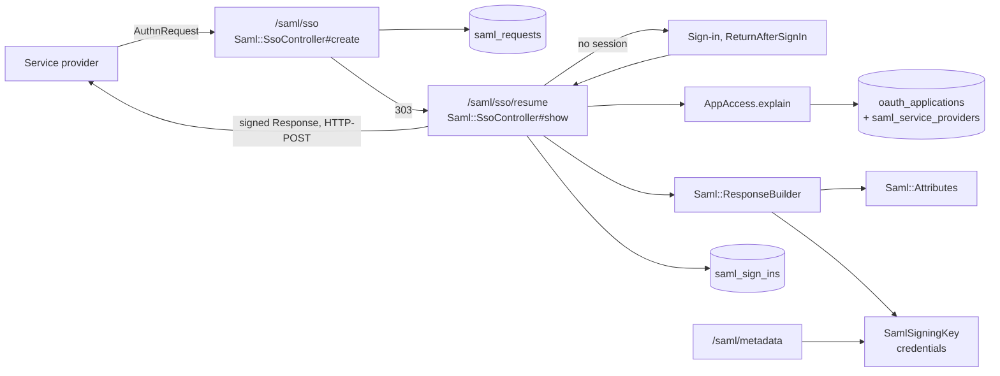

# SAML identity provider

*   **Author:** Jasper Mayone
*   **Status:** Proposed (revised after review and re-audit)
*   **Date:** 2026-11-16
*   **Issue:** [#104](https://github.com/patchworklabsorg/weave/issues/104)

--------------------------------------------------------------------------------

## Overview

Weave signs members in to other apps through OAuth 2.0 and OpenID Connect
(OIDC). Some apps accept only SAML 2.0 for single sign-on. This design makes
Weave a SAML 2.0 identity provider (IdP) for those apps. SAML calls such an
app a service provider (SP).

An SP is an OAuth app row in Weave with a SAML extension. So an SP gets the
same access rules, access grants, app roles, launcher tile and access
requests as an OAuth app, with no copy of that code.

Superadmins add SPs and change their SAML fields in Weave. A new SP needs
no code change and no deploy. Weave signs each SAML response with a key from encrypted
credentials, in the same way as the OIDC signing key.

### Terms

*   **Weave ID:** the public identifier of a member (`user.p_id`). OIDC apps
    get it as `sub`.
*   **Access decision:** the result of `AppAccess.explain(user, app)`. It
    checks the app's access policy (`everyone` or `restricted`), access
    grants, app roles, email domains, the Code of Conduct, guardian consent
    for members under 18, and identity verification.
*   **Patch:** a grant program in Patchwork Labs. The `patches` claim lists a
    member's roles in each patch.
*   **Admin, superadmin, owner:** the admin tiers on `users.role`. A
    superadmin is an admin with more rights. An owner is above a superadmin.

## The Problem

1.  **Apps that need SAML have no path to Weave.** Some paid tools (chat
    workspaces on enterprise plans, HR and payroll tools, some dashboards)
    give single sign-on only through SAML. Patchwork Labs must keep a
    separate account for each person in each of those tools. Weave does not
    disable those accounts when a person leaves a group or leaves Patchwork
    Labs.
2.  **A second sign-in path can bypass access rules.** If SAML has its own
    access logic, the two paths will become different over time. A person
    whom OAuth refuses can then sign in through SAML.
3.  **A signing key needs a rotation path.** Each SP stores the IdP
    certificate. If Weave replaces its signing key and the SPs do not have
    the new certificate first, every SP refuses Weave's responses at the same
    time.

This design solves problem 1 at sign-in time only. A person who loses access
can not sign in to the SP again. Their SP account and any open SP session
stay until the SP ends them. Session revokers
([#292](https://github.com/patchworklabsorg/weave/issues/292),
`docs/designs/session-revokers.md`) cover open sessions later.

## Goals

*   A member signs in to a SAML SP with Weave through SP-initiated sign-in:
    the SP sends an `AuthnRequest` and Weave answers.
*   Each SP is an `oauth_applications` row with a 1:1
    `saml_service_providers` row. `AppAccess` needs no SAML code.
*   Every SAML sign-in uses the same access decision as an OAuth sign-in,
    including the birthday step that the OAuth authorize page runs first.
*   The NameID is the member's Weave ID. It does not change when the member
    changes their email address.
*   Weave sends only the attributes that an admin selects for the SP. Weave
    sends `email` only when the address is verified or the SP has email
    domains.
*   Superadmins create SPs by pasting or uploading the SP's metadata XML, or by
    typing the entity ID and the ACS URL.
*   Weave publishes its IdP metadata at `/saml/metadata`. The metadata lists
    the current signing certificate and, during a rotation, the next one.
*   Outside development, Weave accepts only HTTPS ACS URLs.
*   The `saml_idp` Flipper flag controls sign-in. Admins can test before
    launch.
*   Weave builds and signs SAML through the `saml_idp` gem. It has no
    XML signature code of its own.

## Non-Goals

*   **IdP-initiated sign-in** (the member starts from Weave). It has a weaker
    security model. Add it when a real SP needs it.
*   **Checking the SPs' request signatures.** Weave posts responses only to
    the ACS URL it stores for the SP, so a request signature adds little.
    Add it when a real SP requires it.
*   **Fetching SP metadata from a URL.** Superadmins paste or upload it.
*   **An `emailAddress` NameID format.**
*   **Weave as a SAML service provider.** Weave does not accept sign-in from
    another SAML IdP.
*   **SAML Single Logout (SLO), encrypted assertions and SCIM
    provisioning.** SPs create accounts at first sign-in (just-in-time).
*   **Self-service SPs.** Only admins add SPs.
*   **Nested groups.** The `groups` attribute uses today's groups. The nested
    groups design (`docs/designs/nested-groups.md`) changes
    `AppAccess.group_slugs`, which SAML then follows.
*   **Changes to OAuth or OIDC behaviour** for OAuth apps.

## Decisions

The author's choices (2026-11-16, revised after review the same day):

1.  **SP model:** an `oauth_applications` row plus a 1:1
    `saml_service_providers` row with a cascading foreign key. Doorkeeper
    refuses every OAuth flow for a SAML row.
2.  **Signing key:** in encrypted credentials, like the OIDC key. Rotation
    uses a "next" slot and two deploys. No database table and no new role.
3.  **No replay cache.** Weave posts only to the stored ACS URL. Each stored
    request is used once.
4.  **SP request signatures:** not checked in version one.
5.  **Version one scope:** SP-initiated sign-in, metadata by paste or upload,
    the persistent NameID.
6.  **Library:** the `saml_idp` gem, version 1.0.
7.  **Refused sign-in:** a signed SAML `Response` with the status
    `urn:oasis:names:tc:SAML:2.0:status:RequestDenied`, posted to the ACS
    URL. Weave writes the reason to the SAML sign-in log.
8.  **NameID:** the Weave ID. The author accepted that SPs can use it to
    match the same person across their records.

## Library findings

The author read the `saml_idp` 1.0.0 gem source (released 2025-10-09):

*   **Signing key:** `SamlIdp.config.x509_certificate` and `secret_key`
    accept a Proc, which the gem calls for each signature
    (`lib/saml_idp/signed_info_builder.rb` L67-68,
    `lib/saml_idp/signature_builder.rb` L23-24). Weave sets both from one
    memoized credentials read.
*   **Metadata:** `SamlIdp::MetadataBuilder#build_key_descriptor` writes one
    certificate (`lib/saml_idp/metadata_builder.rb` L56-64). Weave subclasses
    the builder to write one `KeyDescriptor` for each published certificate.
*   **Refused sign-in:** `SamlIdp::ResponseBuilder` always writes the status
    `Success` (`lib/saml_idp/response_builder.rb` L59). Weave builds the
    refused `Response` XML itself and signs it through the gem's
    `SamlIdp::Signable` module.

## Critical User Journeys (CUJs)

### CUJ 1: SP-initiated sign-in

*   **Given:** a member with a Weave account, and an enabled SP that is
    restricted to the group `design`. The member is in `design`.
*   **When:** the member opens the SP and selects "Sign in with SSO". The SP
    sends an `AuthnRequest` to `/saml/sso`.
*   **Then:**
    1.  Weave stores the request and redirects the browser to a same-site
        page.
    2.  If the member has no Weave session, Weave asks them to sign in, then
        continues the same request.
    3.  `AppAccess` permits the member.
    4.  Weave posts a signed `Response` to the stored ACS URL. The NameID is
        the member's Weave ID. The attributes are only those set for the SP.

### CUJ 2: Refused sign-in

*   **Given:** the same SP, and a member who is not in `design`.
*   **When:** the member starts SP-initiated sign-in.
*   **Then:** Weave posts a signed `Response` with the status
    `RequestDenied` and no assertion. Weave writes the refusal and its
    `AppAccess` reason to the SAML sign-in log. The SP shows its own error.
    The member can still request access from the Weave launcher tile, if the
    app has an access request group.

### CUJ 3: Admin adds an SP from metadata

*   **Given:** an admin and the SP's metadata XML file.
*   **When:** the admin selects "SAML" on the new app page and uploads the
    file.
*   **Then:** Weave reads the entity ID and the HTTP-POST ACS URL from the
    file and shows the form to review. Weave saves nothing until the admin
    submits the form. Weave makes no network request.

### CUJ 4: Signing certificate rotation

*   **Given:** the current signing key and certificate in credentials.
*   **When:** an owner adds `next_signing_key` and `next_certificate` to
    credentials and deploys.
*   **Then:** the IdP metadata lists both certificates. The owner tells each
    SP owner to add the new certificate (the list is on
    `/admin/oauth_applications?protocol=saml`). When all SPs have it, the
    owner moves the next pair to the current slot, removes the old pair and
    deploys again. `docs/SAML.md` has the runbook.

## Technical Plan (Architecture)

### Components



### Data model

*   **`oauth_applications.redirect_uri`** becomes nullable. A SAML row has no
    redirect URI. Doorkeeper's `allow_blank_redirect_uri` allows a blank one
    only for SAML rows.
*   **`saml_service_providers`** (new), one row for each SP:
    *   `oauth_application_id`: unique, foreign key with
        `ON DELETE CASCADE`.
    *   `entity_id`: unique.
    *   `acs_url`: the only URL Weave posts to for this SP.
    *   `attribute_keys`: the attribute keys Weave sends (from
        `Saml::Attributes::ALL`).
    *   `enabled`.

    All access fields (`access_policy`, `requires_code_of_conduct`,
    `requires_guardian_consent`, `requires_verification`, `email_domains`)
    and launcher fields stay on `oauth_applications`.
*   **`saml_requests`** (new). It holds one `AuthnRequest` between the SP's
    post and the response. Columns: a random `handle`, the SP, the SAML
    request ID, `relay_state`, `force_authn`, `is_passive` and `expires_at`
    (10 minutes). Weave deletes the row when it answers the request, so each
    request is used once: Weave answers only if its `DELETE` removed exactly
    one row. A job deletes expired rows.
*   **`saml_sign_ins`** (new), the SAML sign-in log. One row for each
    response to a signed-in member: the user, the SP, the request ID, the result (`success`,
    `refused`, `unsupported`), the `AppAccess` reason and the time. It holds
    no IP address. `DataRetention` deletes rows after the period in
    `config/kyc/data_retention.yml`. Takeout exports a member's rows, and the
    deletion pipeline deletes them.

### OAuth rows that are SAML SPs

*   `Doorkeeper::Application` gets `has_one :saml_service_provider` and a
    `saml?` method.
*   Doorkeeper's `allow_grant_flow_for_client` refuses a SAML row at the
    authorize endpoint and for `client_credentials` at the token endpoint
    (`unauthorized_client`). Doorkeeper does not call it for
    `authorization_code` or `refresh_token`. A SAML row never has a code or a
    token, so those grants fail with `invalid_grant`.
*   `Oauth::TokensController` refuses introspection and revocation for a
    SAML client with `unauthorized_client` (403).
*   A SAML row gets a random client secret that Weave never shows. The admin
    page hides the client ID and the secret for SAML rows.
*   Doorkeeper's own `/oauth/applications` pages refuse SAML rows.
*   A SAML row has no OAuth scopes.

### Request flow

1.  **Entry.** `Saml::SsoController#create` (POST, HTTP-POST binding) and
    `#new` (GET, HTTP-Redirect binding) receive the `AuthnRequest`. This
    action never reads or writes the session or the flash. A cross-site
    POST carries no `SameSite=Lax` session cookie, and a new cookie would
    replace the member's real session.
2.  **Request checks.** `Saml::RequestValidator` decodes the request with
    `saml_idp`. It checks these items:
    *   the issuer is an enabled SP;
    *   `Destination` equals Weave's SSO URL;
    *   `IssueInstant` is not older than 5 minutes and not more than 1
        minute in the future;
    *   `AssertionConsumerServiceURL`, if present, equals the SP's `acs_url`;
    *   `ProtocolBinding`, if present, is HTTP-POST.

    If a check fails, Weave shows an error page. Weave never posts to a URL
    that the request supplies.
3.  **Store and redirect.** Weave writes a `saml_requests` row and redirects
    (303) to `GET /saml/sso/resume?handle=<handle>`. The browser sends the
    session cookie on this same-site GET.
4.  **Resume.** `Saml::SsoController#show` runs these checks in this order:
    1.  Load the live row by handle. An unknown, expired or used handle, or
        an SP that is now disabled, gets the error page (404).
    2.  No session: if `is_passive`, answer with the status `NoPassive` (no
        log row, because there is no member). Else store the resume path
        with `ReturnAfterSignIn` (short, so it fits the 1024-character
        limit) and send the member to sign in.
    3.  The member must pass the same gate as OAuth sign-in:
        `email_verified? && can_authenticate?`. Else the same page as
        OAuth.
    4.  The `saml_idp` flag must be on for the member. Else 404.
    5.  An admin who impersonates the member gets the error page. Weave sends
        nothing, the same rule as deletion requests.
    6.  `force_authn`: answer with the status `RequestUnsupported`. This
        matches the OIDC side, which refuses `prompt=login` (#87).
    7.  No birthday and the app requires guardian consent: ask for the
        birthday first, as the OAuth authorize page does, then continue.
5.  **Access decision.** `AppAccess.explain(user, app)` decides. The SP row
    is an OAuth app row, so `AppAccess` needs no change. Every refusal,
    including a missing Code of Conduct or guardian consent, gets
    `RequestDenied`. OAuth sends those two cases to the step that fixes them.
    SAML does not, because it must answer the SP.
6.  **Response.** `Saml::ResponseBuilder` builds the response with
    `saml_idp`:
    *   Permitted: a `Response` with an assertion, both signed (RSA-SHA256),
        with the Weave ID as a persistent
        NameID, the selected attributes, `AuthnContextClassRef`
        `urn:oasis:names:tc:SAML:2.0:ac:classes:unspecified`, `NotOnOrAfter`
        of 5 minutes, `InResponseTo` the request ID and an
        `AudienceRestriction` to the SP's entity ID.
    *   Refused or unsupported: `Saml::DeniedResponse`, a signed `Response`
        with the status code and no assertion.
7.  **Post.** Weave deletes the `saml_requests` row and writes a
    `saml_sign_ins` row. Then it renders an auto-submit form that posts
    `SAMLResponse` and `RelayState` to the stored `acs_url`. The page sets
    the CSP `form-action` to `'self'` and `https:`. Chrome and Safari apply
    `form-action` to each redirect hop, and many SPs answer the ACS post with
    a redirect to a different origin. The page has no user input, and the
    form action is the stored `acs_url`. The submit script uses the CSP
    nonce.

### Attributes

`Saml::Attributes` is a registry. Each entry has a SAML `Name`, a
`FriendlyName` (the key), `NameFormat`
`urn:oasis:names:tc:SAML:2.0:attrname-format:uri` and a value. Each value
comes from the same method that the OIDC claim uses, so the two protocols
send the same values. SPs store these names, so they never change after
launch. A blank value is left out.

| Key | `Name` | Value | Rule |
| --- | --- | --- | --- |
| `email` | `urn:oid:0.9.2342.19200300.100.1.3` | `AppAccess.email_for` | Sent only if the SP has email domains or `user.email_verified?`, the rule of the OIDC `email_verified` claim. |
| `given_name` | `urn:oid:2.5.4.42` | `user.first_name` | |
| `family_name` | `urn:oid:2.5.4.4` | `user.last_name` | |
| `name` | `urn:oid:2.16.840.1.113730.3.1.241` | `user.full_name` | |
| `weave_id` | `urn:patchworklabs:weave:attribute:weave_id` | `user.p_id` | The same as the NameID. |
| `groups` | `urn:patchworklabs:weave:attribute:groups` | `AppAccess.group_slugs` | One `AttributeValue` for each slug. |
| `roles` | `urn:patchworklabs:weave:attribute:roles` | `AppAccess.role_keys` | One `AttributeValue` for each key. |
| `patches` | `urn:patchworklabs:weave:attribute:patches` | `PatchRoles.for` | One `AttributeValue` for each pair, as `<patch slug>=<role key>`. Role keys can contain `:`, so the separator is `=`. |

Weave's IdP entity ID is `<base URL>/saml/metadata`. The metadata lists the
SSO endpoint `<base URL>/saml/sso` for both the HTTP-POST and the
HTTP-Redirect binding, and the NameID format
`urn:oasis:names:tc:SAML:2.0:nameid-format:persistent`.

An admin selects the keys for each SP. This selection is the SAML gate that
matches the OIDC scope gate on `patches`.

### Signing key

`SamlSigningKey` reads encrypted credentials, in the same way as
`OidcSigningKey`:

```yaml
saml:
  signing_key: <PEM RSA private key>
  certificate: <PEM certificate for that key>
  next_signing_key: <optional>
  next_certificate: <optional>
```

*   Weave signs with `signing_key` and `certificate`. A missing or
    mismatched pair raises on first use, like the OIDC key.
*   `/saml/metadata` lists `certificate` and, if set, `next_certificate`.
*   Test uses a key that it generates in memory, like the OIDC test key.
*   A daily job warns owners 60 and 14 days before the certificate expires.

### Feature flag

`saml_idp` in `FeatureFlags::FLAGS`. The flag is on for the Flipper group
`admins` before launch, and on for everyone at launch.

*   `/saml/sso/resume` (the page that answers) returns 404 when the flag is
    off for the viewer.
*   `/saml/sso` (the entry) does not check the flag, because it has no signed-in
    viewer. It only stores the request for an enabled SP.
*   `/saml/metadata` is always public. It holds only certificates.
*   The SAML section on the admin app pages shows when the flag is on for
    the viewer.
*   The launcher shows a SAML tile only when the flag is on for the viewer.
    Without this rule, a member without the flag gets a 404 from the
    tile.

### Admin pages

*   The new app page gets a protocol choice: OAuth or SAML. It can not change
    after create. Only a superadmin can create a SAML row, and only a
    superadmin can change its SAML fields (`entity_id`, `acs_url`,
    `attribute_keys`, `enabled`). SAML has no consent screen and no client
    secret, so a changed `acs_url` sends signed assertions with member data
    to that URL with no member action. This is the same tier as
    `access_policy` and the access grants.
*   A new SAML row starts with `access_policy: "restricted"`. The superadmin
    opens it to members with a grant or a policy change.
*   For a SAML row, the app page shows a SAML section: entity ID, ACS URL,
    attributes, enabled, and the metadata paste or upload field. It hides the
    client ID, the secret, the redirect URIs and the scopes.
*   The SAML sign-in log shows on the app page.
*   Grants, roles, access requests, the launcher fields, the patch link and
    the superadmin-only access actions are the existing OAuth app features.
    They need no change.
*   The app list gets a protocol column and a `protocol` filter.

### Effect on other work

*   `AppAccess.explain` and `.permitted?` do not change.
    `RevokeLostAppAccessJob` does not change. SAML has no tokens, so it has
    nothing to revoke.
*   Session revokers (#292) can use the plain `oauth_applications` foreign
    key for SAML SPs too. A successful SAML response can write an
    `app_sign_ins` row when #292 ships.
*   Nested groups (`docs/designs/nested-groups.md`) can keep plain foreign
    keys to `oauth_applications` for `app_owners` and `app_group_names`.

## Risks and Mitigations

| Risk | Effect | Mitigation |
| --- | --- | --- |
| An unverified email reaches an SP that links accounts by email | Account takeover in the SP | Send `email` only when verified or when the SP has email domains. No email NameID. |
| A SAML row is used as an OAuth client | OAuth tokens for an app that should only get SAML | `allow_grant_flow_for_client` refuses all flows. The secret is random and never shown. A spec calls each OAuth endpoint with a SAML row. |
| A bug or a vulnerability in `saml_idp` signing | Forged or broken responses | Weave signs only. It parses no signed XML from SPs. Dependabot watches the gem. A spec checks the signed response with `ruby-saml` and with signature-wrapping cases. |
| The gem is abandoned | No security fixes | The gem surface is small: response, metadata and `Signable`. Replace it with `saml2` or `ruby-saml` behind the same `Saml::` classes. |
| The access decision runs at sign-in only | A person who lost access keeps an open SP session | Stated in The Problem. Session revokers (#292). Ask SP owners to set short sessions. |
| An SP does not load the next certificate before the swap | That SP refuses Weave's responses | Two-deploy rotation, an SP list on the admin page, the runbook, and expiry warnings at 60 and 14 days. |
| A request is replayed | A second response to the same SP | Weave posts only to the stored ACS URL, to the member's own browser. Each stored request is used once. |
| An admin impersonates a member | The admin signs in to the member's HR or payroll SP | SAML sign-in is refused while impersonating. |
| A minor with no birthday | `AppAccess` can not see the age | The birthday step runs before the access decision. |
| `saml_sign_ins` growth | Storage and personal data | No IP column. Retention key in `config/kyc/data_retention.yml`. Takeout and deletion cover it. |
| No signing key in credentials | Every SAML sign-in fails | Raises on first use with a clear message, like the OIDC key. Boot is not blocked. |

## Alternatives Considered

### Alternative A: SPs in `config/saml.yml`

*   **Pros:** no admin page. Each change gets code review.
*   **Cons:** each new SP needs a deploy.
*   **Reason for Rejection:** the author requires SPs that admins add with
    no deploy (#104).

### Alternative B: a separate `SamlServiceProvider` model with polymorphic grant tables

*   **Pros:** a model with SAML fields only.
*   **Cons:** grants, roles and access requests lose their foreign keys and
    `ON DELETE CASCADE`. Each lookup must match a type column, or a SAML SP
    and an OAuth app with the same ID share access. The SP table copies 12
    access columns.
*   **Reason for Rejection:** the author first chose this. The review showed
    the ID collision and the copied columns. The author changed to the 1:1
    extension, which keeps one access source and real foreign keys.

### Alternative C: a supertype `apps` table

*   **Pros:** real foreign keys and no Doorkeeper rows for SAML.
*   **Cons:** moves columns off a model that Doorkeeper owns. Each app is two
    rows.
*   **Reason for Rejection:** the author chose the 1:1 extension, which gives
    the same integrity with less change.

### Alternative D: signing certificates in a database table with a SAML officer role

*   **Pros:** rotation with no deploy, and per-step audit records.
*   **Cons:** a table, a four-state machine, an admin page, a new role in the
    locked `config/roles.yml`, for a certificate that lasts 3 years. It also
    departs from the OIDC key pattern.
*   **Reason for Rejection:** the author first chose this. After review the
    author chose credentials and two deploys.

### Alternative E: a replay cache in Redis or the database

*   **Pros:** stops the reuse of a request ID.
*   **Cons:** Redis is a cache that can evict keys. Its error behaviour is
    unclear. The test cache is `:null_store`. A reused request can only send
    the member's own assertion to the stored ACS URL.
*   **Reason for Rejection:** the author removed it. Single-use stored
    requests and the fixed ACS URL cover the risk.

### Alternative F: check SP request signatures in version one

*   **Pros:** proves the request came from the SP.
*   **Cons:** pure-Ruby XML signature checks, the HTTP-Redirect signature
    format, and failures when the SP rotates its key.
*   **Reason for Rejection:** the fixed ACS URL removes most of the risk. Add
    it when a real SP requires it.

### Alternative G: the `saml2` gem

*   **Pros:** typed builders, signing through libxmlsec1.
*   **Cons:** a native dependency on the Alpine and musl image.
*   **Reason for Rejection:** `saml_idp` signs in pure Ruby and adds no
    native build step.

### Alternative H: `ruby-saml` with Weave-built responses

*   **Pros:** the Ruby SAML library with the longest history.
*   **Cons:** it is built for SPs. Weave would write its own signing code.
*   **Reason for Rejection:** #104 rejects signing code in Weave.

### Alternative I: a Weave page for a refused sign-in

*   **Pros:** the member sees the reason and an access-request button.
*   **Cons:** a second page to keep the same as the OAuth one. Some SPs wait
    for a response.
*   **Reason for Rejection:** the author keeps `RequestDenied` for version
    one. The launcher tile offers the access request.

### Alternative J: a per-SP NameID

*   **Pros:** two SPs can not use the NameID to match the same person.
*   **Cons:** support must look the value up. A key change makes every SP
    see new users.
*   **Reason for Rejection:** the author chose the Weave ID, the same value
    as the OIDC `sub`, so support staff can read it directly.

--------------------------------------------------------------------------------

## Non-Functional Requirements

*   **Security:** see Risks and Mitigations. A failed request check never
    posts. Metadata upload parses with Nokogiri strict mode, with no DTD, no
    external entities, no network and a 1 MB limit.
*   **Rate limit:** `saml/ip`, 20 requests a minute for paths that start
    with `/saml/`, the same as `oauth/ip`.
*   **Rollout:** Phase 1 and Phase 2 change nothing for members. Phase 3
    ships with the flag on for `admins` only. The flag goes on for everyone
    after one real SP passes the manual test.
*   **Rollback:** turn the flag off. The resume page returns 404 and the
    launcher hides SAML tiles. `/saml/sso` still stores requests, and the
    sweep job deletes them. To stop an SP fully, a superadmin clears its
    `enabled` field.

--------------------------------------------------------------------------------

## Detailed Implementation Plan

Each phase is one pull request from `main`. Start a phase only after the pull
request before it merges. Paths are as of 2026-11-16. A refactor
(untangle-codebase) can move files, so compare each path with `main` before
work starts.

### Phase 1: SAML rows and admin pages

#### 1. `db/migrate/<ts>_allow_blank_redirect_uri.rb` (Create)

*   `change_column_null :oauth_applications, :redirect_uri, true`.

#### 2. `db/migrate/<ts>_create_saml_service_providers.rb` (Create)

*   `oauth_application_id` bigint, not null, unique index, foreign key to
    `oauth_applications` with `on_delete: :cascade`.
*   `entity_id` string, not null, unique index.
*   `acs_url` string, not null.
*   `attribute_keys` string array, not null, default `[]`.
*   `enabled` boolean, not null, default `true`.
*   Timestamps.
*   Run `bundle exec annotaterb models` after the migration.

#### 3. `app/models/saml_service_provider.rb` (Create)

*   `belongs_to :application, class_name: "Doorkeeper::Application",
    foreign_key: :oauth_application_id, inverse_of: :saml_service_provider`.
*   `has_many :saml_requests, dependent: :delete_all` and
    `has_many :saml_sign_ins, dependent: :delete_all` (Phase 3 adds the
    models; add these lines in Phase 3).
*   `has_paper_trail`.
*   Validations: `entity_id` present and unique; `acs_url` an HTTPS URL
    outside development; each `attribute_keys` entry in
    `Saml::Attributes::ALL`.

#### 4. `app/models/concerns/oauth_application_saml.rb` (Create)

*   `has_one :saml_service_provider, foreign_key: :oauth_application_id,
    inverse_of: :application, dependent: :destroy`.
*   `accepts_nested_attributes_for :saml_service_provider`.
*   `saml?` returns `saml_service_provider.present?`. It works on an unsaved
    record, because the controller builds the child before `save`.
*   Validation: a SAML row has blank `scopes`. Doorkeeper's own
    `RedirectUriValidator` keeps the redirect URI rule for other rows.

#### 5. `config/initializers/oauth_application_public_id.rb` (Modify)

*   Add `Doorkeeper::Application.include OauthApplicationSaml` next to the
    other includes.

#### 6. `config/initializers/doorkeeper.rb` (Modify)

*   `allow_grant_flow_for_client { |_flow, application| !application&.saml? }`.
    Doorkeeper 5.9.9 passes the `Doorkeeper::Application`
    (`oauth/pre_authorization.rb` L121,
    `oauth/client_credentials/validator.rb` L31). It can be nil on the
    password path.
*   `allow_blank_redirect_uri { |_server_flows, application| application.saml? }`.
    Doorkeeper passes the server's grant flows and the record under
    validation (`orm/active_record/redirect_uri_validator.rb` L11).

#### 7. `app/controllers/oauth/tokens_controller.rb` (Modify)

*   Before `introspect` and `revoke`: if the authenticated client's
    application is `saml?`, render the `unauthorized_client` error with 403.

#### 8. `config/routes.rb` (Modify, Phase 1 part)

*   Keep the Doorkeeper `applications` routes, but make
    `Doorkeeper::ApplicationsController` refuse SAML rows: add
    `app/controllers/doorkeeper_applications_saml_guard.rb` (Create), a
    `before_action` that redirects to the admin app page for a `saml?`
    record, included from `config/initializers/doorkeeper.rb` in a
    `to_prepare` block.

#### 9. `app/services/saml/attributes.rb` (Create)

*   `Saml::Attributes::ALL`: a frozen hash from key to `name`,
    `friendly_name` and a value lambda `(user, application)`, as in the
    Attributes table.
*   `Saml::Attributes.for(user, application)` returns
    `[[name, friendly_name, [values]], ...]` for the selected keys, without
    blank values.

#### 10. `app/services/saml/metadata_import.rb` (Create)

*   Input: pasted XML, or an uploaded file. Refuse more than 1 MB before
    parsing.
*   Parse with `Nokogiri::XML(xml) { |config| config.strict.nonet }`. Do not
    set `noent` or `dtdload`. Refuse the document if
    `doc.internal_subset` is present.
*   Read one `EntityDescriptor` with one `SPSSODescriptor`. If the file has
    more, refuse it.
*   Return unsaved values: `entityID` and the first
    `AssertionConsumerService` with the HTTP-POST binding. Ignore signing
    certificates and `AuthnRequestsSigned`.
*   Errors: a `Saml::MetadataImport::Error` with a message key in
    `config/locales/saml.en.yml` (Create).

#### 11. `app/controllers/admin/oauth_applications_controller.rb` (Modify)

*   `new`: a `protocol` parameter (`oauth` or `saml`). Show the SAML choice
    only when the `saml_idp` flag is on for the admin and the admin is a
    superadmin.
*   `require_superadmin` for `create` with `protocol=saml`, and for `update`
    of a SAML row when the params change `saml_service_provider_attributes`.
    A plain admin can still change the name and the launcher fields.
*   `create`:
    *   With `import=1` and a metadata field: run `Saml::MetadataImport`,
        fill `saml_service_provider_attributes`, and render `new` again
        with the values. Save nothing.
    *   For `protocol=saml`: build the row with `confidential: true`, blank
        `redirect_uri`, blank `scopes`, and the nested
        `saml_service_provider_attributes` (`entity_id`, `acs_url`,
        `enabled`, `attribute_keys: []`) and `access_policy: "restricted"`.
        On success redirect to the app
        page with a notice. Do not call `show_secret_once`.
    *   For `protocol=oauth`: as today.
*   `update`: for a SAML row, permit only `name`, the launcher fields, the
    patch field rule as today, and `saml_service_provider_attributes` with
    `:id`. Never `redirect_uri`, `scopes` or `confidential`. A row's protocol
    can not change.
*   `regenerate_secret`: refuse for SAML rows with an alert.
*   `index`: a `protocol` filter (`oauth`, `saml`).

#### 12. `app/views/admin/oauth_applications/` (Modify and Create)

*   `new.html.erb`: the protocol choice; for SAML, the
    `_saml_fields.html.erb` partial (Create) with entity ID, ACS URL,
    attribute checkboxes, enabled, and a metadata text area and file field
    with an "Import" button (`import=1`).
*   `edit.html.erb`: the same partial for SAML rows, without the protocol
    choice.
*   `show.html.erb`: for SAML rows, hide the client ID, secret, redirect
    URIs and scopes (L440 reads `redirect_uri.split`), and show the SAML
    section. Show the SAML section only when the flag is on for the viewer.
*   `index.html.erb`: a "Protocol" column. For SAML rows, the Client ID and
    Type columns show "SAML".
*   Follow `docs/UI.md`. Run `spec/ui/view_conventions_spec.rb`.

#### 13. `lib/feature_flags.rb` (Modify)

*   Add `saml_idp` to `FeatureFlags::FLAGS` with a description.

#### 14. `Gemfile` (Modify)

*   Add `gem "saml_idp", "~> 1.0"`.
*   Add `gem "ruby-saml", "~> 1.18"` to `group :test`. It checks Weave's
    responses as a test SP.
*   Build the Alpine image to check it.

#### 15. Specs and factories (Create)

*   `spec/factories/saml_service_providers.rb`, and a `:saml` trait on the
    `oauth_application` factory.
*   `spec/models/saml_service_provider_spec.rb`: validations.
*   `spec/requests/oauth_saml_row_refused_spec.rb`:
    *   `/oauth/authorize`: `unauthorized_client`;
    *   `/oauth/token` with `client_credentials`: `unauthorized_client`;
        with `authorization_code` and `refresh_token`: `invalid_grant`;
    *   `/oauth/introspect`, `/oauth/revoke`: 403 `unauthorized_client`;
    *   `/oauth/applications/:id` for a SAML row: redirect.
*   `spec/services/saml/metadata_import_spec.rb`: a good file, two
    `SPSSODescriptor`s, an internal DTD, an external entity, a file over
    1 MB, no HTTP-POST ACS.
*   `spec/services/saml/attributes_spec.rb`: `email` with and without
    verification and email domains; blank names left out; multi-value
    `groups`, `roles`, `patches`; the `patches` separator.
*   `spec/requests/admin_oauth_application_saml_spec.rb`: import, create,
    no secret shown, update parameters, refused `regenerate_secret`, the
    SAML choice hidden with the flag off.

#### 16. `docs/SAML.md` (Create)

*   What an SP is in Weave, how to add one, and the attributes table.

### Phase 2: signing key and metadata

#### 17. `config/initializers/saml_idp.rb` (Create)

*   `SamlSigningKey` module, beside `OidcSigningKey`:
    *   `current` returns `{ key: OpenSSL::PKey::RSA, certificate:
        OpenSSL::X509::Certificate }` from `saml.signing_key` and
        `saml.certificate`. It raises `SamlSigningKey::MissingKey` with
        the setup steps when one is missing, and
        `SamlSigningKey::Mismatch` when the certificate's public key is not
        the key's.
    *   `next_pair` returns the same shape from `saml.next_signing_key` and
        `saml.next_certificate`, or nil. A mismatched next pair raises.
    *   `published_certificates` returns `[current certificate, next
        certificate]` without nil.
    *   Values are memoized for the process. Test generates a 2048-bit key
        and a self-signed certificate in memory.
*   `SamlIdp.configure`:
    *   `x509_certificate` and `secret_key`: Procs that return the PEM of
        `SamlSigningKey.current`.
    *   `algorithm`: `:sha256`.
    *   `base_saml_location`: `SamlIdp::Urls.base + "/saml"`.
    *   `single_service_post_location` and
        `single_service_redirect_location`: `SamlIdp::Urls.base +
        "/saml/sso"`.
    *   `entity_id`: `SamlIdp::Urls.base + "/saml/metadata"`.
    *   `name_id.formats`: persistent only, value `user.p_id`.
*   `Weave.oauth_base_url` in `lib/weave.rb` (Modify): returns
    `ENV["OIDC_ISSUER"].presence || (production ? Weave.url : test ?
    "http://www.example.com" : "http://localhost:3000")`. The OIDC `issuer`
    block in `config/initializers/doorkeeper_openid_connect.rb` (Modify)
    calls it, and SAML calls it, so the rule exists once.
    (`SamlIdp::Urls.base` is `Weave.oauth_base_url`.)

#### 18. `app/services/saml/metadata_builder.rb` (Create)

*   Subclass of `SamlIdp::MetadataBuilder`. Override `build_key_descriptor`
    to write one `KeyDescriptor use="signing"` for each
    `SamlSigningKey.published_certificates` entry.

#### 19. `app/controllers/saml/metadata_controller.rb` (Create), `config/routes.rb` (Modify)

*   `class Saml::MetadataController < ActionController::Base`. No session,
    no sign-in, no flag check.
*   `GET /saml/metadata`: XML from `Saml::MetadataBuilder`, with
    `Cache-Control: public, max-age=3600`.

#### 20. `app/jobs/saml_certificate_expiry_job.rb` (Create), `config/recurring.yml` (Modify)

*   Schedule: `every day at 7am`.
*   For the current and the next certificate, send a warning when today is
    exactly `not_after.to_date - 60` or `not_after.to_date - 14`. The job
    keeps no state. A missed run means one missed warning, which is
    acceptable because there are two warnings.
*   Recipients: `User.owner`.
*   Mail: `AdminMailer#saml_certificate_expiring(user, certificate, days)`
    (Modify `app/mailers/admin_mailer.rb`), with
    `app/views/admin_mailer/saml_certificate_expiring.text.erb` and
    `.html.erb` (Create).

#### 21. Specs (Create)

*   `spec/initializers/saml_signing_key_spec.rb`: missing key, mismatched
    pair, mismatched next pair, published certificates.
*   `spec/requests/saml_metadata_spec.rb`: the entity ID, both bindings, one
    certificate, two certificates, public with the flag off.
*   `spec/services/saml/metadata_builder_spec.rb`.
*   `spec/jobs/saml_certificate_expiry_job_spec.rb`: day 60, day 14, other
    days, the next certificate.
*   `spec/initializers/oidc_issuer_spec.rb` (or the existing OIDC spec): the
    issuer is unchanged after `Weave.oauth_base_url`.

#### 22. `docs/SAML.md` (Modify)

*   The metadata URL, the entity ID, and the rotation runbook with a
    Mermaid sequence: add next, deploy, tell SP owners, swap, deploy.

### Phase 3: sign-in

#### 23. `db/migrate/<ts>_create_saml_requests.rb` (Create)

*   `handle` string, not null, unique index.
*   `saml_service_provider_id` bigint, not null, foreign key to
    `saml_service_providers` with `on_delete: :cascade`.
*   `request_id` string, not null.
*   `relay_state` string, null.
*   `force_authn`, `is_passive` booleans, not null, default `false`.
*   `expires_at` datetime, not null, index.
*   `created_at`.

#### 24. `db/migrate/<ts>_create_saml_sign_ins.rb` (Create)

*   `user_id` bigint, not null, foreign key to `users` with cascade.
*   `saml_service_provider_id` bigint, not null, foreign key to
    `saml_service_providers` with cascade.
*   `request_id` string, not null.
*   `result` string, not null (`success`, `refused`, `unsupported`).
*   `reason` string, null.
*   `created_at`; index on `(saml_service_provider_id, created_at)` and on
    `(user_id, created_at)`.

#### 25. `app/models/saml_request.rb`, `app/models/saml_sign_in.rb` (Create)

*   `SamlRequest`: `belongs_to :saml_service_provider`;
    `has_secure_token :handle, length: 32`; scope `live` (`expires_at >
    now`); `self.consume!(handle)`: `live.where(handle:).delete_all == 1`
    after it loads the row, so two parallel resumes can not both answer.
*   `SamlSignIn`: `belongs_to :user`, `belongs_to :saml_service_provider`;
    enum `result`.
*   `SamlServiceProvider`: add the two `has_many` lines from item 3.
*   `User` (`app/models/user.rb`, Modify): `has_many :saml_sign_ins,
    dependent: :delete_all`.

#### 26. `app/services/saml/request_validator.rb` (Create)

*   Refuse a `SAMLRequest` value above 64 KB before any decode
    (`request_too_large`). The endpoint has no authentication, so one large
    request must not use much memory.
*   Do not call `SamlIdp::Request.from_deflated_request` on raw input. It
    inflates with no output limit (`lib/saml_idp/request.rb` L8-23), so a
    small deflate value can expand to gigabytes. Decode in Weave:
    *   POST binding: Base64 only, with no inflate.
    *   Redirect binding: Base64, then `Zlib::Inflate` in chunks. Stop and
        refuse at 256 KB of output.
*   Parse the XML with `Nokogiri::XML(xml) { |config| config.strict.nonet }`
    and refuse a document with an internal DTD, as `Saml::MetadataImport`
    does. Then give the XML to `SamlIdp::Request.new`.
*   Checks, each with an error key in `config/locales/saml.en.yml`:
    *   `unknown_issuer`: no enabled SP with that entity ID;
    *   `bad_destination`: `Destination` present and not
        `<base URL>/saml/sso`. A missing `Destination` is allowed, because
        unsigned Redirect requests often leave it out;
    *   `stale`: `IssueInstant` older than 5 minutes or more than 1 minute in
        the future;
    *   `acs_mismatch`: `AssertionConsumerServiceURL` present and not the
        SP's `acs_url`. `AssertionConsumerServiceIndex` is ignored;
    *   `bad_binding`: `ProtocolBinding` present and not HTTP-POST;
    *   `relay_state_too_long`: `RelayState` over 80 bytes. Refuse, do not
        cut.
*   Returns `Result(sp:, request_id:, relay_state:, force_authn:,
    is_passive:)` or `Result(error:)`.

#### 27. `app/services/saml/response_builder.rb`, `app/services/saml/denied_response.rb` (Create)

*   `ResponseBuilder.call(user:, saml_request:)`: calls
    `SamlIdp::SamlResponse.new(...)` directly (not the controller mixin).
    The constructor takes positional arguments
    (`lib/saml_idp/saml_response.rb` L27-45), in this order:
    *   `reference_id` and `response_id`: new UUIDs;
    *   `issuer_uri`: the IdP entity ID;
    *   `principal`: the user; NameID persistent, `user.p_id`;
    *   `audience_uri`: the SP's `entity_id`;
    *   `saml_request_id`: the stored `request_id`;
    *   `saml_acs_url`: the SP's `acs_url`;
    *   `algorithm`: `:sha256`;
    *   `authn_context_classref`:
        `urn:oasis:names:tc:SAML:2.0:ac:classes:unspecified`;
    *   `expiry`: 300 seconds;
    *   `asserted_attributes_opts`: the attributes from
        `Saml::Attributes.for`, in the gem's attribute config shape;
    *   `signed_message_opts`: true, and `signed_assertion_opts`: true (the
        default), so both the response and the assertion are signed;
    *   `encryption_opts`: nil; `compression_opts`: false.

    Returns the base64 `SAMLResponse`.
*   `DeniedResponse.call(saml_request:, status:)`: builds this XML with
    Builder and signs it with `SamlIdp::Signable`. The class provides the
    methods that `Signable::ClassMethods` names (`raw`, `reference_id`,
    `digest`, `algorithm`; `lib/saml_idp/signable.rb` L117-127), and calls
    `signed`:

    ```xml
    <samlp:Response ID="_<uuid>" Version="2.0" IssueInstant="<now>"
        Destination="<acs_url>" InResponseTo="<request_id>">
      <saml:Issuer><IdP entity ID></saml:Issuer>
      <samlp:Status>
        <samlp:StatusCode Value="urn:oasis:names:tc:SAML:2.0:status:Responder">
          <samlp:StatusCode Value="urn:oasis:names:tc:SAML:2.0:status:<status>"/>
        </samlp:StatusCode>
      </samlp:Status>
    </samlp:Response>
    ```

    `status` is `RequestDenied`, `NoPassive` or `RequestUnsupported`.

#### 28. `app/controllers/saml/sso_controller.rb` (Create), views, `config/routes.rb` (Modify)

*   `class Saml::SsoController < ApplicationController`.
*   Routes: `get "/saml/sso", to: "saml/sso#new"`,
    `post "/saml/sso", to: "saml/sso#create"`,
    `get "/saml/sso/resume", to: "saml/sso#show", as: :saml_sso_resume`.
*   For `new` and `create`:
    *   `skip_before_action :authenticate_user!, :track_user_session`;
    *   `skip_around_action :attribute_privileged_changes`;
    *   `skip_forgery_protection only: :create`;
    *   `before_action { request.session_options[:skip] = true }`, so Rails
        writes no session cookie;
    *   validate; on error render `error` (400); else create the
        `SamlRequest` and `redirect_to saml_sso_resume_url(handle:),
        status: :see_other`.
*   For `show`:
    *   `skip_before_action :authenticate_user!`; the action calls
        `authenticate_user!` itself after the `is_passive` check (step 4.2).
    *   The checks in "Request flow", step 4, in that order.
    *   The birthday step: `session[:birthday_return_to] = request.fullpath`
        and `redirect_to slack_onboarding_path`, as
        `Oauth::AuthorizationsController` does.
    *   Impersonation: render `error` (403) with `data_handling.impersonating`.
    *   Then steps 5 to 7: `SamlRequest.consume!`, the response, the
        `SamlSignIn` row, render `post`.
*   `content_security_policy(only: :show) { |policy| policy.form_action(:self, :https) }`.
    Rails runs this block as a `before_action`, so it can not use a value
    that the action body loads. See "Request flow", step 7, for why the
    page allows `https:`.
*   `app/views/saml/sso/post.html.erb` (Create): a form with the hidden
    `SAMLResponse` and `RelayState` fields, a `<noscript>` submit button,
    and `<script nonce>` that submits it.
*   `app/views/saml/sso/error.html.erb` (Create): the error text from
    `config/locales/saml.en.yml`.

#### 29. `app/controllers/birthdays_controller.rb` (Modify)

*   Follow `birthday_return_to` when it starts with `/oauth/authorize` or
    `/saml/sso/resume`.

#### 30. `app/jobs/saml_request_sweep_job.rb` (Create), `config/recurring.yml` (Modify)

*   Schedule: `every hour`. Deletes rows with `expires_at < now`.

#### 31. `config/initializers/rack_attack.rb` (Modify)

*   `throttle("saml/ip", limit: 20, period: 1.minute)` for paths that start
    with `/saml/`. It also counts `/saml/metadata`; SPs fetch it far less
    often than that.

#### 32. Data handling (Modify)

*   `config/kyc/data_retention.yml`: under `shared`, add
    `saml_sign_ins: keep_days: 90`, with the comment "Proposed; counsel to
    confirm". Not LOCKED.
*   `app/services/data_retention.rb`: `def saml_sign_in_window =
    Integer(config.dig(:saml_sign_ins, :keep_days)).days`.
*   `app/services/data_retention/sweeps.rb`: `purge_saml_sign_ins!`
    deletes rows older than the window; call it from `run_all`.
*   `app/services/data_categories.rb`: add `SamlSignIn` to the
    `account_profile` `source_models`.
*   `app/services/takeout.rb`: a `"saml_sign_ins"` key inside
    `account_profile(user)`: SP name, result, time.
*   Deletion: `user.destroy!` in `DeletionPipeline` deletes the rows through
    `dependent: :delete_all`. No change to `app/services/deletion_pipeline.rb`.

#### 33. Admin app page and `AppAccess` comment (Modify)

*   `app/views/admin/oauth_applications/show.html.erb`: for SAML rows, the
    last 50 `saml_sign_ins` rows with `time_label`.
*   `app/services/app_access.rb`: add the SAML resume page to the list of
    callers in the header comment.

#### 34. Specs and factories (Create)

*   Factories: `spec/factories/saml_requests.rb`,
    `spec/factories/saml_sign_ins.rb`.
*   `spec/services/saml/request_validator_spec.rb`: each error key, both
    bindings, a missing `Destination`.
*   `spec/services/saml/response_builder_spec.rb` and
    `spec/services/saml/denied_response_spec.rb`: each checked with
    `ruby-saml`; signature-wrapping cases on the produced response.
*   `spec/requests/saml_sso_spec.rb`:
    *   POST binding and Redirect binding, each with and without a session;
        `new` and `create` set no session cookie;
    *   success: signature, audience, NameID, `InResponseTo`, only the
        selected attributes;
    *   one refusal for each `AppAccess` reason, with the reason in
        `saml_sign_ins`;
    *   an unknown, expired and used handle; an SP disabled after the
        request;
    *   `IsPassive` with no session (no log row), `ForceAuthn`;
    *   an unverified member; the flag off for the member;
    *   impersonation; the birthday step returns to the resume page;
    *   the CSP header.
*   `spec/requests/birthdays_spec.rb` (Modify): the `/saml/sso/resume`
    return path.
*   `spec/jobs/saml_request_sweep_job_spec.rb`.
*   Data handling: the retention sweep, Takeout, `DataCategories`.
*   `spec/requests/rack_attack_saml_spec.rb`: the `saml/ip` throttle.

#### 35. Docs (Modify)

*   `docs/SAML.md`: the sign-in flow (Mermaid), refused sign-in, the
    attributes, the NameID and the flag.
*   `docs/OAUTH.md`: one paragraph that an app can be OAuth or SAML.
*   `CLAUDE.md`: one line on the SAML endpoints.

### Verification Plan

*   **Build:** the Alpine Docker image builds with `saml_idp`.
*   **Tests:** `bundle exec rspec`. `bin/rails test` runs the existing
    Minitest files.
*   **Static analysis:** `bin/rubocop`, `bin/brakeman --no-pager`,
    `bin/rails zeitwerk:check`, `spec/ui/view_conventions_spec.rb`.
*   **Manual interop:** sign in to a local `ruby-saml` sample SP in a `try`
    directory. On staging, with the flag on for admins, sign in to a public
    SAML test SP. Do one rotation on staging and sign in after each deploy.
*   **UI:** each changed page at widths of 1280 px and 390 px, light and
    dark, with the keyboard. Screenshots in each pull request.

--------------------------------------------------------------------------------

*Drafted with EGM*
