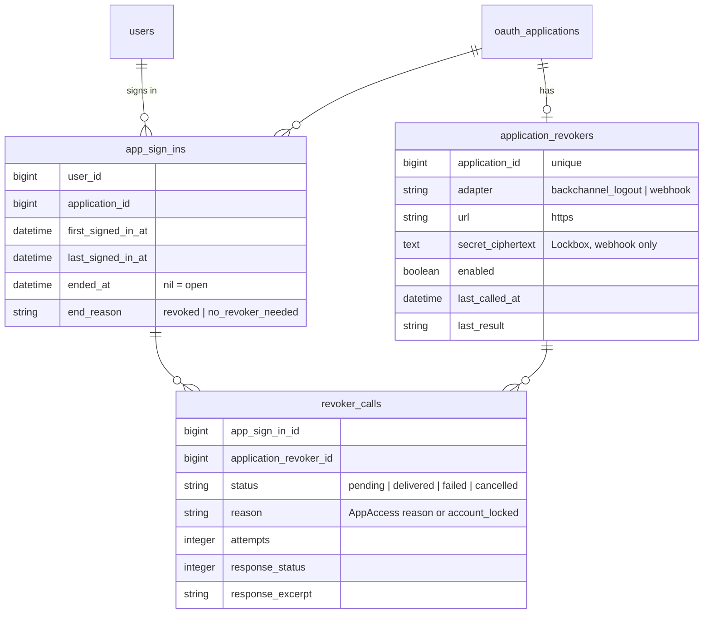
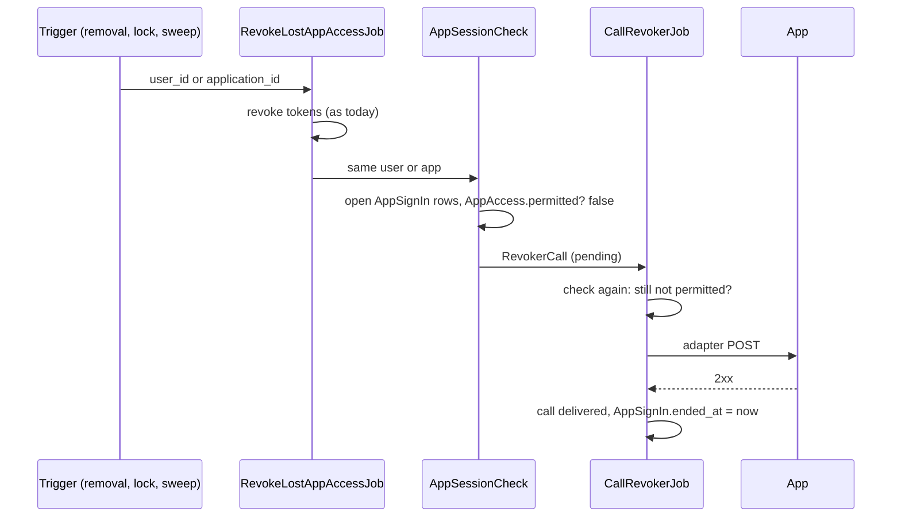

# Session revokers: end an app's own session when a user loses access

*   **Author:** Jasper Mayone
*   **Status:** In Review (EGM review 2026-11-16: not ready, 4 blockers open)
*   **Date:** 2026-11-16
*   **Issue:** #292

--------------------------------------------------------------------------------

## Review status

An EGM review and an adversarial review on 2026-11-16 rated this design not ready. These findings are open. Resolve them before implementation:

1.  **Account deletion sends no call.** At deletion time the user is still permitted, so `AppSessionCheck` creates nothing. "Skip on the unique index" inside the `DeletionPipeline` transaction aborts that transaction on Postgres. Use `ON CONFLICT DO NOTHING` or a savepoint.
2.  **The discovery metadata has no hook.** The `doorkeeper-openid_connect` discovery controller builds a fixed hash. Name the override.
3.  **The webhook secret lifecycle is not defined.** It does not say who sets the secret, how it is shown or how it is rotated.
4.  **The implementation plan has no phases.**
5.  **The re-check must use one predicate:** `user.can_authenticate? && AppAccess.permitted?`. `permitted?` alone passes for a locked user, so the CUJ 4 call is cancelled.
6.  **The failure budget fails open.** A short outage can turn the revoker off, and the sweep then skips the app.
7.  **`reason` leaks private state.** Raw `AppAccess::Decision` reasons include age, guardian consent and verification. Send a coarse reason or none.
8.  **`end!` can close a sign-in that was just reopened.** A late 2xx arrives after the user signed in again. End the row only if `last_signed_in_at <= revoker_call.created_at`.
9.  **The logout token `iss` must be `Doorkeeper::OpenidConnect.resolve_issuer`,** not `Weave.url`.
10. **`belongs_to :app_sign_in` must be `optional: true`.** `OutboundPost` must keep the `DeliverWebhookJob` constants and the stored `body` key.
11. **A simpler variant is undecided:** Back-Channel Logout only, the URL as a column on `oauth_applications`, and `app_sign_ins` as the outbox.

## Overview

Weave decides who can use each OAuth app (`AppAccess`). When a user loses
access, Weave revokes the user's tokens for that app (`RevokeLostAppAccessJob`).
Most apps do not use those tokens after sign-in. They make their own session
cookie and keep the user signed in until that session ends.

A session revoker is a per-app setting that tells Weave how to end the user's
session in the app itself. When Weave decides that a user lost access to an
app, it calls the app's revoker. The app then ends the user's session.

## The Problem

Today, access removal in Weave is not effective in most apps until the app's
own session ends. That can take hours, days or longer. Examples:

*   An admin removes a volunteer from a group that opens a restricted app. The
    volunteer stays signed in to the app.
*   A group membership expires. The volunteer stays signed in.
*   A user's account is locked or deleted. The user stays signed in to every
    app that keeps its own session.

Weave already does the parts it controls:

*   The token, userinfo and introspection endpoints refuse a token when
    `AppAccess.permitted?` is false.
*   `RevokeLostAppAccessJob` marks the tokens as revoked.

These only help an app that calls Weave again (refresh, userinfo or
introspection). An app that reads the ID token once and then trusts its own
cookie never learns that access was removed.

The existing `group.member_removed` webhook does not close the gap:

*   Webhooks belong to a Service, not to an OAuth app, and an app does not
    always have a Service.
*   The event says that a membership changed, not that the user lost access to
    a given app. The receiver would have to copy `AppAccess` to decide, and
    `AppAccess` also uses age, guardian consent, verification, the code of
    conduct and email domains.
*   Many losses of access do not change a group at all (see the trigger list
    below).

### Ways a user loses access today

Each of these already starts `RevokeLostAppAccessJob`, so the revoker can use
the same points:

| Trigger | Where |
|---|---|
| Group membership removed or expired, group deleted | `Group::Membership`, `Group` |
| Direct grant removed | `ApplicationAccessGrant` |
| App role, or the user's role assignment, removed | `ApplicationRole`, `ApplicationRoleAssignment` |
| App made restricted, or a requirement added (code of conduct, guardian consent, verification, email domains) | `Admin::OauthApplicationsController`, `GoogleWorkspaceApp` |
| Birthday changed, code of conduct exemption removed | `BirthdaysController`, `Admin::UsersController` |
| Guardian consent withdrawn | `GuardianConsentFlow` |

Some losses of access do not start the job today. The Technical Plan must
decide about each one:

*   An account is locked or deleted (`can_authenticate?` turns false).
*   A membership passes its `expires_at`. Access stops at once, but
    `ExpireGroupMembershipsJob` destroys the row (and so starts the job) only
    every 15 minutes.
*   A user turns 18 or another time-based state changes.
*   Identity verification lapses or is revoked.

## Goals

*   When Weave decides that a user may no longer use an app, the app ends that
    user's session within 5 minutes, for every app that has a revoker.
*   One setting per OAuth app. An admin sets it on the app's admin page. No
    code change is needed to add a revoker to a new app.
*   The revoker fires only on a real loss of access: it checks
    `AppAccess.permitted?` again before each call. A second run does nothing.
*   Weave retries a failed call and shows the last result on the app page, so
    an admin can see that a revoker is broken.
*   The call is safe to send to a URL that an app owner gives: the same SSRF
    rules as outbound webhooks (`WebhookUrlGuard`), no redirects, a time limit
    and a body limit.
*   The payload and the receiver's duties are documented, so an app team can
    build a receiver without reading Weave code.

## Non-Goals

*   **Signing the user out of Weave itself.** This design is about app
    sessions. Weave sessions already have their own controls.
*   **User-initiated sign-out across apps** (single logout when the user clicks
    "sign out" in Weave). That is a different event with different users. It
    can reuse this mechanism later.
*   **SAML service providers.** Weave has no SAML IdP yet (#104, drafted
    separately).
*   **Changes to who has access.** `AppAccess` stays the only place that
    decides access. This design only reacts to its answer.
*   **Group nesting or a split between teams and access** (#294, drafted
    separately). If #294 changes how access is computed, the revoker still asks
    `AppAccess`, so it does not need to change.
*   **A guarantee for apps without a revoker.** Those apps keep today's
    behaviour: tokens are revoked, the app's own session runs out on its own.

## Open Questions

*   **Which apps keep their own session today, and for how long?** The answer
    decides which adapters are worth building first. Known relying parties
    include Quilt, Selvage and Google Workspace. Google Workspace will not
    accept a custom webhook: it needs a call to the Google Admin SDK
    (`users.signOut`).
*   **Standard or custom payload?** OpenID Connect Back-Channel Logout 1.0
    defines a signed `logout_token` that Weave would POST to each app. Some
    libraries already support it. A custom JSON webhook is simpler to receive.
    The Technical Plan will present both.
*   **Which "silent" losses of access must start a revoke?** Locked and deleted
    accounts are the most important. Time-based changes (membership expiry,
    age) need a scheduled check.
*   **How does Weave know that a user has a session in an app?** Today
    `RevokeLostAppAccessJob` finds users through token rows that are not
    revoked. If an app or a cleanup task deletes or revokes those rows, Weave
    no longer knows the user signed in, and would not call the revoker.
*   **SAML service providers (#104).** The #104 draft makes app references
    polymorphic (`Doorkeeper::Application` or `SamlServiceProvider`), and
    `AppAccess.permitted?` accepts either. This design uses a plain
    `application_id` FK in `app_sign_ins` and `application_revokers`. Decide
    before the migrations: make both polymorphic now, or migrate them when
    SAML SPs need revokers.

## Critical User Journeys (CUJs)

### CUJ 1: A manager removes a volunteer from a group

*   **Given**: Quilt is restricted to the group `quilt-crew` and has a
    `backchannel_logout` revoker. The volunteer signed in to Quilt today.
*   **When**: A group manager removes the volunteer from `quilt-crew`.
*   **Then**: Within a few seconds Weave revokes the volunteer's Quilt tokens
    and POSTs a logout token to Quilt. Quilt ends the volunteer's session. The
    Quilt admin page shows "last called: 200".

### CUJ 2: A membership expires

*   **Given**: A contractor's membership in a group that opens Selvage has
    `expires_at` at 17:00. Selvage has a `webhook` revoker.
*   **When**: The clock passes 17:00.
*   **Then**: By 17:05 the sweep finds the open sign-in, sees that
    `AppAccess.permitted?` is false, and POSTs `app_access.revoked` with reason
    `no_grant` to Selvage. Selvage ends the session.

### CUJ 3: The app is down

*   **Given**: An app's revoker URL answers 503.
*   **When**: A user loses access to that app.
*   **Then**: Weave retries with a growing wait. The sign-in stays open while
    it retries. The app page shows the failed attempts. If the user gets
    access back before a retry, Weave cancels the call.

### CUJ 4: An admin locks an account

*   **Given**: A user is signed in to three apps. Two have a revoker.
*   **When**: An admin locks the account.
*   **Then**: Weave revokes the tokens for all three apps and calls the two
    revokers. The third app keeps its session until it ends on its own, as
    today.

## Technical Plan (Architecture)

### Decisions made by the author

1.  **Per-app adapter.** Each app picks one adapter: `backchannel_logout`
    (OpenID Connect Back-Channel Logout 1.0) or `webhook` (a signed JSON
    POST). Later adapters (`google_admin`, `cloudflare_access`) use the same
    slot.
2.  **A sign-in record.** A new table, `app_sign_ins`, records which users
    signed in to which app. Weave calls a revoker only for an open sign-in. It
    does not use token rows to decide this.
3.  **Events and a sweep.** The places that start `RevokeLostAppAccessJob`
    today also start a revoker check. A job every 5 minutes checks all open
    sign-ins and catches every other loss of access.

### Components

| Component | New or changed | Job |
|---|---|---|
| `AppSignIn` (table `app_sign_ins`) | New | One row per (user, app). Open while `ended_at` is nil. |
| `ApplicationRevoker` (table `application_revokers`) | New | One per app: adapter, URL, secret, enabled, last result. |
| `RevokerCall` (table `revoker_calls`) | New | One row per call: status, attempts, response excerpt. The delivery log for revokers. |
| `AppSessionCheck` | New service | For a user or an app: find open sign-ins that are no longer permitted, and create a `RevokerCall` for each. |
| `CallRevokerJob` | New job | Sends one `RevokerCall` through its adapter. Retries on failure. |
| `SweepAppSignInsJob` | New job | Every 5 minutes: `AppSessionCheck` over every open sign-in of an app with an enabled revoker. |
| `Revokers::BackchannelLogout`, `Revokers::Webhook` | New adapters | Build the request. Return success or failure. |
| `OutboundPost` | New, extracted | The HTTP part of `DeliverWebhookJob` (SSRF guard, no redirects, time and body limits), shared by webhooks and revokers. |
| `RevokeLostAppAccessJob` | Changed | After it revokes tokens, it runs `AppSessionCheck` for the same user or app. |
| Token endpoint | Changed | Records the sign-in on each token issue. |
| Admin app page | Changed | A "Session revoker" card. Superadmin only. |

### Data model



*   `app_sign_ins` has a unique index on `(user_id, application_id)`. A new
    sign-in after an end opens the same row again (`ended_at = nil`).
*   A row with `ended_at` nil for an app with no enabled revoker stays open.
    If the app gets a revoker later, the next sweep handles it.
*   `DataRetentionJob` deletes `revoker_calls` rows after 30 days, the same
    window as webhook deliveries (`WebhookDelivery::KEEP`).

### Flow



*   **Recording a sign-in.** When `/oauth/token` issues a token with a user
    (authorization code or refresh), Weave upserts the `AppSignIn` row and sets
    `last_signed_in_at`. A refresh after an end opens the row again. A failed
    upsert must not fail the token response: log it and go on.
*   **Checking.** `AppSessionCheck` asks `AppAccess.permitted?(user, app)` and
    `user.can_authenticate?`. Either false means a loss of access. It creates
    at most one pending `RevokerCall` per sign-in. A second check while one is
    pending does nothing.
*   **Calling.** `CallRevokerJob` checks access again just before it sends. If
    the user has access again, it marks the call `cancelled` and leaves the
    sign-in open. On 2xx it marks the call `delivered` and ends the sign-in.
    On failure it retries with a growing wait, 8 attempts, the same as
    `DeliverWebhookJob`. After the last attempt the call is `failed` and the
    sign-in stays open. The next sweep makes a new call.
*   **Failure budget.** A revoker that fails 10 calls in a row is turned off
    and the app page says so, the same rule as `Service::Webhook`. This keeps
    a dead URL from filling the queue. An alert goes to the admins.
*   **The sweep.** `SweepAppSignInsJob` runs every 5 minutes from
    `config/recurring.yml`. It reads open sign-ins of apps with an enabled
    revoker in batches of 500 and runs the same check. It skips a sign-in that
    already has a pending call.
*   **New event triggers.** When an account can no longer sign in (locked,
    suspended, deactivated), the `after_update` callback in `User` already
    runs `revoke_oauth_access!`. That callback also enqueues `AppSessionCheck`
    for the user. Account deletion (`DeletionPipeline`) does the same before
    it removes the user's rows. The other silent cases (membership expiry,
    age, verification) are left to the sweep.

### Adapters

**`backchannel_logout`.** Weave POSTs `application/x-www-form-urlencoded`
`logout_token=<JWT>` to the app's URL. The JWT:

*   is signed RS256 with the ID token key (`OidcSigningKey`), header
    `typ: logout+jwt`, `kid` from the JWKS;
*   has `iss` (`Weave.url`), `aud` (the app's client ID), `iat`, `exp`
    (`iat` + 2 minutes), `jti` (the `RevokerCall` public ID), `sub` (the same
    `sub` as the ID token) and
    `events: {"http://schemas.openid.net/event/backchannel-logout": {}}`;
*   has no `sid`, because Weave has no per-app session ID. The spec allows
    `sub` alone. The receiver must end every session of that `sub`.

The discovery document adds `backchannel_logout_supported: true` and
`backchannel_logout_session_supported: false`.

**`webhook`.** Weave POSTs JSON with the same envelope, headers and HMAC
signature as `docs/WEBHOOKS.md`, keyed with the revoker's own secret:

```json
{
  "id": "<RevokerCall public id>",
  "type": "app_access.revoked",
  "created_at": "2026-11-16T17:05:00Z",
  "data": {
    "sub": "<same as the ID token sub>",
    "email": "<AppAccess.email_for(user, app)>",
    "application_id": "<app public id>",
    "reason": "no_grant"
  }
}
```

`reason` is the `AppAccess::Decision` reason, or `account_locked` or
`account_deleted`. It never contains group names, so an app does not learn
about groups that are not linked to it.

### Security and privacy

*   Only a superadmin can create, change or remove a revoker, the same rule as
    other app security settings. Changing the URL clears the secret, so a
    changed URL can not receive the old secret.
*   Weave sends a user's identifiers only to an app that the user signed in to.
*   `OutboundPost` applies `WebhookUrlGuard`, does not follow redirects, and
    limits time (20 s) and body (1000 bytes).
*   The logout token is short-lived and bound to one app (`aud`) and one call
    (`jti`). The receiver should reject a `jti` it already saw.
*   Every change to a revoker is versioned with PaperTrail.

### Rollout

*   Ship the table and the sign-in recording first, with no adapters. Backfill
    `app_sign_ins` from token and grant rows that are not revoked
    (`first_signed_in_at` = the oldest `created_at`).
*   Then ship adapters behind the Flipper flag `session_revokers`. Turn on one
    app on staging, then on production.
*   Rollback: turn off the flag. Sign-ins keep being recorded. No revoker is
    called.

## Alternatives Considered

### Alternative A: Use the existing `group.member_removed` webhook

*   **Pros**: It exists today. No new code in Weave.
*   **Cons**: Webhooks belong to a Service, not to an OAuth app. The event says
    that a membership changed, not that a user lost access to a given app.
    Each receiver would have to copy `AppAccess`, including age, guardian
    consent, verification, code of conduct and email domain rules. Most losses
    of access (account lock, a new app requirement, a removed grant) send no
    group event at all.
*   **Reason for Rejection**: Rejected by author: it does not tell an app that
    the user lost access to that app, and it misses most triggers.

### Alternative B: Only OpenID Connect Back-Channel Logout

*   **Pros**: One payload, a standard, no shared secret. Quilt and Selvage
    already verify Weave JWTs.
*   **Cons**: Receivers that are not OIDC libraries (internal tools, Cloudflare
    Access workers) can not use it. It has no reason field.
*   **Reason for Rejection**: Rejected by author: per-app adapters let each
    app use what its stack supports.

### Alternative C: Only a custom signed webhook

*   **Pros**: Reuses the webhook signing scheme and carries a reason.
*   **Cons**: Not a standard. Each app must write a receiver. Each app needs a
    shared secret.
*   **Reason for Rejection**: Rejected by author: same as B. Both adapters are
    kept behind one interface.

### Alternative D: Use token rows to find sessions

*   **Pros**: No new table. The revoker call joins `RevokeLostAppAccessJob`.
*   **Cons**: "Has a token that is not revoked" stands in for "has a session".
    The job revokes tokens before it calls the revoker, so a failed call is
    lost after the job's retries: the next run finds no live pair. An app that
    revokes its own token at sign-in is never called.
*   **Reason for Rejection**: Rejected by author: the gap after a failed call
    leaves sessions open with no signal.

### Alternative E: Call the app on every loss of access

*   **Pros**: No session tracking. Never misses a session.
*   **Cons**: Sends the `sub` and email of users who never used the app to the
    app's URL. That tells the app about access changes it had no reason to
    know. One group removal can send many calls per app.
*   **Reason for Rejection**: Rejected by author: it fails a privacy review.

### Alternative F: Sweep only, or events only

*   **Pros**: Sweep only has one code path. Events only has no constant load.
*   **Cons**: Sweep only makes an urgent removal wait up to 5 minutes. Events
    only needs a hook for every current and future rule in `AppAccess`, and
    time-based rules (expiry, age) need a scheduled job anyway.
*   **Reason for Rejection**: Rejected by author: events give speed for the
    common cases, and the sweep catches what a hook misses.

### Alternative G: Short app sessions and no revoker

*   **Pros**: No Weave change. Each app keeps its session short (for example
    1 hour) and checks userinfo or refreshes often.
*   **Cons**: Each app team must do it, and Weave can not see if they did.
    Removal still waits up to the session length. Every refresh adds load on
    Weave.
*   **Reason for Rejection**: Rejected by author: it moves the problem to every
    app team. Apps can still do it, and the docs will say so.

## Non-Functional Requirements

*   **Security & Privacy**: See "Security and privacy" in the Technical Plan.
    A revoker URL receives user identifiers, so only a superadmin may set it,
    and the URL passes `WebhookUrlGuard` on save and on each call.
*   **Performance**: One upsert per token issue. The sweep reads open sign-ins
    of apps with an enabled revoker in batches of 500, and runs
    `AppAccess.permitted?` for each (a few queries). At 10,000 open rows this
    is about 30,000 small queries every 5 minutes. If the sweep takes more
    than 2 minutes, it must log a warning so the batch size or the interval
    can change.
*   **Rollout & Rollback**: The Flipper flag `session_revokers` gates all
    revoker calls. Sign-in recording is not gated.

## Detailed Implementation Plan

### Target Files to Create/Modify

#### 1. `db/migrate/<timestamp>_create_app_sign_ins.rb` (Create)

*   **Type / Scope**: Migration.
*   **Proposed Changes**: Table `app_sign_ins`: `user_id` (FK users, on delete
    cascade), `application_id` (FK oauth_applications, on delete cascade),
    `first_signed_in_at`, `last_signed_in_at`, `ended_at`, `end_reason`,
    timestamps. Unique index `(user_id, application_id)`. Partial index on
    `application_id` where `ended_at IS NULL`, for the sweep.

#### 2. `db/migrate/<timestamp>_create_application_revokers.rb` (Create)

*   **Type / Scope**: Migration.
*   **Proposed Changes**: Table `application_revokers`: `application_id`
    (unique, FK on delete cascade), `adapter` (string, check constraint
    `backchannel_logout | webhook`), `url`, `secret_ciphertext` (text, null),
    `enabled` (default true), `consecutive_failures` (integer, default 0),
    `last_called_at`, `last_result`, `created_by_id` (FK users, nullify),
    timestamps.

#### 3. `db/migrate/<timestamp>_create_revoker_calls.rb` (Create)

*   **Type / Scope**: Migration.
*   **Proposed Changes**: Table `revoker_calls`: `app_sign_in_id` (FK,
    null, on delete nullify, so a call outlives a deleted user),
    `application_revoker_id` (FK cascade), `subject` (the `sub`, string),
    `email_ciphertext` (Lockbox), `status` (check
    constraint `pending | delivered | failed | cancelled`), `reason`,
    `attempts`, `response_status`, `response_excerpt` (max 1000),
    `delivered_at`, timestamps. Partial unique index on `app_sign_in_id`
    where `status = 'pending'`, so one sign-in has at most one pending call.

#### 4. `db/migrate/<timestamp>_backfill_app_sign_ins.rb` (Create)

*   **Type / Scope**: Data migration.
*   **Proposed Changes**: Insert one open `app_sign_ins` row for each
    `(resource_owner_id, application_id)` with an access token or access grant
    that is not revoked. `first_signed_in_at` is the oldest `created_at`,
    `last_signed_in_at` the newest. `INSERT ... ON CONFLICT DO NOTHING`, so it
    can run again.

#### 5. `db/schema.rb` (Modify)

*   **Type / Scope**: Schema dump.
*   **Proposed Changes**: The three tables. Dump only the new tables (see the
    schema dump trap in project memory: do not commit unrelated drift).

#### 6. `app/models/app_sign_in.rb` (Create)

*   **Type / Scope**: Model.
*   **Proposed Changes**: `belongs_to :user`, `belongs_to :application`
    (`Doorkeeper::Application`), `has_many :revoker_calls`. Scopes `open`
    (`ended_at: nil`) and `with_enabled_revoker`. `AppSignIn.record!(user,
    application)`: upsert, set `last_signed_in_at`, clear `ended_at` and
    `end_reason`. `#end!(reason)`.

#### 7. `app/models/application_revoker.rb` (Create)

*   **Type / Scope**: Model.
*   **Proposed Changes**: `belongs_to :application`. `has_encrypted :secret`
    (Lockbox). Public ID prefix `rvk`. `has_paper_trail` (secret ignored).
    Validations: adapter in `ADAPTERS`; `url` https when
    `WebhookUrlGuard.https_only?`; secret required for `webhook`. Changing
    `url` clears `secret`. `#record_success!`, `#record_failure!` (turns off
    at 10 in a row, like `Service::Webhook`), `#adapter_class`.

#### 8. `app/models/revoker_call.rb` (Create)

*   **Type / Scope**: Model.
*   **Proposed Changes**: Public ID prefix `rvkcall` (used as `jti` and event
    `id`). `belongs_to :app_sign_in`, `belongs_to :application_revoker`.
    Status enum. `has_encrypted :email`. `subject` and `email` are copied
    from the user when the call is created. `KEEP = 30.days`.
    `#finish!(status, **attrs)` clears `email` when the call ends.

#### 9. `config/initializers/oauth_application_public_id.rb` (Modify)

*   **Type / Scope**: Initializer.
*   **Proposed Changes**: Add `has_one :revoker` (`ApplicationRevoker`) and
    `has_many :app_sign_ins` to `Doorkeeper::Application`, next to the
    existing `include OauthApplicationLauncher`.

#### 10. `app/services/outbound_post.rb` (Create)

*   **Type / Scope**: Service, extracted.
*   **Proposed Changes**: `OutboundPost.call(url:, headers:, body:)` returns
    `{status:, excerpt:, error:}`. Moves the HTTP code from
    `DeliverWebhookJob#attempt`: `WebhookUrlGuard` check, no redirects,
    `OPEN_TIMEOUT` 5, `READ_TIMEOUT` 10, `TOTAL_TIMEOUT` 20, `BODY_LIMIT`
    1000, `Accept-Encoding: identity`, `User-Agent: Weave-Webhooks/1.0`.

#### 11. `app/jobs/deliver_webhook_job.rb` (Modify)

*   **Type / Scope**: Job, refactor.
*   **Proposed Changes**: Use `OutboundPost` in place of its own HTTP code.
    No change in behaviour. `spec/jobs/deliver_webhook_job_spec.rb` must pass
    unchanged.

#### 12. `app/services/revokers/backchannel_logout.rb` (Create)

*   **Type / Scope**: Adapter.
*   **Proposed Changes**: `call(revoker_call)`: build the logout token (claims
    in the Technical Plan), sign it with `OidcSigningKey`, POST it form-encoded
    through `OutboundPost`. The `sub` comes from the same code path as the ID
    token `sub`.

#### 13. `app/services/revokers/webhook.rb` (Create)

*   **Type / Scope**: Adapter.
*   **Proposed Changes**: `call(revoker_call)`: build the `app_access.revoked`
    envelope, sign it with the revoker secret in the `docs/WEBHOOKS.md`
    scheme, set the `X-Weave-*` headers, POST through `OutboundPost`. Share
    the signing helper with the webhook code (extract it if it is private).

#### 14. `app/services/app_session_check.rb` (Create)

*   **Type / Scope**: Service.
*   **Proposed Changes**: `AppSessionCheck.for_user(user_id)`,
    `.for_application(application_id)`, `.for_sign_ins(scope)`. For each open
    sign-in of an app with an enabled revoker: if the user is missing, cannot
    authenticate, or `AppAccess.permitted?` is false, create a pending
    `RevokerCall` (skip on the unique index) and enqueue `CallRevokerJob`.
    Returns early when the flag `session_revokers` is off.

#### 15. `app/jobs/call_revoker_job.rb` (Create)

*   **Type / Scope**: Job.
*   **Proposed Changes**: `perform(revoker_call)`. Returns if not pending.
    Cancels if the revoker is off or the user has access again. Runs the
    adapter. 2xx: `delivered`, `app_sign_in.end!("revoked")`,
    `revoker.record_success!`. Else: `record_failure!`, raise to retry.
    `retry_on` with `wait: :polynomially_longer, attempts: 8`, then `failed`.
    `discard_on ActiveJob::DeserializationError`.

#### 16. `app/jobs/sweep_app_sign_ins_job.rb` (Create)

*   **Type / Scope**: Job.
*   **Proposed Changes**: `AppSignIn.open.with_enabled_revoker` in batches of
    500, skip rows with a pending call, run `AppSessionCheck.for_sign_ins`.
    Log a warning when the run takes more than 2 minutes.

#### 17. `config/recurring.yml` (Modify)

*   **Type / Scope**: Config.
*   **Proposed Changes**: `sweep_app_sign_ins`, class `SweepAppSignInsJob`,
    `every 5 minutes`.

#### 18. `app/jobs/revoke_lost_app_access_job.rb` (Modify)

*   **Type / Scope**: Job.
*   **Proposed Changes**: At the end of `perform`, call
    `AppSessionCheck.for_user` or `.for_application` with the same argument.
    Update the header comment.

#### 19. `app/models/user.rb` (Modify)

*   **Type / Scope**: Model.
*   **Proposed Changes**: In the `lost_ability_to_authenticate?` path, after
    `revoke_oauth_access!`, enqueue a job that runs
    `AppSessionCheck.for_user(id)` (after commit). `has_many :app_sign_ins`.

#### 20. `app/services/deletion_pipeline.rb` (Modify)

*   **Type / Scope**: Service.
*   **Proposed Changes**: Before the user's rows are removed, run
    `AppSessionCheck.for_user` with reason `account_deleted`. Each
    `RevokerCall` already holds its own copy of `subject` and email, so the
    call still works after the user and the `app_sign_ins` rows are gone
    (`app_sign_in_id` becomes null). `CallRevokerJob` treats a call with no
    sign-in as "user gone": it sends and does not re-check access.

#### 21. `config/initializers/doorkeeper.rb` (Modify)

*   **Type / Scope**: Initializer.
*   **Proposed Changes**: Turn on `after_successful_strategy_response`. When
    the response is a token response with a resource owner, call
    `AppSignIn.record!`. Rescue and log errors so the token response never
    fails because of it.

#### 22. `config/initializers/doorkeeper_openid_connect.rb` (Modify)

*   **Type / Scope**: Initializer.
*   **Proposed Changes**: Add `backchannel_logout_supported: true` and
    `backchannel_logout_session_supported: false` to the discovery document,
    in the way this file already adds metadata.

#### 23. `lib/feature_flags.rb` (Modify)

*   **Type / Scope**: Config.
*   **Proposed Changes**: Add `session_revokers` to `FLAGS` with a
    description.

#### 24. `app/jobs/data_retention_job.rb` (Modify)

*   **Type / Scope**: Job.
*   **Proposed Changes**: Delete `revoker_calls` older than `RevokerCall::KEEP`.
    Clear user identifiers from finished calls, like webhook deliveries.

#### 25. `app/controllers/admin/application_revokers_controller.rb` (Create)

*   **Type / Scope**: Controller.
*   **Proposed Changes**: Nested under `admin/oauth_applications`, singular
    resource: `create`, `update`, `destroy`, and `test` (sends a call for the
    current admin's own sign-in, no session ends in Weave). Superadmin only.

#### 26. `config/routes.rb` (Modify)

*   **Type / Scope**: Routes.
*   **Proposed Changes**: `resource :revoker, only: [:create, :update,
    :destroy], controller: "admin/application_revokers" do post :test end`
    inside `admin/oauth_applications`.

#### 27. `app/views/admin/oauth_applications/show.html.erb` and `app/views/admin/oauth_applications/_revoker.html.erb` (Modify, Create)

*   **Type / Scope**: Views.
*   **Proposed Changes**: A "Session revoker" card: adapter, URL, secret
    (never shown; the card says "set" or "not set"), enabled, last call
    with `time_label`, and the last 20 `RevokerCall` rows in a `.table-wrap`.
    Danger action "Remove revoker" confirms first. Follows `docs/UI.md`.

#### 28. `docs/SESSION_REVOKERS.md` (Create)

*   **Type / Scope**: Docs.
*   **Proposed Changes**: For app teams: what a revoker is, both payloads,
    how to verify each, what the receiver must do (end every session of the
    `sub`, answer 2xx in 10 seconds, drop repeated `jti` or event `id`),
    retries, and when a call is not sent. A Mermaid flow.

#### 29. `docs/OAUTH.md`, `docs/WEBHOOKS.md`, `CLAUDE.md` (Modify)

*   **Type / Scope**: Docs.
*   **Proposed Changes**: Link to `docs/SESSION_REVOKERS.md`. In
    `docs/WEBHOOKS.md`, say that `app_access.revoked` is sent by a revoker,
    not by a Service webhook. One line in `CLAUDE.md` under Webhooks System.

#### 30. Specs (Create)

*   **Type / Scope**: RSpec.
*   **Proposed Changes**:
    *   `spec/models/app_sign_in_spec.rb`: `record!` opens and reopens a row.
    *   `spec/models/application_revoker_spec.rb`: validations, URL change
        clears the secret, failure budget.
    *   `spec/services/app_session_check_spec.rb`: one pending call per
        sign-in; no call when permitted, when no revoker, when the flag is off;
        a call for a locked user.
    *   `spec/jobs/call_revoker_job_spec.rb`: 2xx ends the sign-in; 5xx retries
        and keeps it open; cancel when access is back.
    *   `spec/jobs/sweep_app_sign_ins_job_spec.rb`: catches an expired
        membership before `ExpireGroupMembershipsJob` runs.
    *   `spec/services/revokers/backchannel_logout_spec.rb`: the JWT verifies
        against the JWKS and has the claims; no `sid`.
    *   `spec/services/revokers/webhook_spec.rb`: the signature verifies with
        the documented snippet; `reason` has no group names.
    *   `spec/services/outbound_post_spec.rb`: guard, redirects, limits.
    *   `spec/requests/oauth/token_sign_in_record_spec.rb`: a code exchange
        and a refresh each record a sign-in.
    *   `spec/requests/admin/application_revokers_spec.rb`: superadmin only.
    *   Update `spec/jobs/revoke_lost_app_access_job_spec.rb` and
        `spec/requests/oauth/discovery_spec.rb`.

### Verification Plan

*   **Static analysis & linting**: `bin/rubocop`, `bin/brakeman --no-pager`,
    `bin/rails zeitwerk:check`. (`bin/rubocop` crashes on main today; see the
    prism note in project memory. Report it, do not hide it.)
*   **Unit and request tests**: `bundle exec rspec` for the specs above, and
    the full suite. `spec/ui/view_conventions_spec.rb` for the new view.
*   **Migrations**: `bin/rails db:migrate`, then `bundle exec annotaterb
    models`. `strong_migrations` must pass.
*   **Staging**: Turn on `session_revokers` for one test app with a
    `webhook` revoker pointing at a test receiver. Remove a test user from the
    app's group. The receiver gets a call in under 1 minute. Let a membership
    expire. The receiver gets a call in under 6 minutes. Lock a test account.
    The receiver gets a call.
*   **UI**: The app page at 1280 and 390 wide, light and dark, keyboard only.
    Screenshots in the PR.
